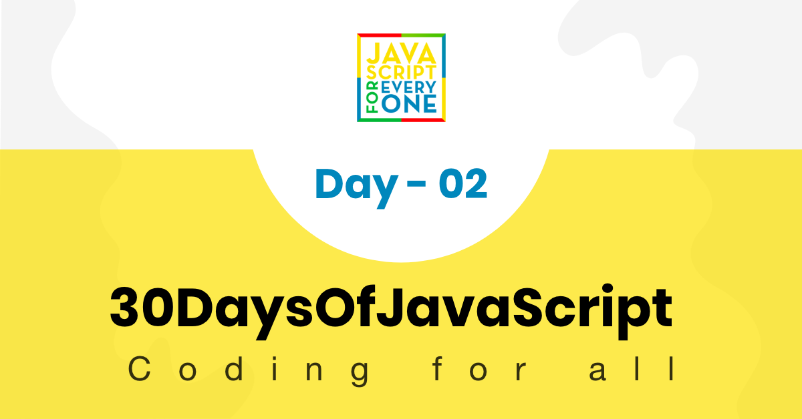
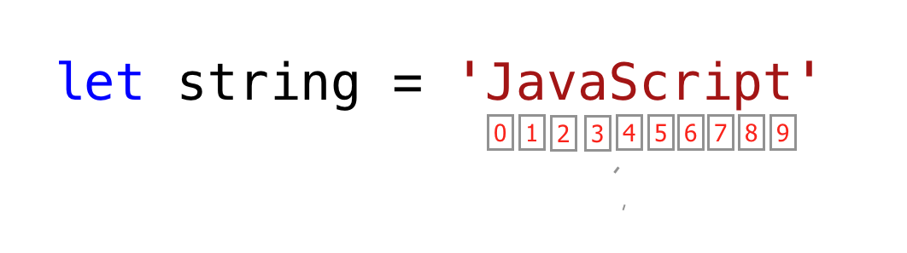

<div align="center">
  <h1> 30 天 JavaScript：数据类型</h1>
  <a class="header-badge" target="_blank" href="https://www.linkedin.com/in/asabeneh/">
  
  </a>
  <a class="header-badge" target="_blank" href="https://twitter.com/Asabeneh">
  
  </a>

  <sub>作者：
  <a href="https://www.linkedin.com/in/asabeneh/" target="_blank">Asabeneh Yetayeh</a><br>
  <small> 2020 年 1 月</small>
  </sub>
</div>

[<< Day 1](../01_Day_Introduction/01_day_introduction.md) | [Day 3 >>](../03_Day_Booleans_operators_date/03_booleans_operators_date.md)



- [📔 第 2 天](#-day-2)
	- [数据类型](#data-types)
		- [原始数据类型](#primitive-data-types)
		- [非原始数据类型](#non-primitive-data-types)
	- [数字](#numbers)
		- [声明数字数据类型](#declaring-number-data-types)
		- [数学对象](#math-object)
			- [随机数生成器](#random-number-generator)
	- [字符串](#strings)
		- [字符串连接](#string-concatenation)
			- [使用加法运算符连接](#concatenating-using-addition-operator)
			- [长文字字符串](#long-literal-strings)
			- [字符串中的转义序列](#escape-sequences-in-strings)
			- [模板字面量（模板字符串）](#template-literals-template-strings)
		- [字符串方法](#string-methods)
	- [检查数据类型和转换](#checking-data-types-and-casting)
		- [检查数据类型](#checking-data-types)
		- [更改数据类型（转换）](#changing-data-type-casting)
			- [字符串到整数](#string-to-int)
			- [字符串转浮点数](#string-to-float)
			- [浮点数转整数](#float-to-int)
	- [💻 第 2 天：练习](#-day-2-exercises)
		- [练习：1 级](#exercise-level-1)
		- [练习：2 级](#exercise-level-2)
		- [练习：3 级](#exercises-level-3)

<a id="-day-2"></a>
# 📔 第 2 天

<a id="data-types"></a>
## 数据类型

在上一节中，我们提到了一些有关数据类型的内容。数据或值具有数据类型。数据类型描述了数据的特征。数据类型可以分为两种：

1. 原始数据类型
2. 非原始数据类型（对象引用）

<a id="primitive-data-types"></a>
### 原始数据类型

JavaScript 中的原始数据类型包括：

 1. 数字——整数、浮点数
 2. 字符串 - 单引号、双引号或反引号下的任何数据
 3. 布尔值 - true 或 false 值
 4. Null - `null` 或无值
 5. undefined——声明的变量没有值
 6. Symbol - 可以由 `Symbol` 构造函数生成的唯一值

JavaScript 中的非原始数据类型包括：

1. 对象
2. 数组

现在，让我们看看原始数据类型和非原始数据类型到底意味着什么。
*原始*数据类型是不可变（不可修改）的数据类型。一旦创建了原始数据类型，我们就无法修改它。

**例子：**

```js
let word = 'JavaScript'
```

如果我们尝试修改存储在变量 *word* 中的字符串，JavaScript 应该会引发错误。单引号、双引号或反引号下面的任何数据类型都是字符串数据类型。

```js
word[0] = 'Y'
```

此表达式不会更改存储在变量 *word* 中的字符串。因此，我们可以说字符串是不可修改的，或者换句话说是不可变的。
原始数据类型通过其值进行比较。让我们比较不同的数据值。请参阅下面的示例：

```js
let numOne = 3
let numTwo = 3

console.log(numOne == numTwo)      // true

let js = 'JavaScript'
let py = 'Python'

console.log(js == py)             //false 

let lightOn = true
let lightOff = false

console.log(lightOn == lightOff) // false
```

<a id="non-primitive-data-types"></a>
### 非原始数据类型

*非原始*数据类型是可修改或可变的。我们可以在非原始数据类型创建后修改它的值。
让我们通过创建一个数组来看看。数组是方括号中的数据值列表。数组可以包含相同或不同的数据类型。数组值由其索引引用。在 JavaScript 中，数组索引从零开始。即，数组的第一个元素位于索引 0 处，第二个元素位于索引 1 处，第三个元素位于索引 2 处，依此类推。

```js
let nums = [1, 2, 3]
nums[0] = 10

console.log(nums)  // [10, 2, 3]
```

正如你所看到的，数组是一种非原始数据类型，它是可变的。非原始数据类型不能按值进行比较。即使两个非原始数据类型具有相同的属性和值，它们也不是严格相等的。

```js
let nums = [1, 2, 3]
let numbers = [1, 2, 3]

console.log(nums == numbers)  // false

let userOne = {
name:'Asabeneh',
role:'teaching',
country:'Finland'
}

let userTwo = {
name:'Asabeneh',
role:'teaching',
country:'Finland'
}

console.log(userOne == userTwo) // false
```

根据经验，我们不比较非原始数据类型。不要比较数组、函数或对象。
非原始值被称为引用类型，因为它们是通过引用而不是值进行比较的。仅当两个对象引用相同的底层对象时，它们才是严格相等的。

```js
let nums = [1, 2, 3]
let numbers = nums

console.log(nums == numbers)  // true

let userOne = {
name:'Asabeneh',
role:'teaching',
country:'Finland'
}

let userTwo = userOne

console.log(userOne == userTwo)  // true
```

如果你很难理解原始数据类型和非原始数据类型之间的区别，那么你并不是唯一一个。先放轻松，继续学习下一部分，过一段时间后再回来复习。现在让我们从数字类型开始。

<a id="numbers"></a>
## 数字

数字是可以进行所有算术运算的整数和小数值。
让我们看一些数字的例子。

<a id="declaring-number-data-types"></a>
### 声明数字数据类型

```js
let age = 35
const gravity = 9.81  // 对不会变化的值使用 const，重力常量，单位 m/s2
let mass = 72         // 质量，单位千克
const PI = 3.14       // 圆周率，几何常量

// 更多示例
const boilingPoint = 100 // 水的沸点，单位 oC，是一个常量
const bodyTemp = 37      // 人体平均体温，单位 oC，是一个常量

console.log(age, gravity, mass, PI, boilingPoint, bodyTemp)
```

<a id="math-object"></a>
### 数学对象

在 JavaScript 中，数学对象提供了许多处理数字的方法。

```js
const PI = Math.PI

console.log(PI)                            // 3.141592653589793

// Rounding to the closest number
// if above .5 up if less 0.5 down rounding

console.log(Math.round(PI))                // 3 to round values to the nearest number

console.log(Math.round(9.81))              // 10

console.log(Math.floor(PI))                // 3，向下取整

console.log(Math.ceil(PI))                 // 4，向上取整

console.log(Math.min(-5, 3, 20, 4, 5, 10)) // -5，返回最小值

console.log(Math.max(-5, 3, 20, 4, 5, 10)) // 20，返回最大值

const randNum = Math.random() // 生成 0 到 0.999999 之间的随机数
console.log(randNum)

// 让我们生成 0 到 10 之间的随机数

const num = Math.floor(Math.random () * 11) // 生成 0 到 10 之间的随机数
console.log(num)

// 绝对值
console.log(Math.abs(-10))      // 10

// 平方根
console.log(Math.sqrt(100))     // 10

console.log(Math.sqrt(2))       // 1.4142135623730951

// 幂
console.log(Math.pow(3, 2))     // 9

console.log(Math.E)             // 2.718

// 对数
// 返回以 E 为底的 x 的自然对数：Math.log(x)
console.log(Math.log(2))        // 0.6931471805599453
console.log(Math.log(10))       // 2.302585092994046

// 分别返回 2 和 10 的自然对数
console.log(Math.LN2)           // 0.6931471805599453
console.log(Math.LN10)          // 2.302585092994046

// 三角函数
Math.sin(0)
Math.sin(60)

Math.cos(0)
Math.cos(60)
```

<a id="random-number-generator"></a>
#### 随机数生成器

JavaScript 数学对象有一个 random() 方法数字生成器，它生成从 0 到 0.999999999 的数字...

```js
let randomNum = Math.random() // 生成 0 到 0.999...
```

现在，让我们看看如何使用 random() 方法生成 0 到 10 之间的随机数：

```js
let randomNum = Math.random()         // 生成 0 到 0.999
let numBtnZeroAndTen = randomNum * 11

console.log(numBtnZeroAndTen)         // 得到的范围：最小 0，最大 10.99

let randomNumRoundToFloor = Math.floor(numBtnZeroAndTen)
console.log(randomNumRoundToFloor)    // 得到 0 到 10 之间的整数
```

<a id="strings"></a>
## 字符串

字符串是文本，位于 **_single_** 、 **_double_** 、 **_back-tick_** 引号下。要声明一个字符串，我们需要一个变量名、赋值运算符、一个单引号、双引号或反引号下的值。
让我们看一些字符串的示例：

```js
let space = ' '           // 一个空格字符串
let firstName = 'Asabeneh'
let lastName = 'Yetayeh'
let country = 'Finland'
let city = 'Helsinki'
let language = 'JavaScript'
let job = 'teacher'
let quote = "The saying,'Seeing is Believing' is not correct in 2020."
let quotWithBackTick = `The saying,'Seeing is Believing' is not correct in 2020.`
```

<a id="string-concatenation"></a>
### 字符串连接

将两个或多个字符串连接在一起称为串联。
使用前面 String 部分中声明的字符串：

```js
let fullName = firstName + space + lastName; // 字符串连接，将两个字符串合并在一起
console.log(fullName);
```

```sh
Asabeneh Yetayeh
```

我们可以用不同的方式连接字符串。

<a id="concatenating-using-addition-operator"></a>
#### 使用加法运算符连接

使用加法运算符连接是一种古老的方法。这种连接方式既繁琐又容易出错。知道如何以这种方式连接是很好的，但我强烈建议使用 ES6 模板字符串（稍后解释）。

```js
// 声明不同数据类型的变量
let space = ' '
let firstName = 'Asabeneh'
let lastName = 'Yetayeh'
let country = 'Finland'
let city = 'Helsinki'
let language = 'JavaScript'
let job = 'teacher'
let age = 250


let fullName =firstName + space + lastName
let personInfoOne = fullName + '. I am ' + age + '. I live in ' + country; // ES5 字符串拼接

console.log(personInfoOne)
```

```sh
Asabeneh Yetayeh. I am 250. I live in Finland
```

<a id="long-literal-strings"></a>
#### 长文字字符串

字符串可以是单个字符、段落或页面。如果字符串长度太大，则一行无法容纳。我们可以在每行末尾使用反斜杠字符（\\）来指示该字符串将在下一行继续。
**例子：**

```js
const paragraph = "My name is Asabeneh Yetayeh. I live in Finland, Helsinki.\
I am a teacher and I love teaching. I teach HTML, CSS, JavaScript, React, Redux, \
Node.js, Python, Data Analysis and D3.js for anyone who is interested to learn. \
In the end of 2019, I was thinking to expand my teaching and to reach \
to global audience and I started a Python challenge from November 20 - December 19.\
It was one of the most rewarding and inspiring experience.\
Now, we are in 2020. I am enjoying preparing the 30DaysOfJavaScript challenge and \
I hope you are enjoying too."

console.log(paragraph)
```

<a id="escape-sequences-in-strings"></a>
#### 字符串中的转义序列

在 JavaScript 和其他编程语言中，\ 后面跟着一些字符是转义序列。让我们看看最常见的转义字符：

- \n: 新行
- \t：制表符，表示8个空格
- \\\\：反斜杠
- \\'：单引号 (')
- \\": 双引号 (")
  
```js
console.log('I hope everyone is enjoying the 30 Days Of JavaScript challenge.\nDo you ?') // line break
console.log('Days\tTopics\tExercises')
console.log('Day 1\t3\t5')
console.log('Day 2\t3\t5')
console.log('Day 3\t3\t5')
console.log('Day 4\t3\t5')
console.log('This is a backslash  symbol (\\)') // To write a backslash
console.log('In every programming language it starts with \"你好，世界！\"')
console.log("In every programming language it starts with \'你好，世界！\'")
console.log('The saying \'Seeing is Believing\' isn\'t correct in 2020')
```

控制台输出：

```sh
I hope everyone is enjoying the 30 Days Of JavaScript challenge.
Do you ?
Days  Topics  Exercises
Day 1 3 5
Day 2 3 5
Day 3 3 5
Day 4 3 5
This is a backslash  symbol (\)
In every programming language it starts with "你好，世界！"
In every programming language it starts with '你好，世界！'
The saying 'Seeing is Believing' isn't correct in 2020
```

<a id="template-literals-template-strings"></a>
#### 模板字面量（模板字符串）

为了创建模板字符串，我们使用两个反引号。我们可以将数据作为表达式注入到模板字符串中。为了注入数据，我们用大括号 ({}) 将表达式括起来，前面加上 $ 符号。请参阅下面的语法。

```js
//Syntax
`String literal text`
`String literal text ${expression}`
```

**示例：1**

```js
console.log(`The sum of 2 and 3 is 5`)              // statically writing the data
let a = 2
let b = 3
console.log(`The sum of ${a} and ${b} is ${a + b}`) // injecting the data dynamically
```

**示例：2**

```js
let firstName = 'Asabeneh'
let lastName = 'Yetayeh'
let country = 'Finland'
let city = 'Helsinki'
let language = 'JavaScript'
let job = 'teacher'
let age = 250
let fullName = firstName + ' ' + lastName

let personInfoTwo = `I am ${fullName}. I am ${age}. I live in ${country}.` //ES6 - String interpolation method
let personInfoThree = `I am ${fullName}. I live in ${city}, ${country}. I am a ${job}. I teach ${language}.`
console.log(personInfoTwo)
console.log(personInfoThree)
```

```sh
I am Asabeneh Yetayeh. I am 250. I live in Finland.
I am Asabeneh Yetayeh. I live in Helsinki, Finland. I am a teacher. I teach JavaScript.
```

使用字符串模板或字符串插值方法，我们可以添加表达式，它可以是一个值，也可以是一些运算（比较、算术运算、三元运算）。

```js
let a = 2
let b = 3
console.log(`${a} is greater than ${b}: ${a > b}`)
```

```sh
2 is greater than 3: false
```

<a id="string-methods"></a>
### 字符串方法

JavaScript 中的一切都是对象。字符串是一种原始数据类型，这意味着它一旦创建就无法修改。字符串对象有许多字符串方法。有不同的字符串方法可以帮助我们处理字符串。

1. *length*：字符串*length* 方法返回字符串中包含空格的字符数。

**例子：**

```js
let js = 'JavaScript'
console.log(js.length)         // 10
let firstName = 'Asabeneh'
console.log(firstName.length)  // 8
```

2. *访问字符串中的字符*：我们可以使用索引来访问字符串中的每个字符。在编程中，从0开始计数。字符串的第一个索引是零，最后一个索引是字符串的长度减一。

  
  
让我们访问“JavaScript”字符串中的不同字符。

```js
let string = 'JavaScript'
let firstLetter = string[0]

console.log(firstLetter)           // J

let secondLetter = string[1]       // a
let thirdLetter = string[2]
let lastLetter = string[9]

console.log(lastLetter)            // t

let lastIndex = string.length - 1

console.log(lastIndex)  // 9
console.log(string[lastIndex])    // t
```

3. *toUpperCase()*：该方法将字符串更改为大写字母。

```js
let string = 'JavaScript'

console.log(string.toUpperCase())     // JAVASCRIPT

let firstName = 'Asabeneh'

console.log(firstName.toUpperCase())  // ASABENEH

let country = 'Finland'

console.log(country.toUpperCase())    // FINLAND
```

4. *toLowerCase()*：该方法将字符串更改为小写字母。

```js
let string = 'JavasCript'

console.log(string.toLowerCase())     // javascript

let firstName = 'Asabeneh'

console.log(firstName.toLowerCase())  // asabeneh

let country = 'Finland'

console.log(country.toLowerCase())   // finland
```

5. *substr()*：它需要两个参数，起始索引和要切片的字符数。

```js
let string = 'JavaScript'
console.log(string.substr(4,6))    // Script

let country = 'Finland'
console.log(country.substr(3, 4))   // land
```

6. *substring()*：它需要两个参数，起始索引和停止索引，但不包括停止索引处的字符。

```js
let string = 'JavaScript'

console.log(string.substring(0,4))     // Java
console.log(string.substring(4,10))    // Script
console.log(string.substring(4))       // Script

let country = 'Finland'

console.log(country.substring(0, 3))   // Fin
console.log(country.substring(3, 7))   // land
console.log(country.substring(3))      // land
```

7. *split()*：`split` 方法在指定位置分割字符串。

```js
let string = '30 Days Of JavaScript'

console.log(string.split())     // Changes to an array -> ["30 Days Of JavaScript"]
console.log(string.split(' '))  // Split to an array at space -> ["30", "Days", "Of", "JavaScript"]

let firstName = 'Asabeneh'

console.log(firstName.split())    // Change to an array - > ["Asabeneh"]
console.log(firstName.split(''))  // Split to an array at each letter ->  ["A", "s", "a", "b", "e", "n", "e", "h"]

let countries = 'Finland, Sweden, Norway, Denmark, and Iceland'

console.log(countries.split(','))  // split to any array at comma -> ["Finland", " Sweden", " Norway", " Denmark", " and Iceland"]
console.log(countries.split(', ')) //  ["Finland", "Sweden", "Norway", "Denmark", "and Iceland"]
```

8. *trim()*：删除字符串开头或结尾的尾随空格。

```js
let string = '   30 Days Of JavaScript   '

console.log(string)
console.log(string.trim(' '))

let firstName = ' Asabeneh '

console.log(firstName)
console.log(firstName.trim())  // still removes spaces at the beginning and the end of the string
```

```sh
   30 Days Of JavasCript   
30 Days Of JavasCript
  Asabeneh 
Asabeneh
```

9. *includes()*：它接受一个子字符串参数，并检查字符串中是否存在子字符串参数。 *includes()* 返回一个布尔值。如果字符串中存在子字符串，则返回 true，否则返回 false。

```js
let string = '30 Days Of JavaScript'

console.log(string.includes('Days'))     // true
console.log(string.includes('days'))     // false - it is case sensitive!
console.log(string.includes('Script'))   // true
console.log(string.includes('script'))   // false
console.log(string.includes('java'))     // false
console.log(string.includes('Java'))     // true

let country = 'Finland'

console.log(country.includes('fin'))     // false
console.log(country.includes('Fin'))     // true
console.log(country.includes('land'))    // true
console.log(country.includes('Land'))    // false
```

10. *replace()*：将旧子字符串和新子字符串作为参数。

```js
string.replace(oldsubstring, newsubstring)
```

```js
let string = '30 Days Of JavaScript'
console.log(string.replace('JavaScript', 'Python')) // 30 Days Of Python

let country = 'Finland'
console.log(country.replace('Fin', 'Noman'))       // Nomanland
```

11. *charAt()*：获取索引并返回该索引处的值

```js
string.charAt(index)
```

```js
let string = '30 Days Of JavaScript'
console.log(string.charAt(0))        // 3

let lastIndex = string.length - 1
console.log(string.charAt(lastIndex)) // t
```

12. *charCodeAt()*：获取索引并返回该索引处的值的字符代码（ASCII 数字）

```js
string.charCodeAt(index)
```

```js
let string = '30 Days Of JavaScript'
console.log(string.charCodeAt(3))        // D ASCII number is 68

let lastIndex = string.length - 1
console.log(string.charCodeAt(lastIndex)) // t ASCII is 116

```

13. *indexOf()*：获取一个子字符串，如果子字符串存在于字符串中，则返回子字符串的第一个位置，如果不存在，则返回-1

```js
string.indexOf(substring)
```

```js
let string = '30 Days Of JavaScript'

console.log(string.indexOf('D'))          // 3
console.log(string.indexOf('Days'))       // 3
console.log(string.indexOf('days'))       // -1
console.log(string.indexOf('a'))          // 4
console.log(string.indexOf('JavaScript')) // 11
console.log(string.indexOf('Script'))     //15
console.log(string.indexOf('script'))     // -1
```

14. *lastIndexOf()*：获取一个子字符串，如果子字符串存在于字符串中，则返回子字符串的最后一个位置，如果不存在，则返回-1


```js
// 语法
string.lastIndexOf(substring)
```

```js
let string = 'I love JavaScript. If you do not love JavaScript what else can you love.'

console.log(string.lastIndexOf('love'))       // 67
console.log(string.lastIndexOf('you'))        // 63
console.log(string.lastIndexOf('JavaScript')) // 38
```

15. *concat()*：它需要许多子字符串并将它们连接起来。

```js
string.concat(substring, substring, substring)
```

```js
let string = '30'
console.log(string.concat("Days", "Of", "JavaScript")) // 30DaysOfJavaScript

let country = 'Fin'
console.log(country.concat("land")) // Finland
```

16. *startsWith*：它接受一个子字符串作为参数，并检查字符串是否以指定的子字符串开头。它返回一个布尔值（true 或 false）。

```js
// 语法
string.startsWith(substring)
```

```js
let string = 'Love is the best to in this world'

console.log(string.startsWith('Love'))   // true
console.log(string.startsWith('love'))   // false
console.log(string.startsWith('world'))  // false

let country = 'Finland'

console.log(country.startsWith('Fin'))   // true
console.log(country.startsWith('fin'))   // false
console.log(country.startsWith('land'))  //  false
```

17. *endsWith*：它接受一个子字符串作为参数，并检查字符串是否以指定的子字符串结尾。它返回一个布尔值（true 或 false）。

```js
string.endsWith(substring)
```

```js
let string = 'Love is the most powerful feeling in the world'

console.log(string.endsWith('world'))         // true
console.log(string.endsWith('love'))          // false
console.log(string.endsWith('in the world')) // true

let country = 'Finland'

console.log(country.endsWith('land'))         // true
console.log(country.endsWith('fin'))          // false
console.log(country.endsWith('Fin'))          //  false
```

18. *search*：它接受一个子字符串作为参数，并返回第一个匹配的索引。搜索值可以是字符串或正则表达式模式。

```js
string.search(substring)
```

```js
let string = 'I love JavaScript. If you do not love JavaScript what else can you love.'
console.log(string.search('love'))          // 2
console.log(string.search(/javascript/gi))  // 7
```

19. *match*：它接受子字符串或正则表达式模式作为参数，如果匹配则返回一个数组，否则返回 null。让我们看看正则表达式模式是什么样子的。以 / 符号开始，以 / 符号结束。

```js
let string = 'love'
let patternOne = /love/     // 不带任何标志
let patternTwo = /love/gi   // g 表示在全文搜索，i 表示忽略大小写
```

匹配语法

```js
// 语法
string.match(substring)
```

```js
let string = 'I love JavaScript. If you do not love JavaScript what else can you love.'
console.log(string.match('love'))
```

```sh
["love", index: 2, input: "I love JavaScript. If you do not love JavaScript what else can you love.", groups: undefined]
```

```js
let pattern = /love/gi
console.log(string.match(pattern))   // ["love", "love", "love"]
```

让我们使用正则表达式从文本中提取数字。这不是正则表达式部分，不要惊慌！稍后我们将介绍正则表达式。

```js
let txt = 'In 2019, I ran 30 Days of Python. Now, in 2020 I am super exited to start this challenge'
let regEx = /\d+/

// d with escape character means d not a normal d instead acts a digit
// + means one or more digit numbers,
// if there is g after that it means global, search everywhere.

console.log(txt.match(regEx))  // ["2", "0", "1", "9", "3", "0", "2", "0", "2", "0"]
console.log(txt.match(/\d+/g)) // ["2019", "30", "2020"]
```

20. *repeat()*：它接受一个数字作为参数，并返回字符串的重复版本。

```js
string.repeat(n)
```

```js
let string = 'love'
console.log(string.repeat(10)) // lovelovelovelovelovelovelovelovelovelove
```

<a id="checking-data-types-and-casting"></a>
## 检查数据类型和转换

<a id="checking-data-types"></a>
### 检查数据类型

要检查某个变量的数据类型，我们使用 _typeof_ 方法。

**例子：**

```js
// Different javascript data types
// Let's declare different data types

let firstName = 'Asabeneh'      // string
let lastName = 'Yetayeh'        // string
let country = 'Finland'         // string
let city = 'Helsinki'           // string
let age = 250                   // number, it is not my real age, do not worry about it
let job                         // undefined, because a value was not assigned

console.log(typeof 'Asabeneh')  // string
console.log(typeof firstName)   // string
console.log(typeof 10)          // number
console.log(typeof 3.14)        // number
console.log(typeof true)        // boolean
console.log(typeof false)       // boolean
console.log(typeof NaN)         // number
console.log(typeof job)         // undefined
console.log(typeof undefined)   // undefined
console.log(typeof null)        // object
```

<a id="changing-data-type-casting"></a>
### 更改数据类型（转换）

- 转换：将一种数据类型转换为另一种数据类型。我们使用 _parseInt()_、_parseFloat()_、_Number()_、_+ sign_、_str()_
  当我们进行算术运算时，字符串数字应该首先转换为整数或浮点数，否则返回错误。

<a id="string-to-int"></a>
#### 字符串到整数

我们可以将字符串数字转换为数字。引号内的任何数字都是字符串数字。字符串数字的示例：“10”、“5”等。
我们可以使用以下方法将字符串转换为数字：

-parseInt()
- 数字()
- 加号(+)

```js
let num = '10'
let numInt = parseInt(num)
console.log(numInt) // 10
```

```js
let num = '10'
let numInt = Number(num)

console.log(numInt) // 10
```

```js
let num = '10'
let numInt = +num

console.log(numInt) // 10
```

<a id="string-to-float"></a>
#### 字符串转浮点数

我们可以将字符串浮点数转换为浮点数。引号内的任何浮点数都是字符串浮点数。字符串浮点数示例：“9.81”、“3.14”、“1.44”等。
我们可以使用以下方法将字符串浮点数转换为数字：

- `parseFloat()`
- `Number()`
- 加号运算符（`+`）

```js
let num = '9.81'
let numFloat = parseFloat(num)

console.log(numFloat) // 9.81
```

```js
let num = '9.81'
let numFloat = Number(num)

console.log(numFloat) // 9.81
```

```js
let num = '9.81'
let numFloat = +num

console.log(numFloat) // 9.81
```

<a id="float-to-int"></a>
#### 浮点数到整数

我们可以将浮点数转换为整数。
我们使用以下方法将 float 转换为 int：

-parseInt()
  
```js
let num = 9.81
let numInt = parseInt(num)

console.log(numInt) // 9
```

🌕 你太棒了。你刚刚完成了第 2 天的挑战，在通往卓越的道路上领先了两步。现在为你的大脑和肌肉做一些练习。

<a id="-day-2-exercises"></a>
## 💻 第 2 天：练习

<a id="exercise-level-1"></a>
### 练习：1 级

1. 声明一个名为 `challenge` 的变量，并将其初始值设置为 **'30 Days Of JavaScript'**。
2. 使用 __console.log()__ 在浏览器控制台打印这个字符串。
3. 使用 _console.log()_ 在浏览器控制台打印字符串的 __length__。
4. 使用 __toUpperCase()__ 方法将所有字符串字符更改为大写字母
5. 使用 __toLowerCase()__ 方法将所有字符串字符更改为小写字母
6. 使用 __substr()__ 或 __substring()__ 方法剪切（切片）字符串的第一个单词
7. 从 *30 Days Of JavaScript* 中删除短语 *Days Of JavaScript*。
8. 使用 __includes()__ 方法检查字符串是否包含单词 __Script__
9. 使用 __split()__ 方法将 __string__ 拆分为 __array__。
10. 使用 __split()__ 方法在空格处分割字符串 30 Days Of JavaScript
11. 使用逗号分割字符串 `'Facebook, Google, Microsoft, Apple, IBM, Oracle, Amazon'`，并将其转换为数组。
12. 使用 __replace()__ 方法将 30 Days Of JavaScript 更改为 30 Days Of Python。
13. 使用 __charAt()__ 方法，找出字符串 “30 Days Of JavaScript” 中索引 15 处的字符。
14. 使用 __charCodeAt()__ 方法，找出字符串 “30 Days Of JavaScript” 中字符 J 的字符编码。
15. 使用 __indexOf__ 确定 30 Days Of JavaScript 中 __a__ 第一次出现的位置
16. 使用 __lastIndexOf__ 确定 __a__ 在 30 Days Of JavaScript 中最后一次出现的位置。
17. 使用 __indexOf__ 查找以下句子中 __because__ 一词第一次出现的位置：__'You can not end a moment withbecausebecausebecause is a conjunction'__
18. 使用 __lastIndexOf__ 查找以下句子中最后一次出现 __because__ 一词的位置：__'You can not end a moment withbecausebecausebecause is a conjunction'__
19. 使用 __search__ 查找以下句子中 __because__ 一词第一次出现的位置：__'You can not end a moment withbecausebecausebecause is a conjunction'__
20. 使用 __trim()__ 删除字符串开头和结尾处的任何尾随空格。例如“30 Days Of JavaScript”。
21. 使用 __startsWith()__ 方法和字符串 *30 Days Of JavaScript* 并使结果为 true
22. 使用 __endsWith()__ 方法和字符串 *30 Days Of JavaScript* 并使结果为 true
23. 使用 __match()__ 方法查找 30 Days Of JavaScript 中的所有 __a__
24. 使用 __concat()__ 并将“30 Days of”和“JavaScript”合并为单个字符串“30 Days Of JavaScript”
25. 使用 __repeat()__ 方法打印 2 次 30 Days Of JavaScript。

<a id="exercise-level-2"></a>
### 练习：2 级

1. 使用 `console.log()` 打印以下语句：

    ```sh
    The quote 'There is no exercise better for the heart than reaching down and lifting people up.' by John Holmes teaches us to help one another.
    ```

2. 使用 console.log() 打印出特蕾莎修女的以下引言：

    ```sh
    "Love is not patronizing and charity isn't about pity, it is about love. Charity and love are the same -- with charity you give love, so don't just give money but reach out your hand instead."
    ```

3. 检查 typeof '10' 是否完全等于 10。如果不等于，则使其完全等于。
4. 检查 `parseFloat('9.8')` 是否等于 10，如果不等于 10 则使其完全等于 10。
5. 检查 `python` 和 `jargon` 中是否都包含 “on”。
6. 检查句子 _I hope this course is not full of jargon_ 中是否包含 _jargon_。
7. 生成 0 到 100 之间的随机数（含 0 和 100）。
8. 生成 50 到 100 之间的随机数（含 50 和 100）。
9. 生成 0 到 255 之间的随机数（含 0 和 255）。
10. 使用随机数访问“JavaScript”字符串字符。
11. 使用 `console.log()` 和转义字符打印以下图案。

    ```js
    1 1 1 1 1
    2 1 2 4 8
    3 1 3 9 27
    4 1 4 16 64
    5 1 5 25 125
    ```

12. 使用 __substr__ 从以下句子中切出短语 __becausebecausebecause__：__'You can not end a moment withbecausebecausebecauseisaconjunction'__

<a id="exercises-level-3"></a>
### 练习：3 级

1. 统计下面句子中 __love__ 这个词出现的次数：__Love is the best thing in this world. Some found their love and some are still looking for their love.__
2. 使用 __match()__ 统计以下句子中所有 __because__ 的个数：__'You cannot end a sentence with because because because is a conjunction'__
3. 清理以下文本并找到最常见的单词（提示，使用替换和正则表达式）。

    ```js
        const sentence = '%I $am@% a %tea@cher%, &and& I lo%#ve %te@a@ching%;. The@re $is no@th@ing; &as& mo@re rewarding as educa@ting &and& @emp%o@weri@ng peo@ple. ;I found tea@ching m%o@re interesting tha@n any ot#her %jo@bs. %Do@es thi%s mo@tiv#ate yo@u to be a tea@cher!? %Th#is 30#Days&OfJavaScript &is al@so $the $resu@lt of &love& of tea&ching'
    ```

4. 从下列文本中提取数字，并计算这个人的年总收入：“他每月工资为 5000 欧元，年度奖金为 10000 欧元，每月在线课程收入为 15000 欧元。”

🎉 恭喜！ 🎉

[<< Day 1](../01_Day_Introduction/01_day_introduction.md) | [Day 3 >>](../03_Day_Booleans_operators_date/03_booleans_operators_date.md)
