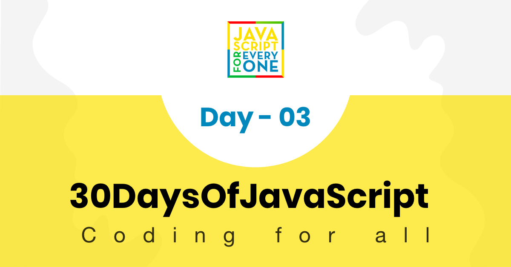
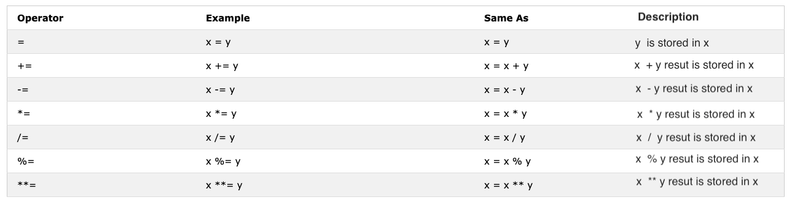
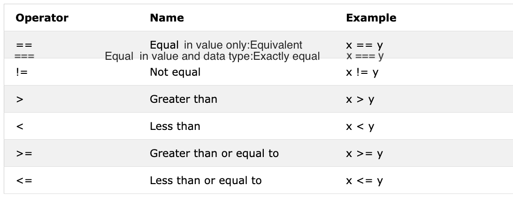
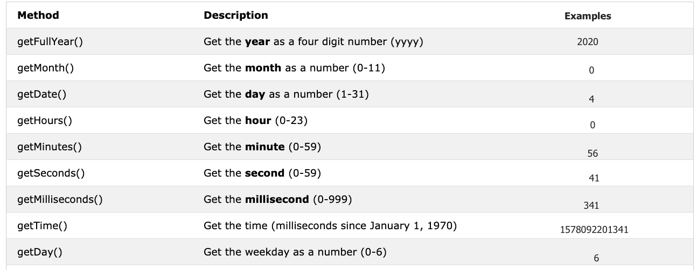

<div align="center">
  <h1> 30 天 JavaScript：布尔值、运算符、日期</h1>
  <a class="header-badge" target="_blank" href="https://www.linkedin.com/in/asabeneh/">
  
  </a>
  <a class="header-badge" target="_blank" href="https://twitter.com/Asabeneh">
  
  </a>

  <sub>作者：
  <a href="https://www.linkedin.com/in/asabeneh/" target="_blank">Asabeneh Yetayeh</a><br>
  <small> 2020 年 1 月</small>
  </sub>
</div>

[<< Day 2](../02_Day_Data_types/02_day_data_types.md) | [Day 4 >>](../04_Day_Conditionals/04_day_conditionals.md)



- [📔 第三天](#-day-3)
	- [布尔值](#booleans)
		- [真值](#truthy-values)
		- [假值](#falsy-values)
	- [undefined](#undefined)
	- [空](#null)
	- [操作员](#operators)
		- [赋值运算符](#assignment-operators)
		- [算术运算符](#arithmetic-operators)
		- [比较运算符](#comparison-operators)
		- [逻辑运算符](#logical-operators)
		- [自增运算符](#increment-operator)
		- [自减运算符](#decrement-operator)
		- [三元运算符](#ternary-operators)
		- [运算符优先级](#operator-precedence)
	- [窗口方法](#window-methods)
		- [window.alert() 方法](#window-alert-method)
		- [window.prompt() 方法](#window-prompt-method)
		- [window.confirm() 方法](#window-confirm-method)
	- [日期对象](#date-object)
		- [创建时间对象](#creating-a-time-object)
		- [获取年份](#getting-full-year)
		- [获取月份](#getting-month)
		- [获取日期](#getting-date)
		- [获取星期](#getting-day)
		- [获取小时](#getting-hours)
		- [获取分钟](#getting-minutes)
		- [获取秒数](#getting-seconds)
		- [获取时间](#getting-time)
	- [💻 第三天：练习](#-day-3-exercises)
		- [练习：1 级](#exercises-level-1)
		- [练习：2 级](#exercises-level-2)
		- [练习：3 级](#exercises-level-3)

<a id="-day-3"></a>
# 📔 第三天

<a id="booleans"></a>
## 布尔值

布尔数据类型表示两个值之一：_true_ 或 _false_。布尔值要么为真，要么为假。当你开始使用比较运算符时，这种数据类型的用途就会很清楚。任何比较都会返回一个布尔值，该值要么为真，要么为假。

**示例：布尔值**

```js
let isLightOn = true
let isRaining = false
let isHungry = false
let isMarried = true
let truValue = 4 > 3    // true
let falseValue = 4 < 3  // false
```

我们一致认为布尔值要么为真，要么为假。

<a id="truthy-values"></a>
### 真值

- 除零外，所有数字（正数和负数）都是真值
- 除空字符串 (`''`) 外，所有字符串都是真值
- 布尔值 true

<a id="falsy-values"></a>
### 假值

- 0
- 0n
- null
- undefined
- NaN
- 布尔值 false
- ''、""、``、空字符串

理解真值和假值很重要。后续学习条件语句时，我们会经常用它们来做判断。

<a id="undefined"></a>
## undefined

如果我们声明一个变量并且不分配值，则该值将是 `undefined`。除此之外，如果函数没有返回值，它将是 `undefined`。

```js
let firstName
console.log(firstName) // undefined，因为还没有给它赋值
```

## null

```js
let empty = null
console.log(empty) // -> null，表示没有值
```

<a id="operators"></a>
## 运算符

<a id="assignment-operators"></a>
### 赋值运算符

JavaScript 中的等号是赋值运算符。它用于分配变量。

```js
let firstName = 'Asabeneh'
let country = 'Finland'
```

赋值运算符



<a id="arithmetic-operators"></a>
### 算术运算符

算术运算符是数学运算符。

- 加法(+)：a + b
- 减法(-): a - b
- 乘法(*): a * b
- 除法(/)：a / b
- 模数(%): a % b
- 指数(**)：a ** b

```js
let numOne = 4
let numTwo = 3
let sum = numOne + numTwo
let diff = numOne - numTwo
let mult = numOne * numTwo
let div = numOne / numTwo
let remainder = numOne % numTwo
let powerOf = numOne ** numTwo

console.log(sum, diff, mult, div, remainder, powerOf) // 7,1,12,1.33,1, 64

```

```js
const PI = 3.14
let radius = 100          // length in meter

// 让我们计算圆的面积
const areaOfCircle = PI * radius * radius
console.log(areaOfCircle)  //  314 m


const gravity = 9.81      // in m/s2
let mass = 72             // in Kilogram

// 让我们计算物体的重量
const weight = mass * gravity
console.log(weight)        // 706.32 N(Newton)

const boilingPoint = 100  // temperature in oC, boiling point of water
const bodyTemp = 37       // body temperature in oC


// Concatenating string with numbers using string interpolation
/*
 The boiling point of water is 100 oC.
 Human body temperature is 37 oC.
 The gravity of earth is 9.81 m/s2.
 */
console.log(
  `The boiling point of water is ${boilingPoint} oC.\nHuman body temperature is ${bodyTemp} oC.\nThe gravity of earth is ${gravity} m / s2.`
)
```

<a id="comparison-operators"></a>
### 比较运算符

在编程中，我们比较值，我们使用比较运算符来比较两个值。我们检查一个值是否大于、小于或等于其他值。


**示例：比较运算符**

```js
console.log(3 > 2)              // true, because 3 is greater than 2
console.log(3 >= 2)             // true, because 3 is greater than 2
console.log(3 < 2)              // false,  because 3 is greater than 2
console.log(2 < 3)              // true, because 2 is less than 3
console.log(2 <= 3)             // true, because 2 is less than 3
console.log(3 == 2)             // false, because 3 is not equal to 2
console.log(3 != 2)             // true, because 3 is not equal to 2
console.log(3 == '3')           // true, compare only value
console.log(3 === '3')          // false, compare both value and data type
console.log(3 !== '3')          // true, compare both value and data type
console.log(3 != 3)             // false, compare only value
console.log(3 !== 3)            // false, compare both value and data type
console.log(0 == false)         // true, equivalent
console.log(0 === false)        // false, not exactly the same
console.log(0 == '')            // true, equivalent
console.log(0 == ' ')           // true, equivalent
console.log(0 === '')           // false, not exactly the same
console.log(1 == true)          // true, equivalent
console.log(1 === true)         // false, not exactly the same
console.log(undefined == null)  // true
console.log(undefined === null) // false
console.log(NaN == NaN)         // false, not equal
console.log(NaN === NaN)        // false
console.log(typeof NaN)         // number

console.log('mango'.length == 'avocado'.length)  // false
console.log('mango'.length != 'avocado'.length)  // true
console.log('mango'.length < 'avocado'.length)   // true
console.log('milk'.length == 'meat'.length)      // true
console.log('milk'.length != 'meat'.length)      // false
console.log('tomato'.length == 'potato'.length)  // true
console.log('python'.length > 'dragon'.length)   // false
```

尝试用一些逻辑来理解上面的比较。没有任何逻辑的记忆可能会很困难。
JavaScript 在某种程度上是一种有线编程语言。 JavaScript 代码运行并给你一个结果，但除非你擅长，否则它可能不是你想要的结果。

根据经验，如果 == 的值不为 true，则它不会等于 ===。使用 === 比使用 == 更安全。以下[链接](https://dorey.github.io/JavaScript-Equality-Table/) 提供了数据类型比较的详尽列表。

<a id="logical-operators"></a>
### 逻辑运算符

以下符号是常见的逻辑运算符：
&&（与符号）、||（竖线）和 !（否定）。
仅当两个操作数都为 true 时，&& 运算符才为 true。
||运算符为 true 任一操作数为 true。
这 ！运算符将 true 变为 false，将 false 变为 true。

```js
// && ampersand operator example

const check = 4 > 3 && 10 > 5         // true && true -> true
const check = 4 > 3 && 10 < 5         // true && false -> false
const check = 4 < 3 && 10 < 5         // false && false -> false

// || pipe or operator, example

const check = 4 > 3 || 10 > 5         // true  || true -> true
const check = 4 > 3 || 10 < 5         // true  || false -> true
const check = 4 < 3 || 10 < 5         // false || false -> false

//! Negation examples

let check = 4 > 3                     // true
let check = !(4 > 3)                  //  false
let isLightOn = true
let isLightOff = !isLightOn           // false
let isMarried = !false                // true
```

<a id="increment-operator"></a>
### 自增运算符

在 JavaScript 中，我们使用增量运算符来增加存储在变量中的值。增量可以是预增量或后增量。让我们看看他们每个人：

1、预自增

```js
let count = 0
console.log(++count)        // 1
console.log(count)          // 1
```

1. 后置自增

```js
let count = 0
console.log(count++)        // 0
console.log(count)          // 1
```

我们大部分时间都使用后增量。至少你应该记住如何使用后自增运算符。

<a id="decrement-operator"></a>
### 自减运算符

在 JavaScript 中，我们使用减量运算符来减少变量中存储的值。减量可以是预减量或后减量。让我们看看他们每个人：

1.预减

```js
let count = 0
console.log(--count) // -1
console.log(count)  // -1
```

2. 后减

```js
let count = 0
console.log(count--) // 0
console.log(count)   // -1
```

<a id="ternary-operators"></a>
### 三元运算符

三元运算符允许编写条件。
编写条件的另一种方法是使用三元运算符。看下面的例子：

```js
let isRaining = true
isRaining
  ? console.log('你需要雨衣。')
  : console.log('不需要雨衣。')
isRaining = false

isRaining
  ? console.log('你需要雨衣。')
  : console.log('不需要雨衣。')
```

```sh
你需要雨衣。
不需要雨衣。
```

```js
let number = 5
number > 0
  ? console.log(`${number} is a positive number`)
  : console.log(`${number} is a negative number`)
number = -5

number > 0
  ? console.log(`${number} is a positive number`)
  : console.log(`${number} is a negative number`)
```

```sh
5 is a positive number
-5 is a negative number
```

<a id="operator-precedence"></a>
### 运算符优先级

建议你通过这个[链接](https://developer.mozilla.org/en-US/docs/Web/JavaScript/Reference/Operators/Operator_Precedence)阅读有关运算符优先级的信息。

<a id="window-methods"></a>
## 窗口方法

<a id="window-alert-method"></a>
### window.alert() 方法

正如你在最开始所看到的，alert() 方法会显示一个带有指定消息和“确定”按钮的警告框。它是一个内置方法，并且可以接收参数。

```js
alert(message)
```

```js
alert('欢迎来到 30DaysOfJavaScript')
```

不要过度使用 `alert()`，因为它会打断用户操作，体验并不好。通常只在测试时使用。

<a id="window-prompt-method"></a>
### window.prompt() 方法

`window.prompt()` 会在浏览器中显示一个带输入框的提示框，用来获取用户输入。输入的数据可以存储到变量中。`prompt()` 方法有两个参数，第二个参数是可选的。

```js
prompt('required text', 'optional text')
```

```js
let number = prompt('请输入数字', '数字写在这里')
console.log(number)
```

<a id="window-confirm-method"></a>
### window.confirm() 方法

confirm() 方法显示一个包含指定消息的对话框，以及“确定”和“取消”按钮。
确认框通常用于请求用户确认某个操作。`window.confirm()` 接收一个字符串作为参数。
点击“确定”会返回 `true`，点击“取消”会返回 `false`。

```js
const agree = confirm('Are you sure you like to delete? ')
console.log(agree) // result will be true or false based on what you click on the dialog box
```

这些并不是所有窗口方法，我们将有一个单独的部分来深入研究窗口方法。

<a id="date-object"></a>
## 日期对象

时间是一件很重要的事情。我们想知道某项活动或事件的时间。在 JavaScript 中，当前时间和日期是使用 JavaScript Date 对象创建的。我们使用 Date 对象创建的对象提供了许多处理日期和时间的方法。我们用来从日期对象值获取日期和时间信息的方法以单词 _get_ 开头，因为它提供了信息。
_getFullYear()、getMonth()、getDate()、getDay()、getHours()、getMinutes、getSeconds()、getMilliseconds()、getTime()、getDay()_



<a id="creating-a-time-object"></a>
### 创建时间对象

一旦我们创建了时间对象。时间对象将提供有关时间的信息。让我们创建一个时间对象

```js
const now = new Date()
console.log(now) // Sat Jan 04 2020 00:56:41 GMT+0200 (Eastern European Standard Time)
```

我们创建了一个时间对象，并且可以使用表中提到的 get 方法从该对象访问任何日期时间信息。

<a id="getting-full-year"></a>
### 获取年份

让我们从时间对象中提取或获取年份。

```js
const now = new Date()
console.log(now.getFullYear()) // 2020
```

<a id="getting-month"></a>
### 获取月份

让我们从时间对象中提取或获取月份。

```js
const now = new Date()
console.log(now.getMonth()) // 0，因为月份是 1 月，月份范围为 0-11
```

<a id="getting-date"></a>
### 获取日期

让我们从时间对象中提取或获取月份的日期。

```js
const now = new Date()
console.log(now.getDate()) // 4，因为今天是当月第 4 天，日期范围为 1-31
```

<a id="getting-day"></a>
### 获取星期

让我们从时间对象中提取或获取星期几。

```js
const now = new Date()
console.log(now.getDay()) // 6，因为今天是星期六，也就是一周中的第 7 天
// 星期日是 0，星期一是 1，星期六是 6
// 以数字形式获取星期几（0-6）
```

<a id="getting-hours"></a>
### 获取小时

让我们从时间对象中提取或获取小时。

```js
const now = new Date()
console.log(now.getHours()) // 0，因为时间是 00:56:41
```

<a id="getting-minutes"></a>
### 获取分钟数

让我们从时间对象中提取或获取分钟。

```js
const now = new Date()
console.log(now.getMinutes()) // 56，因为时间是 00:56:41
```

<a id="getting-seconds"></a>
### 获取秒数

让我们从时间对象中提取或获取秒。

```js
const now = new Date()
console.log(now.getSeconds()) // 41，因为时间是 00:56:41
```

<a id="getting-time"></a>
### 获取时间戳

这个方法返回从 1970 年 1 月 1 日开始到当前时间经过的毫秒数，也称为 Unix 时间戳。可以通过两种方式获取 Unix 时间戳：

1. 使用_getTime()_

```js
const now = new Date() //
console.log(now.getTime()) // 1578092201341，这是从 1970 年 1 月 1 日到 2020 年 1 月 4 日 00:56:41 经过的毫秒数
```

1. 使用_Date.now()_

```js
const allSeconds = Date.now() //
console.log(allSeconds) // 1578092201341，这是从 1970 年 1 月 1 日到 2020 年 1 月 4 日 00:56:41 经过的毫秒数

const timeInSeconds = new Date().getTime()
console.log(allSeconds == timeInSeconds) // true
```

让我们将这些值格式化为人类可读的时间格式。
**例子：**

```js
const now = new Date()
const year = now.getFullYear() // return year
const month = now.getMonth() + 1 // return month(0 - 11)
const date = now.getDate() // return date (1 - 31)
const hours = now.getHours() // return number (0 - 23)
const minutes = now.getMinutes() // return number (0 -59)

console.log(`${date}/${month}/${year} ${hours}:${minutes}`) // 4/1/2020 0:56
```

🌕 你有无限的能量。你刚刚完成了第 3 天的挑战，并且在通往伟大之路上领先了三步。现在为你的大脑和肌肉做一些练习。

<a id="-day-3-exercises"></a>
## 💻 第三天：练习

<a id="exercises-level-1"></a>
### 练习：1 级

1. 声明 `firstName`、`lastName`、`country`、`city`、`age`、`isMarried`、`year` 变量并为其赋值，并使用 `typeof` 运算符检查不同的数据类型。
2. 检查'10'的类型是否等于10
3. 检查 `parseInt('9.8')` 是否等于 10
4. 布尔值要么为真，要么为假。
   1. 编写三个提供真值的 JavaScript 语句。
   2. 编写三个提供假值的 JavaScript 语句。

5. 不使用 `console.log()`，先算出以下比较表达式的结果。决定结果后使用 `console.log()` 确认它
   1. 4 > 3
   2. 4 >= 3
   3. 4 < 3
   4. 4 <= 3
   5. 4==4
   6. 4 === 4
   7. 4 != 4
   8. 4 !== 4
   9. 4 != '4'
   10. 4 == '4'
   11. 4 === '4'
   12. 求出 `python` 和 `jargon` 的长度，并写出一个结果为假的比较语句。

6. 不使用 `console.log()`，先算出以下表达式的结果。确定结果后，使用 `console.log()` 确认它
   1. 4 > 3 && 10 < 12
   2. 4 > 3 && 10 > 12
   3. 4 > 3 || 10 < 12
   4. 4 > 3 || 10 > 12
   5.!(4 > 3)
   6. !(4 < 3)
   7. !（假）
   8. !(4 > 3 && 10 < 12)
   9. !(4 > 3 && 10 > 12)
   10. !(4 === '4')
   11.龙和蟒都没有“上”

7. 使用 Date 对象执行以下活动
   1. 今天是几岁？
   2. 今天是几月？
   3. 今天是几号？
   4. 今天是星期几？
   5. 现在几点了？
   6. 现在几点了？
   7. 找出从 1970 年 1 月 1 日到现在经过的秒数。

<a id="exercises-level-2"></a>
### 练习：2 级

1. 编写一个脚本，提示用户输入三角形的底和高，并计算三角形的面积（面积 = 0.5 x b x h）。

   ```sh
   请输入底：20
   请输入高：10
   三角形的面积是 100
   ```

1. 编写一个脚本，提示用户输入三角形的 a 边、b 边和 c 边，并计算三角形的周长（周长 = a + b + c）

   ```sh
   请输入 a 边：5
   请输入 b 边：4
   请输入 c 边：3
   三角形的周长是 12
   ```

1. 根据提示获取长和宽，并计算矩形面积（面积 = 长 x 宽和长方形周长（周长 = 2 x（长 + 宽））
1. 使用提示获取半径并计算圆的面积 (面积 = pi x r x r) 和圆的周长 (c = 2 x pi x r)，其中 pi = 3.14。
1. 计算 y = 2x -2 的斜率、x 截距和 y 截距
1. 斜率 m = (y<sub>2</sub>-y<sub>1</sub>)/(x<sub>2</sub>-x<sub>1</sub>)。求点 (2, 2) 和点 (6,10) 之间的斜率
1. 比较以上两题的斜率。
1. 计算 y 的值 (y = x<sup>2</sup> + 6x + 9)。尝试使用不同的 x 值并找出 x 值时 y 为 0。
1. 编写一个脚本，提示用户输入小时数和每小时费率。计算该人的工资？

    ```sh
    请输入小时数：40
    请输入每小时费率：28
    你的周收入是 1120
    ```

1.如果你的名字长度大于7，则说你的名字长，否则说你的名字短。
1. 比较你的名字长度和姓氏长度，应该得到如下输出。

    ```js
    let firstName = 'Asabeneh'
    let lastName = 'Yetayeh'
    ```

    ```sh
    你的名字 Asabeneh 比姓氏 Yetayeh 更长
    ```

1. 声明两个变量 _myAge_ 和 _yourAge_ 并为其分配初始值以及 myAge 和 yourAge。

   ```js
   let myAge = 250
   let yourAge = 25
   ```

   ```sh
   我比你大 225 岁。
   ```

1. 使用 prompt 获取用户出生年份。如果用户年满 18 岁或以上，则允许用户驾驶；否则，告诉用户还需要等待多少年。

    ```sh

    请输入出生年份：1995
    你 25 岁。你已经足够大，可以开车。

    请输入出生年份：2005
    你 15 岁。3 年后你就可以开车。
    ```

1. 编写一个脚本，提示用户输入年数。计算一个人可以存活的秒数。假设有人只活一百岁

   ```sh
   请输入你预计生活的年数：100
   你已经生活了 3153600000 秒。
   ```

1. 使用 Date 时间对象创建人类可读的时间格式
   1. 年-月-日 时:分
   2. 日-月-年 时:分
   3. 日/月/年 时:分

<a id="exercises-level-3"></a>
### 练习：3 级

1. 使用日期时间对象创建人类可读的时间格式。小时和分钟应始终为两位数（7 小时应为 07 ，5 分钟应为 05 ）
   1. YYY-MM-DD HH:mm 例如。 20120-01-02 07:05

[<< Day 2](../02_Day_Data_types/02_day_data_types.md) | [Day 4 >>](../04_Day_Conditionals/04_day_conditionals.md)
