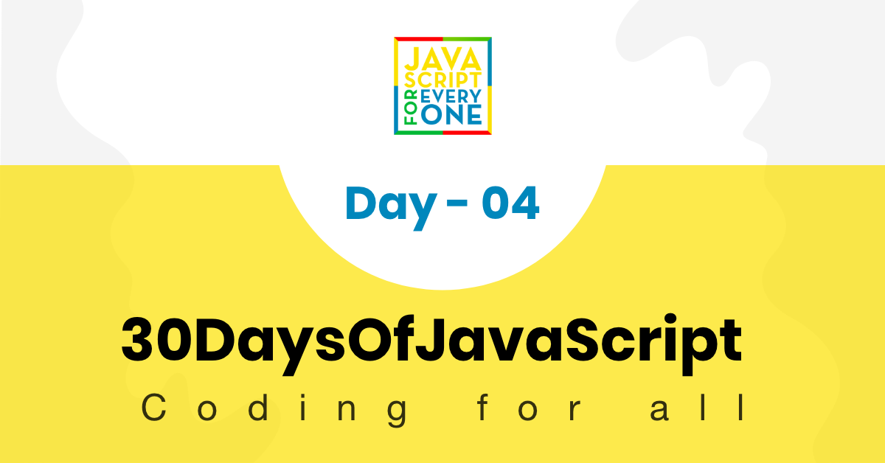

<div align="center">
  <h1> 30 天 JavaScript：条件</h1>
  <a class="header-badge" target="_blank" href="https://www.linkedin.com/in/asabeneh/">
  
  </a>
  <a class="header-badge" target="_blank" href="https://twitter.com/Asabeneh">
  
  </a>

  <sub>作者：
  <a href="https://www.linkedin.com/in/asabeneh/" target="_blank">Asabeneh Yetayeh</a><br>
  <small> 2020 年 1 月</small>
  </sub>
</div>

[<< Day 3](../03_Day_Booleans_operators_date/03_booleans_operators_date.md) | [Day 5 >>](../05_Day_Arrays/05_day_arrays.md)



- [📔 第 4 天](#-day-4)
	- [条件语句](#conditionals)
		- [if](#if)
		- [if else](#if-else)
		- [if else if else](#if--else-if-else)
		- [switch](#switch)
		- [三元运算符](#ternary-operators)
	- [💻练习](#-exercises)
		- [练习：1 级](#exercises-level-1)
		- [练习：2 级](#exercises-level-2)
		- [练习：3 级](#exercises-level-3)

<a id="-day-4"></a>
# 📔 第 4 天

<a id="conditionals"></a>
## 条件语句

条件语句用于根据不同的条件做出决策。
默认情况下，JavaScript 脚本中的语句从上到下顺序执行。如果处理逻辑需要的话，可以通过两种方式改变执行的顺序流程：

- 条件执行：如果某个表达式为 true，则将执行一个或多个语句块
- 重复执行：只要某个表达式为真，一个或多个语句块就会被重复执行。在本节中，我们将介绍 _if_、_else_、_else if_ 语句。我们在前面几节中学到的比较和逻辑运算符在这里将很有用。

条件可以通过以下方式实现：

- if
- if else
- if else if else
- switch
- 三元运算符

<a id="if"></a>
### if

在 JavaScript 和其他编程语言中，关键字 _if_ 用于检查条件是否为真并执行块代码。要创建 if 条件，我们需要 _if_ 关键字、括号内的条件和大括号 ({}) 内的代码块。

```js
// 语法
if (condition) {
  //this part of code runs for truthy condition
}
```

**例子：**

```js
let num = 3
if (num > 0) {
  console.log(`${num} is a positive number`)
}
//  3 is a positive number
```

正如你在上面的条件示例中看到的，3 大于 0，因此它是一个正数。条件为真，代码块被执行。但是，如果条件为假，我们将看不到任何结果。

```js
let isRaining = true
if (isRaining) {
  console.log('记得带雨衣。')
}
```

 第二个条件也是如此，如果 isRaining 为 false，则 if 块将不会被执行，我们看不到任何输出。为了查看错误条件的结果，我们应该有另一个块，即_else_。

<a id="if-else"></a>
### if else

如果条件为真，则将执行第一个块，否则将执行 else 条件。

```js
// 语法
if (condition) {
  // 条件为真时运行这部分代码
} else {
  // 条件为假时运行这部分代码
}
```

```js
let num = 3
if (num > 0) {
  console.log(`${num} is a positive number`)
} else {
  console.log(`${num} is a negative number`)
}
//  3 is a positive number

num = -3
if (num > 0) {
  console.log(`${num} is a positive number`)
} else {
  console.log(`${num} is a negative number`)
}
//  -3 is a negative number
```

```js
let isRaining = true
if (isRaining) {
  console.log('你需要雨衣。')
} else {
  console.log('不需要雨衣。')
}
// 你需要雨衣。

isRaining = false
if (isRaining) {
  console.log('你需要雨衣。')
} else {
  console.log('不需要雨衣。')
}
// 不需要雨衣。
```

最后一个条件为 false，因此执行了 else 块。如果我们有两个以上的条件怎么办？在这种情况下，我们将使用 *else if* 条件。

<a id="if--else-if-else"></a>
### if else if else

在我们的日常生活中，我们每天都会做出决定。我们做出决定不是通过检查一两个条件，而是根据多个条件做出决定。与我们的日常生活类似，编程也充满条件。当我们有多个条件时，我们使用*else if*。

```js
// 语法
if (condition) {
     // code
} else if (condition) {
   // code
} else {
    //  code

}
```

**例子：**

```js
let a = 0
if (a > 0) {
  console.log(`${a} is a positive number`)
} else if (a < 0) {
  console.log(`${a} is a negative number`)
} else if (a == 0) {
  console.log(`${a} is zero`)
} else {
  console.log(`${a} is not a number`)
}
```

```js
// if else if else
let weather = 'sunny'
if (weather === 'rainy') {
  console.log('你需要雨衣。')
} else if (weather === 'cloudy') {
  console.log('天气可能会冷，你需要一件夹克。')
} else if (weather === 'sunny') {
  console.log('放心出门吧。')
} else {
  console.log('不需要雨衣。')
}
```

<a id="switch"></a>
### switch

`switch` 是 **if else if else else** 的替代方案。
switch 语句以 *switch* 关键字开头，后跟括号和代码块。在代码块内会有不同的 case。如果 switch 语句括号中的值与 case 值匹配，则对应的 case 块运行。`break` 语句的作用是终止执行，这样条件满足后代码就不会继续向下执行。如果所有 case 都不满足条件，则运行默认块。

```js
switch(caseValue){
  case 1:
    // code
    break
  case 2:
   // code
   break
  case 3:
   // code
   break
  default:
   // code
}
```

```js
let weather = 'cloudy'
switch (weather) {
  case 'rainy':
    console.log('你需要雨衣。')
    break
  case 'cloudy':
    console.log('天气可能会冷，你需要一件夹克。')
    break
  case 'sunny':
    console.log('放心出门吧。')
    break
  default:
    console.log('不需要雨衣。')
}

// 更多 switch 示例
let dayUserInput = prompt('今天星期几？')
let day = dayUserInput.toLowerCase()

switch (day) {
  case 'monday':
    console.log('今天是星期一')
    break
  case 'tuesday':
    console.log('今天是星期二')
    break
  case 'wednesday':
    console.log('今天是星期三')
    break
  case 'thursday':
    console.log('今天是星期四')
    break
  case 'friday':
    console.log('今天是星期五')
    break
  case 'saturday':
    console.log('今天是星期六')
    break
  case 'sunday':
    console.log('今天是星期日')
    break
  default:
    console.log('这不是有效的星期名称。')
}

```

// 在案例中使用条件的示例

```js
let num = prompt('请输入数字');
switch (true) {
  case num > 0:
    console.log('数字是正数');
    break;
  case num == 0:
    console.log('数字是零');
    break;
  case num < 0:
    console.log('数字是负数');
    break;
  default:
    console.log('输入的值不是数字');
}
```

<a id="ternary-operators"></a>
### 三元运算符

编写条件的另一种方法是使用三元运算符。我们已经在其他部分介绍过这一点，但我们也应该在这里提及。

```js
let isRaining = true
isRaining
  ? console.log('你需要雨衣。')
  : console.log('不需要雨衣。')
```

🌕 你很出色，也有很大的潜力。你刚刚完成了第 4 天的挑战，已经在卓越之路上迈出四步。现在为你的大脑和肌肉做一些练习。

<a id="-exercises"></a>
## 💻 练习

<a id="exercises-level-1"></a>
### 练习：1 级

1. 使用 `prompt()` 获取用户输入：“请输入你的年龄：”。如果用户年满 18 岁，提示“你已经足够大，可以开车”；如果未满 18 岁，提示还需要等待多少年才能满 18 岁。

   ```sh
   请输入你的年龄：30
   你已经足够大，可以开车。

   请输入你的年龄：15
   你还需要 3 年才能开车。
   ```

1. 使用 `if ... else` 比较 `myAge` 和 `yourAge` 的值，并在控制台输出谁年龄更大。使用 `prompt()` 获取年龄输入。

   ```sh
   请输入你的年龄：30
   你比我大 5 岁。
   ```

1. 如果 `a` 大于 `b`，返回 “a 大于 b”，否则返回 “a 小于 b”。尝试用多种方式实现。

    - 使用 if else
    - 三元运算符。

    ```js
      let a = 4
      let b = 3
    ```

    ```sh
      4 大于 3
    ```

1. 偶数能被2整除，余数为零。如何使用 JavaScript 检查数字是否为偶数？

    ```sh
    请输入数字：2
    2 是偶数

    请输入数字：9
    9 是奇数。
    ```

<a id="exercises-level-2"></a>
### 练习：2 级

1. 编写一段代码，根据学生的成绩给学生打分：
   - 80-100，A
   - 70-89，B
   - 60-69，C
   - 50-59，D
   - 0-49，F
1. 检查季节是秋季、冬季、春季还是夏季。
   如果用户输入是：
   - 九月、十月或十一月，季节是秋天。
   - 十二月、一月或二月，季节是冬季。
   - 三月、四月或五月，季节是春天
   - 六月、七月或八月，季节是夏季
1. 检查某一天是周末还是工作日。你的脚本需要接收一天作为输入。

```sh
    今天是星期几？Saturday
    Saturday 是周末。

    今天是星期几？saturDaY
    Saturday 是周末。

    今天是星期几？Friday
    Friday 是工作日。

    今天是星期几？FrIDAy
    Friday 是工作日。
  ```

<a id="exercises-level-3"></a>
### 练习：3 级

1. 编写一个程序来计算一个月的天数。

  ```sh
    请输入月份：一月
    一月有 31 天。

    请输入月份：JANUARY
    一月有 31 天。

    请输入月份：二月
    二月有 28 天。

    请输入月份：FEbruary
    二月有 28 天。
  ```

1. 编写一个程序来计算一个月的天数，现在考虑闰年。


🎉 恭喜！ 🎉

[<< Day 3](../03_Day_Booleans_operators_date/03_booleans_operators_date.md) | [Day 5 >>](../05_Day_Arrays/05_day_arrays.md)
