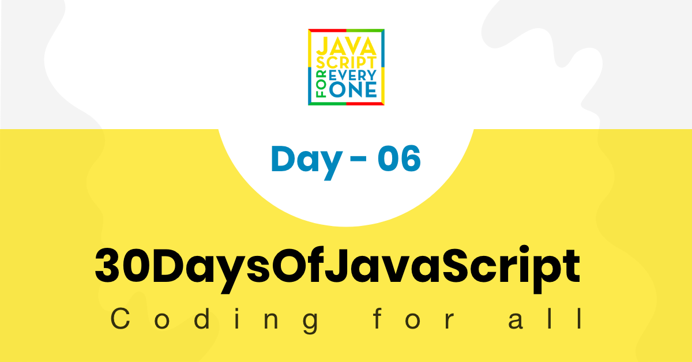

<div align="center">
  <h1> 30 天 JavaScript：循环</h1>
  <a class="header-badge" target="_blank" href="https://www.linkedin.com/in/asabeneh/">
  
  </a>
  <a class="header-badge" target="_blank" href="https://twitter.com/Asabeneh">
  
  </a>

  <sub>作者：
  <a href="https://www.linkedin.com/in/asabeneh/" target="_blank">Asabeneh Yetayeh</a><br>
  <small> 2020 年 1 月</small>
  </sub>
</div>

[<< Day 5](../05_Day_Arrays/05_day_arrays.md) | [Day 7 >>](../07_Day_Functions/07_day_functions.md)



- [📔 第 6 天](#-day-6)
	- [循环](#loops)
		- [for 循环](#for-loop)
		- [while 循环](#while-loop)
		- [do while 循环](#do-while-loop)
		- [for of 循环](#for-of-loop)
		- [break](#break)
		- [continue](#continue)
	- [💻练习：第 6 天](#-exercisesday-6)
		- [练习：1 级](#exercises-level-1)
		- [练习：2 级](#exercises-level-2)
		- [练习：3 级](#exercises-level-3)

<a id="-day-6"></a>
# 📔 第 6 天

<a id="loops"></a>
## 循环

我们生活中的大多数活动都充满重复。想象一下，如果我要求你使用 console.log() 打印 0 到 100，实现这个简单任务可能需要 2 到 5 分钟。这种繁琐且重复的任务可以使用循环来完成。如果你喜欢观看视频，可以查看[视频教程](https://www.youtube.com/channel/UCM4xOopkYiPwJqyKsSqL9mw)。

在编程语言中，为了执行重复性任务，我们使用不同类型的循环。以下示例是 JavaScript 和其他编程语言中常用的循环。

<a id="for-loop"></a>
### for 循环

```js
// For loop structure
for(initialization, condition, increment/decrement){
  // 代码写在这里
}
```

```js
for(let i = 0; i <= 5; i++){
  console.log(i)
}

// 0 1 2 3 4 5
```

```js
for(let i = 5; i >= 0; i--){
  console.log(i)
}

// 5 4 3 2 1 0
```

```js
for(let i = 0; i <= 5; i++){
  console.log(`${i} * ${i} = ${i * i}`)
}
```

```sh
0 * 0 = 0
1 * 1 = 1
2 * 2 = 4
3 * 3 = 9
4 * 4 = 16
5 * 5 = 25
```

```js
const countries = ['Finland', 'Sweden', 'Denmark', 'Norway', 'Iceland']
const newArr = []
for(let i = 0; i < countries.length; i++){
  newArr.push(countries[i].toUpperCase())
}

// ["FINLAND", "SWEDEN", "DENMARK", "NORWAY", "ICELAND"]
```

添加数组中的所有元素

```js
const numbers = [1, 2, 3, 4, 5]
let sum = 0
for(let i = 0; i < numbers.length; i++){
  sum  = sum + numbers[i]  // can be shorten, sum += numbers[i]

}

console.log(sum)  // 15
```

基于现有数组创建新数组

```js
const numbers = [1, 2, 3, 4, 5]
const newArr = []
let sum = 0
for(let i = 0; i < numbers.length; i++){
  newArr.push( numbers[i] ** 2)

}

console.log(newArr)  // [1, 4, 9, 16, 25]
```

```js
const countries = ['Finland', 'Sweden', 'Norway', 'Denmark', 'Iceland']
const newArr = []
for(let i = 0; i < countries.length; i++){
  newArr.push(countries[i].toUpperCase())
}

console.log(newArr)  // ["FINLAND", "SWEDEN", "NORWAY", "DENMARK", "ICELAND"]
```

<a id="while-loop"></a>
### while 循环

```js
let i = 0
while (i <= 5) {
  console.log(i)
  i++
}

// 0 1 2 3 4 5
```

<a id="do-while-loop"></a>
### do while 循环

```js
let i = 0
do {
  console.log(i)
  i++
} while (i <= 5)

// 0 1 2 3 4 5
```

<a id="for-of-loop"></a>
### for of 循环

我们对数组使用 for of 循环。如果我们对数组中每个元素的索引不感兴趣，那么迭代数组是一种非常方便的方法。

```js
for (const element of arr) {
  // 代码写在这里
}
```

```js

const numbers = [1, 2, 3, 4, 5]

for (const num of numbers) {
  console.log(num)
}

// 1 2 3 4 5

for (const num of numbers) {
  console.log(num * num)
}

// 1 4 9 16 25

// 将数组中的所有数字相加
let sum = 0
for (const num of numbers) {
  sum = sum + num  
  // 也可以简写为 sum += num
  // 之后我们会使用更简短的语法（+=、-=、*=、/= 等）
}
console.log(sum) // 15

const webTechs = [
  'HTML',
  'CSS',
  'JavaScript',
  'React',
  'Redux',
  'Node',
  'MongoDB'
]

for (const tech of webTechs) {
  console.log(tech.toUpperCase())
}

// HTML CSS JAVASCRIPT REACT NODE MONGODB

for (const tech of webTechs) {
  console.log(tech[0]) // get only the first letter of each element,  H C J R N M
}

```

```js
const countries = ['Finland', 'Sweden', 'Norway', 'Denmark', 'Iceland']
const newArr = []
for(const country of countries){
  newArr.push(country.toUpperCase())
}

console.log(newArr)  // ["FINLAND", "SWEDEN", "NORWAY", "DENMARK", "ICELAND"]
```

<a id="break"></a>
### break

`break` 用于中断循环。

```js
for(let i = 0; i <= 5; i++){
  if(i == 3){
    break
  }
  console.log(i)
}

// 0 1 2
```

如果迭代过程中找到3，上面的代码就会停止。

<a id="continue"></a>
### continue

我们使用关键字 `continue` 来跳过某些迭代。

```js
for(let i = 0; i <= 5; i++){
  if(i == 3){
    continue
  }
  console.log(i)
}

// 0 1 2 4 5
```

🌕 你真勇敢，已经走到了这一步。现在，你已经能够自动执行重复且乏味的任务。你刚刚完成了第 6 天的挑战，并且在通往卓越之路上领先 6 步。现在为你的大脑和肌肉做一些练习。

<a id="-exercisesday-6"></a>
## 💻 练习：第 6 天

<a id="exercises-level-1"></a>
### 练习：1 级

  ```js
  const countries = [
    'Albania',
    'Bolivia',
    'Canada',
    'Denmark',
    'Ethiopia',
    'Finland',
    'Germany',
    'Hungary',
    'Ireland',
    'Japan',
    'Kenya'
  ]

  const webTechs = [
    'HTML',
    'CSS',
    'JavaScript',
    'React',
    'Redux',
    'Node',
    'MongoDB'
  ]

  const mernStack = ['MongoDB', 'Express', 'React', 'Node']
  ```

1. 使用 for 循环迭代 0 到 10，使用 while 和 do while 循环执行相同操作
2. 使用 for 循环迭代 10 到 0，使用 while 和 do while 循环执行相同操作
3. 使用 for 循环迭代 0 到 n
4. 编写一个循环，使用 console.log() 生成以下模式：

   ```js
       #
       ##
       ###
       ####
       #####
       ######
       #######
   ```

5. 使用循环打印以下图案：

   ```sh
   0 x 0 = 0
   1 x 1 = 1
   2 x 2 = 4
   3 x 3 = 9
   4 x 4 = 16
   5 x 5 = 25
   6 x 6 = 36
   7 x 7 = 49
   8 x 8 = 64
   9 x 9 = 81
   10 x 10 = 100
   ```

6. 使用循环打印以下图案

   ```sh
    i    i^2   i^3
    0    0     0
    1    1     1
    2    4     8
    3    9     27
    4    16    64
    5    25    125
    6    36    216
    7    49    343
    8    64    512
    9    81    729
    10   100   1000
   ```

7. 使用 for 循环从 0 迭代到 100 并仅打印偶数
8. 使用 for 循环从 0 迭代到 100 并且只打印奇数
9. 使用 for 循环从 0 迭代到 100 并仅打印素数
10. 使用 for 循环从 0 迭代到 100 并打印所有数字的总和。

    ```sh
    The sum of all numbers from 0 to 100 is 5050.
    ```

11. 使用 for 循环从 0 迭代到 100，并打印所有偶数之和以及所有奇数之和。

    ```sh
    The sum of all evens from 0 to 100 is 2550. And the sum of all odds from 0 to 100 is 2500.
    ```

12. 使用 for 循环从 0 迭代到 100，并打印所有偶数之和以及所有奇数之和。将偶数总和和奇数总和打印为数组

    ```sh
      [2550, 2500]
    ```

13. 开发一个小脚本，生成 5 个随机数的数组
14. 开发一个小脚本，生成 5 个随机数的数组，并且这些数字必须是唯一的
15. 开发一个小脚本，生成六个字符的随机 ID：

    ```sh
    5j2khz
    ```

<a id="exercises-level-2"></a>
### 练习：2 级

1. 开发一个小脚本，生成任意数量的字符随机 id：

    ```sh
      fe3jo1gl124g
    ```

    ```sh
      xkqci4utda1lmbelpkm03rba
    ```

1. 编写一个生成随机十六进制数的脚本。

    ```sh
    '#ee33df'
    ```

1. 编写一个生成随机 RGB 颜色数的脚本。

    ```sh
    rgb(240,180,80)
    ```

1. 使用上面的国家数组，创建以下新数组。

    ```sh
    ["ALBANIA", "BOLIVIA", "CANADA", "DENMARK", "ETHIOPIA", "FINLAND", "GERMANY", "HUNGARY", "IRELAND", "JAPAN", "KENYA"]
    ```

1. 使用上面的国家数组，创建一个国家长度数组'。

    ```sh
    [7, 7, 6, 7, 8, 7, 7, 7, 7, 5, 5]
    ```

1. 使用 `country` 数组创建以下数组：

    ```sh
      [
      ['Albania', 'ALB', 7],
      ['Bolivia', 'BOL', 7],
      ['Canada', 'CAN', 6],
      ['Denmark', 'DEN', 7],
      ['Ethiopia', 'ETH', 8],
      ['Finland', 'FIN', 7],
      ['Germany', 'GER', 7],
      ['Hungary', 'HUN', 7],
      ['Ireland', 'IRE', 7],
      ['Iceland', 'ICE', 7],
      ['Japan', 'JAP', 5],
      ['Kenya', 'KEN', 5]
    ]
    ```

2. 在上面的国家数组中，检查是否有一个或多个国家包含单词 “land”。如果存在这样的国家，则将它们作为数组打印；如果不存在，则打印“所有这些国家都不包含 land”。

    ```sh
    ['Finland','Ireland', 'Iceland']
    ```

3. 在上面的国家数组中，检查是否有一个或多个国家以子字符串 “ia” 结尾。如果存在，则将它们作为数组打印；如果不存在，则打印“没有国家以 ia 结尾”。

    ```sh
    ['Albania', 'Bolivia','Ethiopia']
    ```

4. 使用上面的国家数组，找到包含最多字符的国家。

      ```sh
      Ethiopia
      ```

5. 使用上面的国家数组，找到只包含 5 个字符的国家。

    ```sh
    ['Japan', 'Kenya']
    ```

6. 找到 webTechs 数组中最长的单词
7. 使用 webTechs 数组创建以下数组：

    ```sh
    [["HTML", 4], ["CSS", 3],["JavaScript", 10],["React", 5],["Redux", 5],["Node", 4],["MongoDB", 7]]
    ```

8. 使用 MongoDB、Express、React 和 Node 创建的应用程序称为 MERN 堆栈应用程序。使用数组 meernStack 创建首字母缩略词 MERN
9. 使用 for 循环或 for of 循环遍历数组 ["HTML", "CSS", "JS", "React", "Redux", "Node", "Express", "MongoDB"] 并打印出项目。
10. 这是一个水果数组，['banana', 'orange', 'mango', 'lemon'] 使用循环反转顺序，而不使用反转方法。
11. 打印数组的所有元素，如下所示。

    ```js
      const fullStack = [
        ['HTML', 'CSS', 'JS', 'React'],
        ['Node', 'Express', 'MongoDB']
      ]
    ````

    ```sh
      HTML
      CSS
      JS
      REACT
      NODE
      EXPRESS
      MONGODB
    ```

<a id="exercises-level-3"></a>
### 练习：3 级

1. 复制国家数组，避免修改原始数组。
2. 数组是可变的。创建数组副本，不修改原始数组；对副本排序并存储到变量 `sortedCountries` 中。
3. 对 `webTechs` 数组和 `mernStack` 数组进行排序。
4. 从 [countries array](https://github.com/Asabeneh/30DaysOfJavaScript/tree/master/data/countries.js) 中提取所有包含 “land” 的国家，并将其打印为数组。
5. 找出 [countries array](https://github.com/Asabeneh/30DaysOfJavaScript/tree/master/data/countries.js) 中字符数最多的国家。
6. 从 [countries array](https://github.com/Asabeneh/30DaysOfJavaScript/tree/master/data/countries.js) 中提取所有只包含 4 个字符的国家，并将其打印为数组。
7. 从 [countries array](https://github.com/Asabeneh/30DaysOfJavaScript/tree/master/data/countries.js) 中提取所有包含两个或更多单词的国家，并将其打印为数组。
8. 反转 [countries array](https://github.com/Asabeneh/30DaysOfJavaScript/tree/master/data/countries.js)，将每个国家名转换为大写，并存储为数组。

🎉 恭喜！ 🎉

[<< Day 5](../05_Day_Arrays/05_day_arrays.md) | [Day 7 >>](../07_Day_Functions/07_day_functions.md)
