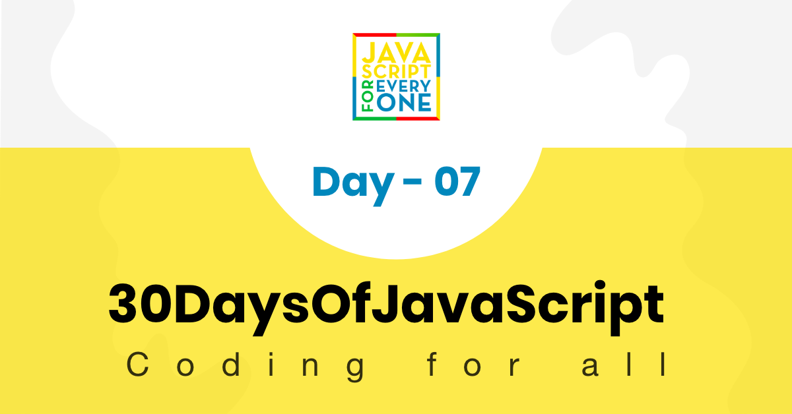

<div align="center">
  <h1> 30 天 JavaScript：函数</h1>
  <a class="header-badge" target="_blank" href="https://www.linkedin.com/in/asabeneh/">
  
  </a>
  <a class="header-badge" target="_blank" href="https://twitter.com/Asabeneh">
  
  </a>

  <sub>作者：
  <a href="https://www.linkedin.com/in/asabeneh/" target="_blank">Asabeneh Yetayeh</a><br>
  <small> 2020 年 1 月</small>
  </sub>
</div>

[<< Day 6](../06_Day_Loops/06_day_loops.md) | [Day 8 >>](../08_Day_Objects/08_day_objects.md)



- [📔 第 7 天](#-day-7)
	- [函数](#functions)
		- [函数声明](#function-declaration)
		- [不带参数和返回的函数](#function-without-a-parameter-and-return)
		- [函数返回值](#function-returning-value)
		- [带参数的函数](#function-with-a-parameter)
		- [有两个参数的函数](#function-with-two-parameters)
		- [多参数函数](#function-with-many-parameters)
		- [参数数量不受限制的函数](#function-with-unlimited-number-of-parameters)
			- [常规函数中参数数量不受限制](#unlimited-number-of-parameters-in-regular-function)
			- [箭头函数参数数量不受限制](#unlimited-number-of-parameters-in-arrow-function)
		- [匿名函数](#anonymous-function)
		- [表达式函数](#expression-function)
		- [自调用函数](#self-invoking-functions)
		- [箭头函数](#arrow-function)
		- [带默认参数的函数](#function-with-default-parameters)
		- [函数声明与箭头函数](#function-declaration-versus-arrow-function)
	- [💻练习](#-exercises)
		- [练习：1 级](#exercises-level-1)
		- [练习：2 级](#exercises-level-2)
		- [练习：3 级](#exercises-level-3)

<a id="-day-7"></a>
# 📔 第 7 天

<a id="functions"></a>
## 函数

到目前为止，我们已经看到了许多内置的 JavaScript 函数。在本节中，我们将重点关注自定义函数。什么是函数？在开始制作函数之前，我们先来了解一下什么是函数以及为什么需要函数？

函数是设计用于执行特定任务的可重用代码块或编程语句。
函数由 `function` 关键字、函数名和括号 `()` 声明。括号中可以放参数。如果函数定义了参数，调用函数时可以传入对应的值。函数也可以设置默认参数。函数如果需要把结果交给外部使用，就应该返回某个值。要获得函数的结果，需要调用这个函数。
函数让代码：

- 干净且易于阅读
- 可重复使用
- 易于测试

可以通过多种方式声明或创建函数：

- _声明函数_
- _表达函数_
- _匿名函数_
- _箭头函数_

<a id="function-declaration"></a>
### 函数声明

让我们看看如何声明函数以及如何调用函数。

```js
// 声明一个不带参数的函数
function functionName() {
  // 代码写在这里
}
functionName() // 使用函数名和括号调用函数
```

<a id="function-without-a-parameter-and-return"></a>
### 不带参数和返回值的函数

可以声明不带参数的函数。

**例子：**

```js
// 不带参数的函数，用于计算数字的平方
function square() {
  let num = 2
  let sq = num * num
  console.log(sq)
}

square() // 4

// 不带参数的函数
function addTwoNumbers() {
  let numOne = 10
  let numTwo = 20
  let sum = numOne + numTwo

  console.log(sum)
}

addTwoNumbers() // 函数必须通过函数名调用才会执行
```

```js
  function printFullName (){
      let firstName = 'Asabeneh'
      let lastName = 'Yetayeh'
      let space = ' '
      let fullName = firstName + space + lastName
      console.log(fullName)
}

printFullName() // 调用函数
```

<a id="function-returning-value"></a>
### 函数返回值

函数也可以返回值，如果函数不返回值，则该函数的值是 `undefined`。让我们用 return 来编写上面的函数。从现在开始，我们将值返回给函数而不是打印它。

```js
function printFullName (){
      let firstName = 'Asabeneh'
      let lastName = 'Yetayeh'
      let space = ' '
      let fullName = firstName + space + lastName
      return fullName
}
console.log(printFullName())
```

```js

  function addTwoNumbers() {
      let numOne = 2
      let numTwo = 3
      let total = numOne + numTwo
      return total

  }

console.log(addTwoNumbers())
```

<a id="function-with-a-parameter"></a>
### 带参数的函数

在函数中，我们可以传递不同的数据类型（数字、字符串、布尔值、对象、函数）作为参数。

```js
// function with one parameter
function functionName(parm1) {
  // 代码写在这里
}
functionName(parm1) // during calling or invoking one argument needed

function areaOfCircle(r) {
  let area = Math.PI * r * r
  return area
}

console.log(areaOfCircle(10)) // should be called with one argument

function square(number) {
  return number * number
}

console.log(square(10))
```

<a id="function-with-two-parameters"></a>
### 有两个参数的函数

```js
// function with two parameters
function functionName(parm1, parm2) {
  // 代码写在这里
}
functionName(parm1, parm2) // during calling or invoking two arguments needed
// Function without parameter doesn't take input, so lets make a function with parameters
function sumTwoNumbers(numOne, numTwo) {
  let sum = numOne + numTwo
  console.log(sum)
}
sumTwoNumbers(10, 20) // 调用函数
// If a function doesn't return it doesn't store data, so it should return

function sumTwoNumbers(numOne, numTwo) {
  let sum = numOne + numTwo
  return sum
}

console.log(sumTwoNumbers(10, 20))
function printFullName(firstName, lastName) {
  return `${firstName} ${lastName}`
}
console.log(printFullName('Asabeneh', 'Yetayeh'))
```

<a id="function-with-many-parameters"></a>
### 具有多个参数的函数

```js
// function with multiple parameters
function functionName(parm1, parm2, parm3,...){
  // 代码写在这里
}
functionName(parm1,parm2,parm3,...) // during calling or invoking three arguments needed


// this function takes array as a parameter and sum up the numbers in the array
function sumArrayValues(arr) {
  let sum = 0;
  for (let i = 0; i < arr.length; i++) {
    sum = sum + arr[i];
  }
  return sum;
}
const numbers = [1, 2, 3, 4, 5];
    // 调用函数
console.log(sumArrayValues(numbers));


    const areaOfCircle = (radius) => {
      let area = Math.PI * radius * radius;
      return area;
    }
console.log(areaOfCircle(10))

```

<a id="function-with-unlimited-number-of-parameters"></a>
### 参数数量不受限制的函数

有时我们不知道用户要传递多少参数。因此，我们应该知道如何编写一个可以接受无限数量参数的函数。我们这样做的方式在函数声明（常规函数）和箭头函数之间有显着的区别。让我们看一下函数声明和箭头函数中的示例。

<a id="unlimited-number-of-parameters-in-regular-function"></a>
#### 常规函数中参数数量不受限制

 函数声明提供了一个类似对象的函数作用域参数数组。我们在函数中作为参数传递的任何内容都可以从函数内部的参数对象访问。让我们看一个例子

 ```js
// 让我们访问 arguments 对象
​
function sumAllNums() {
  console.log(arguments)
}

sumAllNums(1, 2, 3, 4)
// Arguments(4) [1, 2, 3, 4, callee: ƒ, Symbol(Symbol.iterator): ƒ]

```

```js
// function declaration
​
function sumAllNums() {
  let sum = 0
  for (let i = 0; i < arguments.length; i++) {
    sum += arguments[i]
  }
  return sum
}

console.log(sumAllNums(1, 2, 3, 4)) // 10
console.log(sumAllNums(10, 20, 13, 40, 10))  // 93
console.log(sumAllNums(15, 20, 30, 25, 10, 33, 40))  // 173
```

<a id="unlimited-number-of-parameters-in-arrow-function"></a>
#### 箭头函数中参数数量不受限制

 箭头函数没有函数作用域的参数对象。为了实现在箭头函数中接受无限数量参数的函数，我们使用展开运算符，后跟任何参数名称。  我们在函数中作为参数传递的任何内容都可以在箭头函数中作为数组进行访问。让我们看一个例子

 ```js
// 让我们访问 arguments 对象
​
const sumAllNums = (...args) => {
  // console.log(arguments), arguments object not found in arrow function
  // instead we use a parameter followed by spread operator (...)
  console.log(args)
}

sumAllNums(1, 2, 3, 4)
// [1, 2, 3, 4]

```

```js
// function declaration
​
const sumAllNums = (...args) => {
  let sum = 0
  for (const element of args) {
    sum += element
  }
  return sum
}

console.log(sumAllNums(1, 2, 3, 4)) // 10
console.log(sumAllNums(10, 20, 13, 40, 10))  // 93
console.log(sumAllNums(15, 20, 30, 25, 10, 33, 40))  // 173
```

<a id="anonymous-function"></a>
### 匿名函数

匿名函数或没有名称

```js
const anonymousFun = function() {
  console.log(
    'I am an anonymous function and my value is stored in anonymousFun'
  )
}
```

<a id="expression-function"></a>
### 表达式函数

表达式函数是匿名函数。创建一个没有名称的函数并将其分配给一个变量后。要从函数返回值，我们应该调用变量。看下面的例子。

```js

// Function expression
const square = function(n) {
  return n * n
}

console.log(square(2)) // -> 4
```

<a id="self-invoking-functions"></a>
### 自调用函数

自调用函数是不需要调用即可返回值的匿名函数。

```js
(function(n) {
  console.log(n * n)
})(2) // 4, but instead of just printing if we want to return and store the data, we do as shown below

let squaredNum = (function(n) {
  return n * n
})(10)

console.log(squaredNum)
```

<a id="arrow-function"></a>
### 箭头函数

箭头函数是编写函数的另一种方法，但是函数声明和箭头函数有一些细微的差别。

箭头函数使用箭头而不是关键字 *function* 来声明函数。让我们看看函数声明和箭头函数。

```js
// 这是普通函数或函数声明的写法
// 让我们把这个函数声明改成箭头函数
function square(n) {
  return n * n
}

console.log(square(2)) // 4

const square = n => {
  return n * n
}

console.log(square(2))  // -> 4

// if we have only one line in the code block, it can be written as follows, explicit return
const square = n => n * n  // -> 4
```

```js
const changeToUpperCase = arr => {
  const newArr = []
  for (const element of arr) {
    newArr.push(element.toUpperCase())
  }
  return newArr
}

const countries = ['Finland', 'Sweden', 'Norway', 'Denmark', 'Iceland']
console.log(changeToUpperCase(countries))

// ["FINLAND", "SWEDEN", "NORWAY", "DENMARK", "ICELAND"]
```

```js
const printFullName = (firstName, lastName) => {
  return `${firstName} ${lastName}`
}

console.log(printFullName('Asabeneh', 'Yetayeh'))
```

上面的函数只有 return 语句，因此，我们可以显式返回它，如下所示。

```js
const printFullName = (firstName, lastName) => `${firstName} ${lastName}`

console.log(printFullName('Asabeneh', 'Yetayeh'))
```

<a id="function-with-default-parameters"></a>
### 带默认参数的函数

有时我们将默认值传递给参数，当我们调用函数时如果不传递参数，将使用默认值。函数声明和箭头函数都可以有一个或多个默认值。

```js
// 语法
// Declaring a function
function functionName(param = value) {
  //codes
}

// Calling function
functionName()
functionName(arg)
```

**例子：**

```js
function greetings(name = 'Peter') {
  let message = `${name}, welcome to 30 Days Of JavaScript!`
  return message
}

console.log(greetings())
console.log(greetings('Asabeneh'))
```

```js
function generateFullName(firstName = 'Asabeneh', lastName = 'Yetayeh') {
  let space = ' '
  let fullName = firstName + space + lastName
  return fullName
}

console.log(generateFullName())
console.log(generateFullName('David', 'Smith'))
```

```js
function calculateAge(birthYear, currentYear = 2019) {
  let age = currentYear - birthYear
  return age
}

console.log('Age: ', calculateAge(1819))
```

```js
function weightOfObject(mass, gravity = 9.81) {
  let weight = mass * gravity + ' N' // the value has to be changed to string first
  return weight
}

console.log('Weight of an object in Newton: ', weightOfObject(100)) // 9.81 gravity at the surface of Earth
console.log('Weight of an object in Newton: ', weightOfObject(100, 1.62)) // gravity at surface of Moon
```

让我们看看如何用箭头函数来编写上面的函数

```js
// 语法
// Declaring a function
const functionName = (param = value) => {
  //codes
}

// Calling function
functionName()
functionName(arg)
```

**例子：**

```js
const greetings = (name = 'Peter') => {
  let message = name + ', welcome to 30 Days Of JavaScript!'
  return message
}

console.log(greetings())
console.log(greetings('Asabeneh'))
```

```js
const generateFullName = (firstName = 'Asabeneh', lastName = 'Yetayeh') => {
  let space = ' '
  let fullName = firstName + space + lastName
  return fullName
}

console.log(generateFullName())
console.log(generateFullName('David', 'Smith'))
```

```js

const calculateAge = (birthYear, currentYear = 2019) => currentYear - birthYear
console.log('Age: ', calculateAge(1819))
```

```js
const weightOfObject = (mass, gravity = 9.81) => mass * gravity + ' N'
  
console.log('Weight of an object in Newton: ', weightOfObject(100)) // 9.81 gravity at the surface of Earth
console.log('Weight of an object in Newton: ', weightOfObject(100, 1.62)) // gravity at surface of Moon
```

<a id="function-declaration-versus-arrow-function"></a>
### 函数声明与箭头函数

它将在其他部分介绍。

🌕 你正在稳步成长，现在你已经理解了函数，也对函数的力量更有信心。你刚刚完成了第 7 天的挑战，并且已经朝卓越之路迈出了 7 步。现在为你的大脑和肌肉做一些练习。


<a id="-exercises"></a>
## 💻 练习

<a id="exercises-level-1"></a>
### 练习：1 级

1. 声明一个函数 _fullName_，并打印出你的全名。
2. 声明一个函数 _fullName_，它以 firstName、lastName 作为参数，并返回你的全名。
3. 声明一个函数 _addNumbers_，它接受两个参数并返回它们的和。
4. 矩形的面积计算如下：_面积 = 长 x 宽_。编写一个计算 _areaOfRectangle_ 的函数。
5. 矩形的周长计算如下：_周长= 2x(长+宽)_。编写一个计算 _perimeterOfRectangle_ 的函数。
6. 长方体的体积计算如下：_体积 = 长 x 宽 x 高_。编写一个计算 _volumeOfRectPrism_ 的函数。
7. 圆的面积计算如下：_area = π x r x r_。编写一个计算 _areaOfCircle_ 的函数
8. 圆的周长计算如下：_circumference = 2πr_。编写一个计算 _circumOfCircle_ 的函数
9. 物质的密度计算如下：_密度 = 质量 / 体积_。编写一个计算 _density_ 的函数。
10. 速度的计算方法是将移动物体所经过的总距离除以所用的总时间。编写一个函数来计算移动物体的速度_speed_。
11. 物体的重量计算如下：_重量 = 质量 x 重力_。编写一个计算 _weight_ 的函数。
12. 可以使用以下公式将 oC 温度转换为 oF：_oF = (oC x 9/5) + 32_。编写一个将 oC 转换为 oF 的函数_convertCelsiusToFahrenheit_。
13. 体重指数 (BMI) 的计算方法如下：_bmi = 体重 (Kg) / (身高 x 身高) (m2)_。编写一个计算 _bmi_ 的函数。 BMI 用于广泛定义 20 岁或以上成年人的不同体重组。根据以下信息检查一个人是否“体重不足、正常、超重”或“肥胖”。

    - 同样的群体适用于男性和女性。
    - _体重过轻_：BMI 低于 18.5
    - _正常体重_：BMI 为 18.5 至 24.9
    - _超重_：BMI 为 25 至 29.9
    - _肥胖_：BMI 为 30 或以上

14. 编写一个名为 _checkSeason_ 的函数，它接受一个月份参数并返回季节：秋季、冬季、春季或夏季。
15. Math.max 返回其最大的参数。编写一个函数 findMax，它接受三个参数并返回它们的最大值，而不使用 Math.max 方法。

    ```js
    console.log(findMax(0, 10, 5))
    10
    console.log(findMax(0, -10, -2))
    0
    ```
  
<a id="exercises-level-2"></a>
### 练习：2 级

1. 线性方程计算如下：_ax + by + c = 0_。编写一个计算线性方程 _solveLinEquation_ 值的函数。
1. 二次方程计算如下：_ax2 + bx + c = 0_。编写一个计算二次方程 _solveQuadEquation_ 的值的函数。

    ```js
    console.log(solveQuadratic()) // {0}
    console.log(solveQuadratic(1, 4, 4)) // {-2}
    console.log(solveQuadratic(1, -1, -2)) // {2, -1}
    console.log(solveQuadratic(1, 7, 12)) // {-3, -4}
    console.log(solveQuadratic(1, 0, -4)) //{2, -2}
    console.log(solveQuadratic(1, -1, 0)) //{1, 0}
    ```

1. 声明一个名为 _printArray_ 的函数。它以数组作为参数，并打印数组中的每个值。
1. 使用 `Date` 对象编写一个名为 _showDateTime_ 的函数，以以下格式显示时间：08/01/2020 04:08。

    ```sh
    showDateTime()
    08/01/2020 04:08
    ```

1. 声明一个名为 _swapValues_ 的函数。该函数交换 `x` 和 `y` 的值。

    ```js
    swapValues(3, 4) // x => 4, y=>3
    swapValues(4, 5) // x = 5, y = 4
    ```

1. 声明一个名为 _reverseArray_ 的函数。它接受数组作为参数，并返回反转后的数组（不使用内置的 `reverse` 方法）。

    ```js
    console.log(reverseArray([1, 2, 3, 4, 5]))
    //[5, 4, 3, 2, 1]
    console.log(reverseArray(['A', 'B', 'C']))
    //['C', 'B', 'A']
    ```

1. 声明一个名为 _capitalizeArray_ 的函数。它接受数组作为参数，并返回元素大写后的数组。
1. 声明一个名为 _addItem_ 的函数。它接受一个元素作为参数，并返回添加该元素后的数组。
1. 声明一个名为 _removeItem_ 的函数。它接受一个索引作为参数，并返回删除该索引元素后的数组。
1. 声明一个名为 _sumOfNumbers_ 的函数。它接收一个数字参数，并将该范围内的所有数字相加。
1. 声明一个名为 _sumOfOdds_ 的函数。它接收一个数字参数，并将该范围内的所有奇数相加。
1. 声明一个名为 _sumOfEven_ 的函数。它接收一个数字参数，并将该范围内的所有偶数相加。
1. 声明一个函数名称 EvensAndOdds 。它以正整数作为参数，并计算该数字中偶数和奇数的数量。

    ```sh
    evensAndOdds(100);
    The number of odds are 50.
    The number of evens are 51.
    ```

1. 编写一个函数，它接受任意数量的参数并返回参数的总和

    ```js
    sum(1, 2, 3) // -> 6
    sum(1, 2, 3, 4) // -> 10
    ```

1. 编写一个生成 _randomUserIp_ 的函数。
1. 编写一个生成 _randomMacAddress_ 的函数
1. 声明一个函数名称_randomHexaNumberGenerator_。调用此函数时，它会生成一个随机的十六进制数。该函数返回十六进制数。

    ```sh
    console.log(randomHexaNumberGenerator());
    '#ee33df'
    ```

1. 声明一个函数名称_userIdGenerator_。当调用此函数时，它会生成七个字符的 ID。该函数返回 id。

    ```sh
    console.log(userIdGenerator());
    41XTDbE
    ```

<a id="exercises-level-3"></a>
### 练习：3 级

1. 修改 _userIdGenerator_ 函数。声明一个名为 _userIdGenerateByUser_ 的函数。它不接受任何参数，但使用 `prompt()` 接受两个输入。其中一个输入是字符数，第二个输入是应该生成的 id 数。

    ```sh
    userIdGeneratedByUser()
    'kcsy2
    SMFYb
    bWmeq
    ZXOYh
    2Rgxf
    '
    userIdGeneratedByUser()
    '1GCSgPLMaBAVQZ26
    YD7eFwNQKNs7qXaT
    ycArC5yrRupyG00S
    UbGxOFI7UXSWAyKN
    dIV0SSUTgAdKwStr
    '
    ```

1. 编写一个名为 _rgbColorGenerator_ 的函数，它生成 RGB 颜色。

    ```sh
    rgbColorGenerator()
    rgb(125,244,255)
    ```

1. 编写一个函数**_arrayOfHexaColors_**，它返回数组中任意数量的十六进制颜色。
1. 编写一个函数**_arrayOfRgbColors_**，它返回数组中任意数量的 RGB 颜色。
1. 编写一个函数 **_convertHexaToRgb_** ，将 hexa 颜色转换为 rgb 并返回 rgb 颜色。
1. 编写一个函数 **_convertRgbToHexa_** ，将 rgb 转换为十六进制颜色并返回六进制颜色。
1. 编写一个函数 **_generateColors_**，它可以生成任意数量的十六进制或 RGB 颜色。

    ```js
    console.log(generateColors('hexa', 3)) // ['#a3e12f', '#03ed55', '#eb3d2b']
    console.log(generateColors('hexa', 1)) // '#b334ef'
    console.log(generateColors('rgb', 3)) // ['rgb(5, 55, 175)', 'rgb(50, 105, 100)', 'rgb(15, 26, 80)']
    console.log(generateColors('rgb', 1)) // 'rgb(33,79, 176)'
    ```

1. 调用函数_shuffleArray_，它接受一个数组作为参数，并返回一个打乱后的数组
1. 调用你的函数_factorial_，它接受一个整数作为参数，并返回该数字的阶乘
1. 调用你的函数_isEmpty_，它接受一个参数并检查它是否为空
1. 调用函数 _sum_，它接受任意数量的参数并返回总和。
1. 编写一个名为 _sumOfArrayItems_ 的函数，它接受一个数组参数并返回所有元素的总和。需要检查数组元素是否全部为数字；如果不是，返回合理的提示。
1. 编写一个名为 _average_ 的函数，它接受一个数组参数并返回元素平均值。需要检查数组元素是否全部为数字；如果不是，返回合理的提示。
1. 编写一个名为 _modifyArray_ 的函数，以数组为参数，修改数组的第五项并返回数组。如果数组长度小于 5，则返回“未找到项目”。

    ```js
    console.log(modifyArray(['Avocado', 'Tomato', 'Potato','Mango', 'Lemon','Carrot']);
    ```

    ```sh
    ['Avocado', 'Tomato', 'Potato','Mango', 'LEMON', 'Carrot']
    ```

    ```js
    console.log(modifyArray(['Google', 'Facebook','Apple', 'Amazon','Microsoft',  'IBM']);
    ```

    ```sh
    ['Google', 'Facebook','Apple', 'Amazon','MICROSOFT',  'IBM']
    ```

    ```js
    console.log(modifyArray(['Google', 'Facebook','Apple', 'Amazon']);
    ```

    ```sh
      'Not Found'
    ```

1. 编写一个名为 _isPrime_ 的函数，用于检查数字是否为素数。
1. 编写一个函数来检查数组中的所有项目是否唯一。
1. 编写一个函数来检查数组的所有项是否具有相同的数据类型。
1. JavaScript 变量名不支持除 `$` 或 `_` 之外的特殊字符或符号。编写一个函数 **isValidVariable** 来检查变量是否有效。
1. 编写一个函数，返回 0-9 范围内七个随机数的数组。所有数字必须是唯一的。

    ```js
    sevenRandomNumbers()
    [(1, 4, 5, 7, 9, 8, 0)]
    ```

1. 编写一个名为 _reverseCountries_ 的函数。它接受国家数组作为参数，先复制该数组，再返回反转后的副本，避免修改原始数组。

🎉 恭喜！ 🎉

[<< Day 6](../06_Day_Loops/06_day_loops.md) | [Day 8 >>](../08_Day_Objects/08_day_objects.md)
