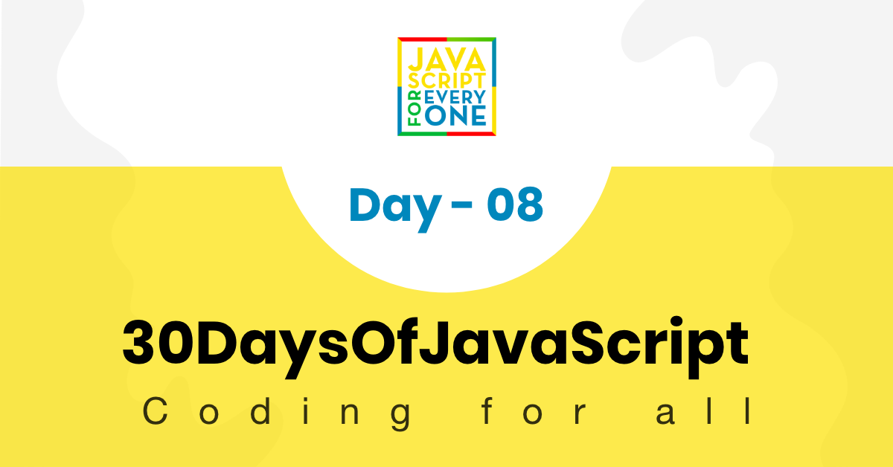

<div align="center">
  <h1> 30 天 JavaScript：对象</h1>
  <a class="header-badge" target="_blank" href="https://www.linkedin.com/in/asabeneh/">
  
  </a>
  <a class="header-badge" target="_blank" href="https://twitter.com/Asabeneh">
  
  </a>

  <sub>作者：
  <a href="https://www.linkedin.com/in/asabeneh/" target="_blank">Asabeneh Yetayeh</a><br>
  <small> 2020 年 1 月</small>
  </sub>
</div>

[<< Day 7](../07_Day_Functions/07_day_functions.md) | [Day 9 >>](../09_Day_Higher_order_functions/09_day_higher_order_functions.md)



- [📔 第 8 天](#-day-8)
	- [作用域](#scope)
		- [窗口全局对象](#window-global-object)
		- [全局作用域](#global-scope)
		- [局部作用域](#local-scope)
	- [📔 对象](#-object)
		- [创建空对象](#creating-an-empty-object)
		- [使用值创建对象](#creating-an-objecting-with-values)
		- [从对象获取值](#getting-values-from-an-object)
		- [创建对象方法](#creating-object-methods)
		- [为对象设置新键](#setting-new-key-for-an-object)
		- [对象方法](#object-methods)
			- [使用Object.keys()获取对象键](#getting-object-keys-using-objectkeys)
			- [使用Object.values()获取对象值](#getting-object-values-using-objectvalues)
			- [使用 Object.entries() 获取对象键和值](#getting-object-keys-and-values-using-objectentries)
			- [使用 hasOwnProperty() 检查属性](#checking-properties-using-hasownproperty)
	- [💻练习](#-exercises)
		- [练习：1 级](#exercises-level-1)
		- [练习：2 级](#exercises-level-2)
		- [练习：3 级](#exercises-level-3)

<a id="-day-8"></a>
# 📔 第 8 天

<a id="scope"></a>
## 作用域

变量是编程的基础部分。我们声明变量来存储不同的数据类型。声明变量可以使用 _var_、_let_ 和 _const_。变量可以在不同作用域中声明。本节将介绍变量的作用域，以及使用 `var`、`let` 时作用域的区别。
变量作用域可以是：

- 全局
- 局部

变量可以声明在全局作用域或局部作用域中。下面我们分别看看这两种作用域。
任何不带 let、var 或 const 声明的内容都处于全局级别。

假设我们有一个 scope.js 文件。

<a id="window-global-object"></a>
### 窗口全局对象

打开浏览器控制台，不使用 console.log()，直接输入 a 或 b，你将看到 a 和 b 的值。这意味着 a 和 b 已经可以从 window 中访问。

```js
//scope.js
a = 'JavaScript' // 不使用 let 或 const 声明变量，会让它成为 window 对象的属性，并且可以在任意位置访问
b = 10 // this is a global scope variable and found in the window object
function letsLearnScope() {
  console.log(a, b)
  if (true) {
    console.log(a, b)
  }
}
console.log(a, b) // accessible
```

<a id="global-scope"></a>
### 全局作用域

可以在同一文件中的任何位置访问全局声明的变量。但“全局”一词是相对的。它可以是文件级全局变量，也可以是相对于某些代码块的全局变量。

```js
//scope.js
let a = 'JavaScript' // is a global scope it will be found anywhere in this file
let b = 10 // is a global scope it will be found anywhere in this file
function letsLearnScope() {
  console.log(a, b) // JavaScript 10, accessible
  if (true) {
    let a = 'Python'
    let b = 100
    console.log(a, b) // Python 100
  }
  console.log(a, b)
}
letsLearnScope()
console.log(a, b) // JavaScript 10, accessible
```

<a id="local-scope"></a>
### 局部作用域

声明为局部变量的变量只能在某些代码块中访问。

- 块作用域
- 函数作用域

```js
//scope.js
let a = 'JavaScript' // is a global scope it will be found anywhere in this file
let b = 10 // is a global scope it will be found anywhere in this file
// Function scope
function letsLearnScope() {
  console.log(a, b) // JavaScript 10, accessible
  let value = false
// block scope
  if (true) {
    // we can access from the function and outside the function but 
    // variables declared inside the if will not be accessed outside the if block
    let a = 'Python'
    let b = 20
    let c = 30
    let d = 40
    value = !value
    console.log(a, b, c, value) // Python 20 30 true
  }
  // we can not access c because c's scope is only the if block
  console.log(a, b, value) // JavaScript 10 true
}
letsLearnScope()
console.log(a, b) // JavaScript 10, accessible
```

现在，你已经了解了作用域。用 *var* 声明的变量是函数作用域，而用 *let* 或 *const* 声明的变量是块作用域（函数块、if 块、循环块等）。JavaScript 中的块是两个大括号 ({}) 之间的代码。

```js
//scope.js
function letsLearnScope() {
  var gravity = 9.81
  console.log(gravity)

}
// console.log(gravity), Uncaught ReferenceError: gravity is not defined

if (true){
  var gravity = 9.81
  console.log(gravity) // 9.81
}
console.log(gravity)  // 9.81

for(var i = 0; i < 3; i++){
  console.log(i) // 0, 1, 2
}
console.log(i) // 3

```

在 ES6 及以上版本中，我们可以使用 *let* 和 *const*，从而避免 *var* 带来的作用域问题。当我们使用 *let* 时，变量是块作用域的，不会污染代码的其他部分。

```js
//scope.js
function letsLearnScope() {
  // you can use let or const, but gravity is constant I prefer to use const
  const gravity = 9.81
  console.log(gravity)

}
// console.log(gravity), Uncaught ReferenceError: gravity is not defined

if (true){
  const  gravity = 9.81
  console.log(gravity) // 9.81
}
// console.log(gravity), Uncaught ReferenceError: gravity is not defined

for(let i = 0; i < 3; i++){
  console.log(i) // 0, 1, 2
}
// console.log(i), Uncaught ReferenceError: i is not defined

```

*let* 和 *const* 的作用域是相同的，区别在于是否可以重新赋值。我们无法更改或重新赋值 `const` 变量。我强烈建议你使用 *let* 和 *const*，这样可以写出更干净的代码，并避免难以调试的错误。一般来说，可以将 *let* 用于会变化的值，将 *const* 用于常量值，以及数组、对象、箭头函数和函数表达式。

<a id="-object"></a>
## 📔 对象

几乎所有内容都可以表示为对象。对象拥有属性，属性由键和值组成，因此对象本质上是一组键值对。对象中键的顺序通常不应作为逻辑依赖。
创建对象字面量时，我们使用一对大括号。

<a id="creating-an-empty-object"></a>
### 创建一个空对象

一个空对象

```js
const person = {}
```

<a id="creating-an-objecting-with-values"></a>
### 使用值创建对象

现在，person 对象具有 firstName、lastName、age、location、skills 和 isMarried 属性。属性或键的值可以是字符串、数字、布尔值、对象、null、undefined 或函数。

让我们看一些对象的例子。每个键在对象中都有一个值。

```js
const rectangle = {
  length: 20,
  width: 20
}
console.log(rectangle) // {length: 20, width: 20}

const person = {
  firstName: 'Asabeneh',
  lastName: 'Yetayeh',
  age: 250,
  country: 'Finland',
  city: 'Helsinki',
  skills: [
    'HTML',
    'CSS',
    'JavaScript',
    'React',
    'Node',
    'MongoDB',
    'Python',
    'D3.js'
  ],
  isMarried: true
}
console.log(person)
```

<a id="getting-values-from-an-object"></a>
### 从对象获取值

我们可以使用两种方法访问对象的值：

- 如果键名是一个单词，可以使用点语法：对象名后接 `.` 和键名。
- 使用方括号和引号

```js
const person = {
  firstName: 'Asabeneh',
  lastName: 'Yetayeh',
  age: 250,
  country: 'Finland',
  city: 'Helsinki',
  skills: [
    'HTML',
    'CSS',
    'JavaScript',
    'React',
    'Node',
    'MongoDB',
    'Python',
    'D3.js'
  ],
  getFullName: function() {
    return `${this.firstName}${this.lastName}`
  },
  'phone number': '+3584545454545'
}

// accessing values using .
console.log(person.firstName)
console.log(person.lastName)
console.log(person.age)
console.log(person.location) // undefined

// value can be accessed using square bracket and key name
console.log(person['firstName'])
console.log(person['lastName'])
console.log(person['age'])
console.log(person['age'])
console.log(person['location']) // undefined

// for instance to access the phone number we only use the square bracket method
console.log(person['phone number'])
```

<a id="creating-object-methods"></a>
### 创建对象方法

现在，person 对象具有 getFullName 属性。 getFullName 是 person 对象内部的函数，我们将其称为对象方法。 _this_ 关键字指的是对象本身。我们可以使用单词 _this_ 来访问对象不同属性的值。我们不能使用箭头函数作为对象方法，因为 this 一词指的是箭头函数内的窗口而不是对象本身。对象示例：

```js
const person = {
  firstName: 'Asabeneh',
  lastName: 'Yetayeh',
  age: 250,
  country: 'Finland',
  city: 'Helsinki',
  skills: [
    'HTML',
    'CSS',
    'JavaScript',
    'React',
    'Node',
    'MongoDB',
    'Python',
    'D3.js'
  ],
  getFullName: function() {
    return `${this.firstName} ${this.lastName}`
  }
}

console.log(person.getFullName())
// Asabeneh Yetayeh
```

<a id="setting-new-key-for-an-object"></a>
### 为对象设置新键

对象是一种可变的数据结构，我们可以在对象创建后修改其内容。

在对象中设置新键

```js
const person = {
  firstName: 'Asabeneh',
  lastName: 'Yetayeh',
  age: 250,
  country: 'Finland',
  city: 'Helsinki',
  skills: [
    'HTML',
    'CSS',
    'JavaScript',
    'React',
    'Node',
    'MongoDB',
    'Python',
    'D3.js'
  ],
  getFullName: function() {
    return `${this.firstName} ${this.lastName}`
  }
}
person.nationality = 'Ethiopian'
person.country = 'Finland'
person.title = 'teacher'
person.skills.push('Meteor')
person.skills.push('SasS')
person.isMarried = true

person.getPersonInfo = function() {
  let skillsWithoutLastSkill = this.skills
    .splice(0, this.skills.length - 1)
    .join(', ')
  let lastSkill = this.skills.splice(this.skills.length - 1)[0]

  let skills = `${skillsWithoutLastSkill}, and ${lastSkill}`
  let fullName = this.getFullName()
  let statement = `${fullName} is a ${this.title}.\nHe lives in ${this.country}.\nHe teaches ${skills}.`
  return statement
}
console.log(person)
console.log(person.getPersonInfo())
```

```sh
Asabeneh Yetayeh is a teacher.
He lives in Finland.
He teaches HTML, CSS, JavaScript, React, Node, MongoDB, Python, D3.js, Meteor, and SasS.
```

<a id="object-methods"></a>
### 对象方法

有不同的方法来操纵对象。让我们看看一些可用的方法。

_Object.assign_：复制对象而不修改原始对象

```js
const person = {
  firstName: 'Asabeneh',
  age: 250,
  country: 'Finland',
  city:'Helsinki',
  skills: ['HTML', 'CSS', 'JS'],
  title: 'teacher',
  address: {
    street: 'Heitamienkatu 16',
    pobox: 2002,
    city: 'Helsinki'
  },
  getPersonInfo: function() {
    return `I am ${this.firstName} and I live in ${this.city}, ${this.country}. I am ${this.age}.`
  }
}

//Object methods: Object.assign, Object.keys, Object.values, Object.entries
//hasOwnProperty

const copyPerson = Object.assign({}, person)
console.log(copyPerson)
```

<a id="getting-object-keys-using-objectkeys"></a>
#### 使用 Object.keys() 获取对象键

_Object.keys_：以数组形式获取对象的键或属性

```js
const keys = Object.keys(copyPerson)
console.log(keys) //['firstName', 'age', 'country','city', 'skills','title', 'address', 'getPersonInfo']
const address = Object.keys(copyPerson.address)
console.log(address) //['street', 'pobox', 'city']
```

<a id="getting-object-values-using-objectvalues"></a>
#### 使用 Object.values() 获取对象值

_Object.values_：以数组形式获取对象的值

```js
const values = Object.values(copyPerson)
console.log(values)
```

<a id="getting-object-keys-and-values-using-objectentries"></a>
#### 使用 Object.entries() 获取对象键和值

_Object.entries_：获取数组中的键和值

```js
const entries = Object.entries(copyPerson)
console.log(entries)
```

<a id="checking-properties-using-hasownproperty"></a>
#### 使用 hasOwnProperty() 检查属性

_hasOwnProperty_：检查对象中是否存在特定键或属性

```js
console.log(copyPerson.hasOwnProperty('name'))
console.log(copyPerson.hasOwnProperty('score'))
```

🌕 你真令人惊喜。现在，你已经理解了对象的作用。你刚刚完成了第 8 天的挑战，并且在通往卓越之路上领先 8 步。现在为你的大脑和肌肉做一些练习。

<a id="-exercises"></a>
## 💻 练习

<a id="exercises-level-1"></a>
### 练习：1 级

1. 创建一个名为 `dog` 的空对象。
2. 在控制台打印 `dog` 对象。
3. 为 `dog` 对象添加 `name`、`legs`、`color`、`age` 和 `bark` 属性，其中 `bark` 是一个返回 _woof woof_ 的方法。
4. 从 `dog` 对象中获取 `name`、`legs`、`color`、`age` 和 `bark` 的值。
5. 为 `dog` 对象设置新属性：`breed` 和 `getDogInfo`。

<a id="exercises-level-2"></a>
### 练习：2 级

1. 在 `users` 对象中找出拥有多项技能的用户。
1、统计登录用户，统计以下对象中积分大于等于50的用户。

   ````js
   const users = {
     Alex: {
       email: 'alex@alex.com',
       skills: ['HTML', 'CSS', 'JavaScript'],
       age: 20,
       isLoggedIn: false,
       points: 30
     },
     Asab: {
       email: 'asab@asab.com',
       skills: ['HTML', 'CSS', 'JavaScript', 'Redux', 'MongoDB', 'Express', 'React', 'Node'],
       age: 25,
       isLoggedIn: false,
       points: 50
     },
     Brook: {
       email: 'daniel@daniel.com',
       skills: ['HTML', 'CSS', 'JavaScript', 'React', 'Redux'],
       age: 30,
       isLoggedIn: true,
       points: 50
     },
     Daniel: {
       email: 'daniel@alex.com',
       skills: ['HTML', 'CSS', 'JavaScript', 'Python'],
       age: 20,
       isLoggedIn: false,
       points: 40
     },
     John: {
       email: 'john@john.com',
       skills: ['HTML', 'CSS', 'JavaScript', 'React', 'Redux', 'Node.js'],
       age: 20,
       isLoggedIn: true,
       points: 50
     },
     Thomas: {
       email: 'thomas@thomas.com',
       skills: ['HTML', 'CSS', 'JavaScript', 'React'],
       age: 20,
       isLoggedIn: false,
       points: 40
     },
     Paul: {
       email: 'paul@paul.com',
       skills: ['HTML', 'CSS', 'JavaScript', 'MongoDB', 'Express', 'React', 'Node'],
       age: 20,
       isLoggedIn: false,
       points: 40
     }
   }
   ````

1. 从 users 对象中找出 MERN 技术栈开发者
1. 在不修改原始 users 对象的情况下，将你的名字添加到 users 对象中
1. 获取 users 对象的所有键或属性
1. 获取 users 对象的所有值
1. 使用 `countries` 对象打印国家名称、首都、人口和语言。

<a id="exercises-level-3"></a>
### 练习：3 级

1. 创建一个名为 _personAccount_ 的对象字面量。它包含 _firstName、lastName、incomes、expenses_ 属性，并包含 _totalIncome、totalExpense、accountInfo、addIncome、addExpense_ 和 _accountBalance_ 方法。incomes 是收入及其描述的集合，expenses 是支出及其描述的集合。
2. **** 第 2、3、4 题基于下面两个数组：users 和 products。

  ```js
      const users = [
      {
          _id: 'ab12ex',
          username: 'Alex',
          email: 'alex@alex.com',
          password: '123123',
          createdAt:'08/01/2020 9:00 AM',
          isLoggedIn: false
      },
      {
          _id: 'fg12cy',
          username: 'Asab',
          email: 'asab@asab.com',
          password: '123456',
          createdAt:'08/01/2020 9:30 AM',
          isLoggedIn: true
      },
      {
          _id: 'zwf8md',
          username: 'Brook',
          email: 'brook@brook.com',
          password: '123111',
          createdAt:'08/01/2020 9:45 AM',
          isLoggedIn: true
      },
      {
          _id: 'eefamr',
          username: 'Martha',
          email: 'martha@martha.com',
          password: '123222',
          createdAt:'08/01/2020 9:50 AM',
          isLoggedIn: false
      },
      {
          _id: 'ghderc',
          username: 'Thomas',
          email: 'thomas@thomas.com',
          password: '123333',
          createdAt:'08/01/2020 10:00 AM',
          isLoggedIn: false
      }
      ];

      const products = [
    {
      _id: 'eedfcf',
      name: 'mobile phone',
      description: 'Huawei Honor',
      price: 200,
      ratings: [
        { userId: 'fg12cy', rate: 5 },
        { userId: 'zwf8md', rate: 4.5 }
      ],
      likes: []
    },
    {
      _id: 'aegfal',
      name: 'Laptop',
      description: 'MacPro: System Darwin',
      price: 2500,
      ratings: [],
      likes: ['fg12cy']
    },
    {
      _id: 'hedfcg',
      name: 'TV',
      description: 'Smart TV:Procaster',
      price: 400,
      ratings: [{ userId: 'fg12cy', rate: 5 }],
      likes: ['fg12cy']
    }
  ]
  ```

  假设你正在从 MongoDB 数据库中获取上述 users 集合。
    a. 创建一个名为 signUp 的函数，允许用户添加到集合中。如果用户已存在，提示该用户已经拥有账号。  
    b. 创建一个名为 signIn 的函数，允许用户登录应用。  

3. products 数组有三个元素，每个元素都有六个属性。
    a. 创建一个名为 rateProduct 的函数，用于给产品评分
    b. 创建一个名为 averageRating 的函数，用于计算产品的平均评分  

4. 创建一个名为 likeProduct 的函数。如果产品尚未被点赞，该函数会添加点赞；如果已经点赞，则移除点赞。


🎉 恭喜！ 🎉

[<< Day 7](../07_Day_Functions/07_day_functions.md) | [Day 9 >>](../09_Day_Higher_order_functions/09_day_higher_order_functions.md)
