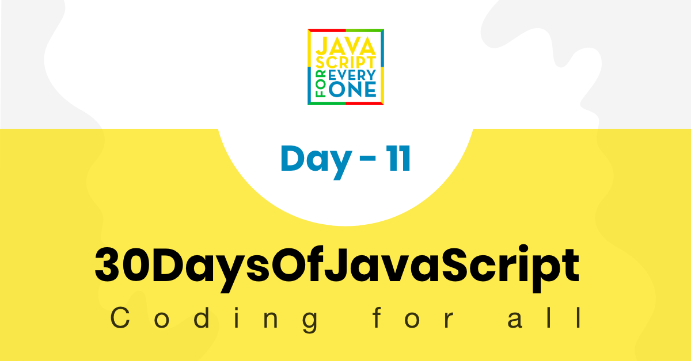

<div align="center">
  <h1> 30 天 JavaScript：解构和展开</h1>
  <a class="header-badge" target="_blank" href="https://www.linkedin.com/in/asabeneh/">
  
  </a>
  <a class="header-badge" target="_blank" href="https://twitter.com/Asabeneh">
  
  </a>

  <sub>作者：
  <a href="https://www.linkedin.com/in/asabeneh/" target="_blank">Asabeneh Yetayeh</a><br>
  <small> 2020 年 1 月</small>
  </sub>
</div>

[<< Day 10](../10_Day_Sets_and_Maps/10_day_Sets_and_Maps.md) | [Day 12 >>](../12_Day_Regular_expressions/12_day_regular_expressions.md)



- [第 11 天](#第-11-天)
  - [解构和展开](#解构和展开)
    - [解构数组](#解构数组)
    - [迭代时解构](#迭代时解构)
    - [解构对象](#解构对象)
    - [解构时重命名](#解构时重命名)
    - [不使用解构的对象参数](#不使用解构的对象参数)
    - [使用解构的对象参数](#使用解构的对象参数)
    - [迭代时解构对象](#迭代时解构对象)
    - [展开运算符和剩余参数](#展开运算符和剩余参数)
    - [使用展开运算符获取数组剩余元素](#使用展开运算符获取数组剩余元素)
    - [使用展开运算符复制数组](#使用展开运算符复制数组)
    - [使用展开运算符复制对象](#使用展开运算符复制对象)
      - [在箭头函数中使用剩余参数](#在箭头函数中使用剩余参数)
  - [练习](#练习)
    - [练习：1 级](#练习1-级)
    - [练习：2 级](#练习2-级)
    - [练习：3 级](#练习3-级)

<a id="第-11-天"></a>
# 第 11 天

<a id="解构和展开"></a>
## 解构和展开

解构是一种从数组或对象中取出值，并把这些值赋给变量的语法。

<a id="解构数组"></a>
### 解构数组

```js
  const numbers = [1, 2, 3]
  let [numOne, numTwo, numThree] = numbers

  console.log(numOne, numTwo, numThree)
```

```sh
  1 2 3
```

```js
  const names = ['Asabeneh', 'Brook', 'David', 'John']
  let [firstPerson, secondPerson, thirdPerson, fourthPerson] = names

  console.log(firstPerson, secondPerson,thirdPerson, fourthPerson)
```

```sh
Asabeneh Brook David John
```

```js
  const scientificConstants = [2.72, 3.14, 9.81, 37, 100]
  let [e, pi, gravity, bodyTemp, boilingTemp] = scientificConstants

  console.log(e,pi,gravity, bodyTemp, boilingTemp)
```

```sh
2.72 3.14 9.81 37 100
```

```js
const fullStack = [
  ['HTML', 'CSS', 'JS', 'React'],
  ['Node', 'Express', 'MongoDB']
]
const [frontEnd, backEnd] = fullStack

console.log(frontEnd)
console.log(backEnd)
```

```sh
["HTML", "CSS", "JS", "React"]
["Node", "Express", "MongoDB"]
```

如果我们想跳过数组中的某个值，我们可以使用额外的逗号。逗号有助于省略该特定索引处的值

```js
  const numbers = [1, 2, 3]
  let [numOne, , numThree] = numbers //2 is omitted

  console.log(numOne, numThree)
```

```sh
1 3
```

```js
  const names = ['Asabeneh', 'Brook', 'David', 'John']
  let [, secondPerson, , fourthPerson] = names // first and third person is omitted

  console.log(secondPerson, fourthPerson)
```

```sh
Brook John
```

如果该索引的数组值是 `undefined`，我们可以使用默认值：

```js
const names = [undefined, 'Brook', 'David']
let [
  firstPerson = 'Asabeneh',
  secondPerson,
  thirdPerson,
  fourthPerson = 'John'
] = names

console.log(firstPerson, secondPerson, thirdPerson, fourthPerson)  
```

```sh
Asabeneh Brook David John
```

我们不能将变量分配给数组中的所有元素。我们可以解构前几个，我们可以使用扩展运算符（...）将剩余的作为数组获得。

```js
const nums = [1, 2, 3, 4, 5, 6, 7, 8, 9, 10]
let [num1, num2, num3, ...rest] = nums

console.log(num1, num2, num3)
console.log(rest)
```

```sh
1 2 3
[4, 5, 6, 7, 8, 9, 10]
```

<a id="迭代时解构"></a>
### 迭代时解构

```js
const countries = [['Finland', 'Helsinki'], ['Sweden', 'Stockholm'], ['Norway', 'Oslo']]

for (const [country, city] of countries) {
console.log(country, city)
}
```

```sh
Finland Helsinki
Sweden Stockholm
Norway Oslo
```

```js
const fullStack = [
  ['HTML', 'CSS', 'JS', 'React'],
  ['Node', 'Express', 'MongoDB']
]

for(const [first, second, third] of fullStack) {
console.log(first, second, third)
}
```

```sh
HTML CSS JS
Node Express MongoDB
```

<a id="解构对象"></a>
### 解构对象

当我们解构时，我们用来解构的变量的名称应该与对象的键或属性完全相同。请参阅下面的示例。

```js
const rectangle = {
  width: 20,
  height: 10,
  area: 200
}
let { width, height, area, perimeter } = rectangle

console.log(width, height, area, perimeter)
```

```sh
20 10 200 undefined
```

<a id="解构时重命名"></a>
### 解构时重命名

```js
const rectangle = {
  width: 20,
  height: 10,
  area: 200
}
let { width: w, height: h, area: a, perimeter: p } = rectangle

console.log(w, h, a, p)
```

```sh
20 10 200 undefined
```

如果对象中找不到对应的键，解构出来的变量值就是 `undefined`。有时某个键可能不存在，这种情况下可以在解构时设置默认值。

```js
const rectangle = {
  width: 20,
  height: 10,
  area: 200
}
let { width, height, area, perimeter = 60 } = rectangle

console.log(width, height, area, perimeter) //20 10 200 60
// 让我们修改对象：width 为 30，perimeter 为 80
```

```js
const rectangle = {
  width: 30,
  height: 10,
  area: 200,
  perimeter: 80
}
let { width, height, area, perimeter = 60 } = rectangle
console.log(width, height, area, perimeter) //30 10 200 80
```

也可以在函数参数中直接解构对象。下面创建一个函数，它接收矩形对象并返回矩形的周长。

<a id="不使用解构的对象参数"></a>
### 不使用解构的对象参数

```js
// 不使用解构
const rect = {
  width: 20,
  height: 10
}
const calculatePerimeter = rectangle => {
  return 2 * (rectangle.width + rectangle.height)
}

console.log(calculatePerimeter(rect)) // 60
// 使用解构
```

```js
// 另一个示例
const person = {
  firstName: 'Asabeneh',
  lastName: 'Yetayeh',
  age: 250,
  country: 'Finland',
  job: 'Instructor and Developer',
  skills: [
    'HTML',
    'CSS',
    'JavaScript',
    'React',
    'Redux',
    'Node',
    'MongoDB',
    'Python',
    'D3.js'
  ],
  languages: ['Amharic', 'English', 'Suomi(Finnish)']
}
// 让我们创建一个不使用解构、返回 person 对象信息的函数

const getPersonInfo = obj => {
  const skills = obj.skills
  const formattedSkills = skills.slice(0, -1).join(', ')
  const languages = obj.languages
  const formattedLanguages = languages.slice(0, -1).join(', ')

  personInfo = `${obj.firstName} ${obj.lastName} lives in ${obj.country}. He is  ${
    obj.age
  } years old. He is an ${obj.job}. He teaches ${formattedSkills} and ${
    skills[skills.length - 1]
  }. He speaks ${formattedLanguages} and a little bit of ${languages[2]}.`

  return personInfo
}

console.log(getPersonInfo(person))
```

<a id="使用解构的对象参数"></a>
### 使用解构的对象参数

```js

const calculatePerimeter = ({ width, height }) => {
  return 2 * (width + height)
}

console.log(calculatePerimeter(rect)) // 60
```

```js
// 让我们创建一个使用解构、返回 person 对象信息的函数
const getPersonInfo = ({
  firstName,
  lastName,
  age,
  country,
  job,
  skills,
  languages
}) => {
  const formattedSkills = skills.slice(0, -1).join(', ')
  const formattedLanguages = languages.slice(0, -1).join(', ')

  personInfo = `${firstName} ${lastName} lives in ${country}. He is ${age} years old. He is an ${job}. He teaches ${formattedSkills} and ${
    skills[skills.length - 1]
  }. He speaks ${formattedLanguages} and a little bit of ${languages[2]}.`

  return personInfo
}
console.log(getPersonInfo(person))
/*
Asabeneh Yetayeh lives in Finland. He is  250 years old. He is an Instructor and Developer. He teaches HTML, CSS, JavaScript, React, Redux, Node, MongoDB, Python and D3.js. He speaks Amharic, English and a little bit of Suomi(Finnish)
*/
```

<a id="迭代时解构对象"></a>
### 迭代时解构对象

```js
const todoList = [
{
  task:'Prepare JS Test',
  time:'4/1/2020 8:30',
  completed:true
},
{
  task:'Give JS Test',
  time:'4/1/2020 10:00',
  completed:false
},
{
  task:'Assess Test Result',
  time:'4/1/2020 1:00',
  completed:false
}
]

for (const {task, time, completed} of todoList){
  console.log(task, time, completed)
}
```

```sh
Prepare JS Test 4/1/2020 8:30 true
Give JS Test 4/1/2020 10:00 false
Assess Test Result 4/1/2020 1:00 false
```

<a id="展开运算符和剩余参数"></a>
### 展开运算符和剩余参数

在解构数组时，可以使用 `...` 获取剩余元素。除此之外，`...` 也可以把数组元素展开到另一个数组中。根据使用位置不同，它可以表示展开运算符，也可以表示剩余参数。

<a id="使用展开运算符获取数组剩余元素"></a>
### 使用展开运算符获取数组剩余元素

```js
const nums = [1, 2, 3, 4, 5, 6, 7, 8, 9, 10]
let [num1, num2, num3, ...rest] = nums
​
console.log(num1, num2, num3)
console.log(rest)
```

```sh
1 2 3
[4, 5, 6, 7, 8, 9, 10]
```

```js
const countries = [
  'Germany',
  'France',
  'Belgium',
  'Finland',
  'Sweden',
  'Norway',
  'Denmark',
  'Iceland'
]

let [gem, fra, , ...nordicCountries] = countries

console.log(gem)
console.log(fra)
console.log(nordicCountries)
```

```sh
Germany
France
["Finland", "Sweden", "Norway", "Denmark", "Iceland"]
```

<a id="使用展开运算符复制数组"></a>
### 使用展开运算符复制数组

```js
const evens = [0, 2, 4, 6, 8, 10]
const evenNumbers = [...evens]

const odds = [1, 3, 5, 7, 9]
const oddNumbers = [...odds]

const wholeNumbers = [...evens, ...odds]

console.log(evenNumbers)
console.log(oddNumbers)
console.log(wholeNumbers)


```

```sh
[0, 2, 4, 6, 8, 10]
[1, 3, 5, 7, 9]
[0, 2, 4, 6, 8, 10, 1, 3, 5, 7, 9]
```

```js
const frontEnd = ['HTML', 'CSS', 'JS', 'React']
const backEnd = ['Node', 'Express', 'MongoDB']
const fullStack = [...frontEnd, ...backEnd]

console.log(fullStack)
```

```sh
["HTML", "CSS", "JS", "React", "Node", "Express", "MongoDB"]
```

<a id="使用展开运算符复制对象"></a>
### 使用展开运算符复制对象

可以使用展开运算符复制对象。

```js
const user = {
  name:'Asabeneh',
  title:'Programmer',
  country:'Finland',
  city:'Helsinki'
}

const copiedUser = {...user}
console.log(copiedUser)
```

```sh
{name: "Asabeneh", title: "Programmer", country: "Finland", city: "Helsinki"}
```

复制对象时，也可以同时覆盖或新增属性。

```js
const user = {
  name:'Asabeneh',
  title:'Programmer',
  country:'Finland',
  city:'Helsinki'
}

const copiedUser = {...user, title:'instructor'}
console.log(copiedUser)
```

```sh
{name: "Asabeneh", title: "instructor", country: "Finland", city: "Helsinki"}
```

<a id="在箭头函数中使用剩余参数"></a>
#### 在箭头函数中使用剩余参数

当我们希望箭头函数接收不定数量的参数时，可以使用剩余参数语法。如果在函数参数中使用 `...args`，调用函数时传入的所有参数都会被收集到一个数组中。

```js

const sumAllNums = (...args) => {
  console.log(args)
}

sumAllNums(1, 2, 3, 4, 5)

```

```sh
[1, 2, 3, 4, 5]

```

```js

const sumAllNums = (...args) => {
  let sum = 0
  for (const num of args){
    sum += num
  }
  return sum
  
}

console.log(sumAllNums(1, 2, 3, 4, 5))
```

```sh
15

```

🌕 到目前为止，你已经完成了很多内容。继续前进！你刚刚完成第 11 天挑战，离目标又近了一步。现在通过练习巩固解构、展开运算符和剩余参数。

<a id="练习"></a>
## 练习

<a id="练习1-级"></a>
### 练习：1 级

```js
const constants = [2.72, 3.14, 9.81, 37, 100]
const countries = ['Finland', 'Estonia', 'Sweden', 'Denmark', 'Norway']
const rectangle = {
  width: 20,
  height: 10,
  area: 200,
  perimeter: 60
}
const users = [
{
  name:'Brook',
  scores:75,
  skills:['HTM', 'CSS', 'JS'],
  age:16
},
{
  name:'Alex',
  scores:80,
  skills:['HTM', 'CSS', 'JS'],
  age:18
},
{
  name:'David',
  scores:75,
  skills:['HTM', 'CSS'],
  age:22
},
{
  name:'John',
  scores:85,
  skills:['HTML'],
  age:25
},
{
  name:'Sara',
  scores:95,
  skills:['HTM', 'CSS', 'JS'],
  age: 26
},
{
  name:'Martha',
  scores:80,
  skills:['HTM', 'CSS', 'JS'],
  age:18
},
{
  name:'Thomas',
  scores:90,
  skills:['HTM', 'CSS', 'JS'],
  age:20
}
]
```

1. 解构 `constants` 数组，并将元素赋值给 `e`、`pi`、`gravity`、`humanBodyTemp`、`waterBoilingTemp`。
2. 解构 `countries` 数组，并将元素赋值给 `fin`、`est`、`sw`、`den`、`nor`。
3. 解构 `rectangle` 对象的属性。

<a id="练习2-级"></a>
### 练习：2 级

1. 遍历 `users` 数组，并使用解构获取每个对象的所有键。
2. 找出技能数量少于 2 项的用户。

<a id="练习3-级"></a>
### 练习：3 级

1. 解构国家对象，打印每个国家的名称、首都、人口和语言。
2. 初级开发人员把学生姓名、技能和分数存储在一个不太易读的数组中。请用一行解构代码完成赋值：将姓名赋值给 `name`，技能数组赋值给 `skills`，JavaScript 分数赋值给 `jsScore`，React 分数赋值给 `reactScore`。

  ```js
    const student = ['David', ['HTM', 'CSS', 'JS', 'React'], [98, 85, 90, 95]]
    console.log(name, skills, jsScore, reactScore)
  ```

  ```sh
  David (4) ["HTM", "CSS", "JS", "React"] 90 95
  ```

3. 编写一个名为 `convertArrayToObject` 的函数，将数组转换为对象数组。

  ```js
      const students = [
          ['David', ['HTM', 'CSS', 'JS', 'React'], [98, 85, 90, 95]],
          ['John', ['HTM', 'CSS', 'JS', 'React'], [85, 80, 85, 80]]
        ]

      console.log(convertArrayToObject(students))
      [
        {
          name: 'David',
          skills: ['HTM','CSS','JS','React'],
          scores: [98,85,90,95]
        },
        {
          name: 'John',
          skills: ['HTM','CSS','JS','React'],
          scores: [85, 80,85,80]
        }
      ]
  ```

4. 将 `student` 对象复制到 `newStudent`，不要修改原始对象。并在新对象中添加以下内容：

- 向前端技能集合添加 `Bootstrap`，等级为 8。
- 向后端技能集合添加 `Express`，等级为 9。
- 向数据库技能集合添加 `SQL`，等级为 8。
- 向数据科学技能集合添加 `SQL`，不设置等级。

```js
    const student = {
      name: 'David',
      age: 25,
      skills: {
        frontEnd: [
          { skill: 'HTML', level: 10 },
          { skill: 'CSS', level: 8 },
          { skill: 'JS', level: 8 },
          { skill: 'React', level: 9 }
        ],
        backEnd: [
          { skill: 'Node',level: 7 },
          { skill: 'GraphQL', level: 8 },
        ],
        dataBase:[
          { skill: 'MongoDB', level: 7.5 },
        ],
        dataScience:['Python', 'R', 'D3.js']
      }
    }
  ```

 复制的对象输出应如下所示：

```js
    {
    name: 'David',
    age: 25,
    skills: {
      frontEnd: [
        {skill: 'HTML',level: 10},
        {skill: 'CSS',level: 8},
        {skill: 'JS',level: 8},
        {skill: 'React',level: 9},
        {skill: 'BootStrap',level: 8}
      ],
      backEnd: [
        {skill: 'Node',level: 7},
        {skill: 'GraphQL',level: 8},
        {skill: 'Express',level: 9}
      ],
      dataBase: [
        { skill: 'MongoDB',level: 7.5},
        { skill: 'SQL',level: 8}
      ],
      dataScience: ['Python','R','D3.js','SQL']
    }
  }

```

🎉 恭喜！ 🎉

[<< Day 10](../10_Day_Sets_and_Maps/10_day_Sets_and_Maps.md) | [Day 12 >>](../12_Day_Regular_expressions/12_day_regular_expressions.md)
