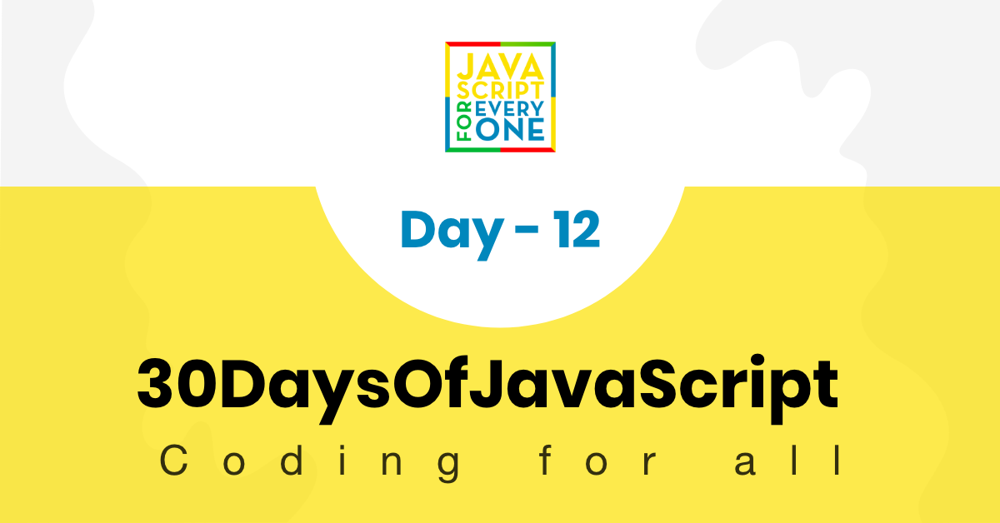
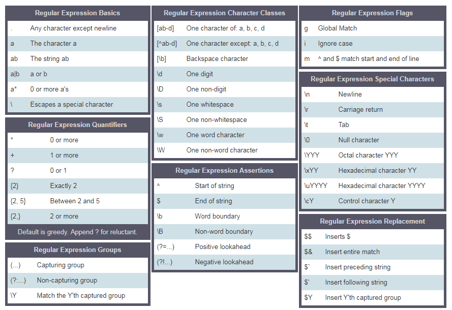

<div align="center">
  <h1> 30 天 JavaScript：正则表达式</h1>
  <a class="header-badge" target="_blank" href="https://www.linkedin.com/in/asabeneh/">
  
  </a>
  <a class="header-badge" target="_blank" href="https://twitter.com/Asabeneh">
  
  </a>

  <sub>作者：
  <a href="https://www.linkedin.com/in/asabeneh/" target="_blank">Asabeneh Yetayeh</a><br>
  <small> 2020 年 1 月</small>
  </sub>
</div>

[<< Day 11](../11_Day_Destructuring_and_spreading/11_day_destructuring_and_spreading.md) | [Day 13 >>](../13_Day_Console_object_methods/13_day_console_object_methods.md)



- [📘 第 12 天](#-day-12)
	- [正则表达式](#regular-expressions)
		- [正则表达式参数](#regexp-parameters)
			- [图案](#pattern)
			- [旗帜](#flags)
		- [使用正则表达式构造函数创建模式](#creating-a-pattern-with-regexp-constructor)
		- [不使用 RegExp 构造函数创建模式](#creating-a-pattern-without-regexp-constructor)
		- [RegExp 对象方法](#regexpp-object-methods)
			- [测试匹配](#testing-for--a-match)
			- [包含所有匹配项的数组](#array-containing-all-of-the-match)
			- [替换子字符串](#replacing-a-substring)
		- [方括号](#square-bracket)
		- [正则表达式中的转义字符(\\)](#escape-character-in-regexp)
		- [一次或多次(+)](#one-or-more-times)
		- [句号(.)](#period)
		- [零次或多次(*)](#zero-or-more-times)
		- [零次或一次(?)](#zero-or-one-times)
		- [正则表达式中的量词](#quantifier-in-regexp)
		- [插入符 ^](#cart-)
		- [完全匹配](#exact-match)
	- [💻练习](#-exercises)
		- [练习：1 级](#exercises-level-1)
		- [练习：2 级](#exercises-level-2)
		- [练习：3 级](#exercises-level-3)

<a id="-day-12"></a>
# 📘 第 12 天

<a id="regular-expressions"></a>
## 正则表达式

正则表达式或 RegExp 是一种小型编程语言，有助于查找数据中的模式。正则表达式可用于检查不同数据类型中是否存在某种模式。要在 JavaScript 中使用 RegExp，我们可以使用 RegExp 构造函数，也可以使用两个正斜杠后跟一个标志来声明 RegExp 模式。我们可以通过两种方式创建模式。

要声明字符串，我们使用单引号、双引号、反引号来声明正则表达式，我们使用两个正斜杠和一个可选标志。标志可以是 g、i、m、s、u 或 y。

<a id="regexp-parameters"></a>
### 正则表达式参数

正则表达式有两个参数。一个必需的搜索模式和一个可选的标志。

<a id="pattern"></a>
#### 模式

模式可以是文本或具有某种相似性的任何形式的模式。例如，电子邮件中的垃圾邮件一词可能是我们有兴趣在电子邮件中寻找的模式，或者电话号码格式号码可能是我们有兴趣寻找的模式。

<a id="flags"></a>
#### 标志

标志是正则表达式中的可选参数，用于确定搜索类型。让我们看看一些标志：

- g：全局标志，意味着在整个文本中寻找模式
- i：不区分大小写的标志（它搜索小写和大写）
-m：多行

<a id="creating-a-pattern-with-regexp-constructor"></a>
### 使用 RegExp 构造函数创建模式

声明不带全局标志和不区分大小写标志的正则表达式。

```js
// without flag
let pattern = 'love'
let regEx = new RegExp(pattern)
```

使用全局标志和不区分大小写标志声明正则表达式。

```js
let pattern = 'love'
let flag = 'gi'
let regEx = new RegExp(pattern, flag)
```

使用 RegExp 对象声明正则表达式模式。在 RegExp 构造函数中写入模式和标志

```js
let regEx = new RegExp('love','gi')
```

<a id="creating-a-pattern-without-regexp-constructor"></a>
### 不使用 RegExp 构造函数创建模式

使用全局标志和不区分大小写标志声明正则表达式。

```js
let regEx= /love/gi
```

上面的正则表达式与我们使用 RegExp 构造函数创建的正则表达式相同

```js
let regEx= new RegExp('love','gi')
```

<a id="regexpp-object-methods"></a>
### RegExp 对象方法

让我们看看一些 RegExp 方法

<a id="testing-for--a-match"></a>
#### 测试匹配

*test()*：测试字符串中的匹配。它返回 true 或 false。

```js
const str = 'I love JavaScript'
const pattern = /love/
const result = pattern.test(str)
console.log(result)
```

```sh
true
```

<a id="array-containing-all-of-the-match"></a>
#### 包含所有匹配项的数组

*match()*：返回包含所有匹配项（包括捕获组）的数组，如果未找到匹配项，则返回 null。
如果我们不使用全局标志，match() 将返回一个包含模式、索引、输入和组的数组。

```js
const str = 'I love JavaScript'
const pattern = /love/
const result = str.match(pattern)
console.log(result)
```

```sh
["love", index: 2, input: "I love JavaScript", groups: undefined]
```

```js
const str = 'I love JavaScript'
const pattern = /love/g
const result = str.match(pattern)
console.log(result)
```

```sh
["love"]
```

*search()*：测试字符串中的匹配项。它返回匹配的索引，如果搜索失败，则返回 -1。

```js
const str = 'I love JavaScript'
const pattern = /love/g
const result = str.search(pattern)
console.log(result)
```

```sh
2
```

<a id="replacing-a-substring"></a>
#### 替换子字符串

*replace()*：在字符串中搜索匹配项，并用替换子字符串替换匹配的子字符串。

```js
const txt = 'Python is the most beautiful language that a human begin has ever created.\
I recommend python for a first programming language'

matchReplaced = txt.replace(/Python|python/, 'JavaScript')
console.log(matchReplaced)
```

```sh
JavaScript is the most beautiful language that a human begin has ever created.I recommend python for a first programming language
```

```js
const txt = 'Python is the most beautiful language that a human begin has ever created.\
I recommend python for a first programming language'

matchReplaced = txt.replace(/Python|python/g, 'JavaScript')
console.log(matchReplaced)
```

```sh
JavaScript is the most beautiful language that a human begin has ever created.I recommend JavaScript for a first programming language
```

```js
const txt = 'Python is the most beautiful language that a human begin has ever created.\
I recommend python for a first programming language'

matchReplaced = txt.replace(/Python/gi, 'JavaScript')
console.log(matchReplaced)
```

```sh
JavaScript is the most beautiful language that a human begin has ever created.I recommend JavaScript for a first programming language
```

```js

const txt = '%I a%m te%%a%%che%r% a%n%d %% I l%o%ve te%ach%ing.\
T%he%re i%s n%o%th%ing as m%ore r%ewarding a%s e%duc%at%i%ng a%n%d e%m%p%ow%er%ing \
p%e%o%ple.\
I fo%und te%a%ching m%ore i%n%t%er%%es%ting t%h%an any other %jobs.\
D%o%es thi%s m%ot%iv%a%te %y%o%u to b%e a t%e%a%cher.'

matches = txt.replace(/%/g, '')
console.log(matches)  
```

```sh
I am teacher and  I love teaching.There is nothing as more rewarding as educating and empowering people.I found teaching more interesting than any other jobs.Does this motivate you to be a teacher.
```

* []: 一组字符
  * [a-c] 表示a或b或c
  * [a-z] 表示任意字母 a 到 z
  * [A-Z] 表示任意字符 A 到 Z
  * [0-3] 表示 0 或 1 或 2 或 3
  * [0-9]表示0到9的任意数字
  * [A-Za-z0-9] a 到 z、A 到 Z、0 到 9 中的任意字符
* \\：用于转义特殊字符
  * \d 意思是：匹配字符串中包含数字的地方（0-9 的数字）
  * \D 意思是：匹配字符串不包含数字的地方
*。 : 除换行符(\n) 之外的任何字符
* ^: 开头为
  * `r'^substring'`，例如 `r'^love'`，表示以 `love` 一词开头的句子
  * r'[^abc] 表示不是a，不是b，不是c。
* $: 结尾为
  * r'substring$' 例如 r'love$'，句子以单词 love 结尾
**：零次或多次
  * r'[a]*' 表示可选或可以出现多次。
* +: 一次或多次
  * r'[a]+'表示至少一次或多次
* ?: 零次或一次
  * r'[a]?'表示零次或一次
* \b：单词边界，匹配单词的开头或结尾
* {3}：正好 3 个字符
* {3,}：至少3个字符
* {3,8}：3 至 8 个字符
* |: 要么
  * r'apple|banana' 表示苹果或香蕉
* (): 捕获并分组



让我们用例子来阐明上面的元字符

<a id="square-bracket"></a>
### 方括号

让我们使用方括号来包含小写和大写

```js
const pattern = '[Aa]pple' // this square bracket means either A or a
const txt = 'Apple and banana are fruits. An old cliche says an apple a day keeps the  doctor way has been replaced by a banana a day keeps the doctor far far away. '
const matches = txt.match(pattern)

console.log(matches)  
```

```sh
["Apple", index: 0, input: "Apple and banana are fruits. An old cliche says an apple a day keeps the  doctor way has been replaced by a banana a day keeps the doctor far far away.", groups: undefined]

```

```js
const pattern = /[Aa]pple/g // this square bracket means either A or a
const txt = 'Apple and banana are fruits. An old cliche says an apple a day a doctor way has been replaced by a banana a day keeps the doctor far far away. '
const matches = txt.match(pattern)

console.log(matches)  
```

```sh
["Apple", "apple"]
```

如果我们想寻找香蕉，我们可以编写如下模式：

```js
const pattern = /[Aa]pple|[Bb]anana/g // this square bracket mean either A or a
const txt = 'Apple and banana are fruits. An old cliche says an apple a day a doctor way has been replaced by a banana a day keeps the doctor far far away. Banana is easy to eat too.'
const matches = txt.match(pattern)

console.log(matches)  
```

```sh
["Apple", "banana", "apple", "banana", "Banana"]
```

使用方括号和或运算符，我们设法提取 Apple、apple、Banana 和蕉。

<a id="escape-character-in-regexp"></a>
### 正则表达式中的转义字符(\\)

```js
const pattern = /\d/g  // d 是一个特殊字符，表示数字
const txt = '这个正则表达式示例创建于 2020 年 1 月 12 日。'
const matches = txt. match(pattern)

console.log(matches)  // ["2", "0", "2", "0", "1", "1", "2"]，这不是我们想要的结果
```

```js
const pattern = /\d+/g  // d 是一个特殊字符，表示数字
const txt = '这个正则表达式示例创建于 2020 年 1 月 12 日。'
const matches = txt. match(pattern)

console.log(matches)  // ["2020", "1", "12"]，这不是我们想要的结果
```

<a id="one-or-more-times"></a>
### 一次或多次(+)

```js
const pattern = /\d+/g  // d 是一个特殊字符，表示数字
const txt = '这个正则表达式示例创建于 2020 年 1 月 12 日。'
const matches = txt. match(pattern)
console.log(matches)  // ["2020", "1", "12"]，这不是我们想要的结果
```

<a id="period"></a>
### 句点（.）

```js
const pattern = /[a]./g  // this square bracket means a and . means any character except new line
const txt = 'Apple and banana are fruits'
const matches = txt.match(pattern)

console.log(matches)  // ["an", "an", "an", "a ", "ar"]
```

```js
const pattern = /[a].+/g  // . any character, + any character one or more times 
const txt = 'Apple and banana are fruits'
const matches = txt.match(pattern)

console.log(matches)  // ['and banana are fruits']
```

<a id="zero-or-more-times"></a>
### 零次或多次(*)

零次或多次。该模式可能不会出现，也可能出现多次。

```js

const pattern = /[a].*/g  //. any character, + any character one or more times 
const txt = 'Apple and banana are fruits'
const matches = txt.match(pattern)

console.log(matches)  // ['and banana are fruits']

```

<a id="zero-or-one-times"></a>
### 零次或一次（？）

零次或一次。该模式可能不会出现，也可能出现一次。

```js
const txt = 'I am not sure if there is a convention how to write the word e-mail.\
Some people write it email others may write it as Email or E-mail.'
const pattern = /[Ee]-?mail/g  // ? means optional
matches = txt.match(pattern)

console.log(matches)  // ["e-mail", "email", "Email", "E-mail"]

```

<a id="quantifier-in-regexp"></a>
### RegExp 中的量词

我们可以使用大括号指定在文本中查找的子字符串的长度。让我们看看如何使用 RegExp 量词。想象一下，我们对长度为 4 个字符的子字符串感兴趣

```js
const txt = 'This regular expression example was made in December 6,  2019.'
const pattern = /\\b\w{4}\b/g  //  exactly four character words
const matches = txt.match(pattern)
console.log(matches)  //['This', 'made', '2019']
```

```js
const txt = 'This regular expression example was made in December 6,  2019.'
const pattern = /\b[a-zA-Z]{4}\b/g  //  exactly four character  words without numbers
const matches = txt.match(pattern)
console.log(matches)  //['This', 'made']
```

```js
const txt = 'This regular expression example was made in December 6,  2019.'
const pattern = /\d{4}/g  // a number and exactly four digits
const matches = txt.match(pattern)
console.log(matches)  // ['2019']
```

```js
const txt = 'This regular expression example was made in December 6,  2019.'
const pattern = /\d{1,4}/g   // 1 to 4
const matches = txt.match(pattern)
console.log(matches)  // ['6', '2019']
```

<a id="cart-"></a>
### 插入符 ^

- 开始于
  
```js
const txt = 'This regular expression example was made in December 6,  2019.'
const pattern = /^This/ // ^ means starts with
const matches = txt.match(pattern)
console.log(matches)  // ['This']
```

- 否定

```js
const txt = 'This regular expression example was made in December 6,  2019.'
const pattern = /[^A-Za-z,. ]+/g  // ^ in set character means negation, not A to Z, not a to z, no space, no comma no period
const matches = txt.match(pattern)
console.log(matches)  // ["6", "2019"]
```

<a id="exact-match"></a>
### 完全匹配

它应该以 ^ 开头，以 $ 结尾。

```js
let pattern = /^[A-Z][a-z]{3,12}$/;
let name = 'Asabeneh';
let result = pattern.test(name)

console.log(result) // true
```

🌕 你已经走得很远了。继续前进！现在，你已经掌握了正则表达式的强大功能，有能力提取和清理各种文本，并从非结构化数据中获得有意义的信息。你刚刚完成了第 12 天的挑战，并且在通往卓越之路上领先 12 步。现在为你的大脑和肌肉做一些练习。

<a id="-exercises"></a>
## 💻 练习

<a id="exercises-level-1"></a>
### 练习：1 级

1. 根据下列文本计算这个人的年总收入：“他每月工资为 4000 欧元，年度奖金为 10000 欧元，每月在线课程收入为 5500 欧元。”
2. 某些粒子在水平 x 轴上的位置分别为 -12、-4、-3、-1、0、4 和 8。提取这些数字，并找出两个最远粒子之间的距离。

```js
points = ['-1', '2', '-4', '-3', '-1', '0', '4', '8']
sortedPoints =  [-4, -3, -1, -1, 0, 2, 4, 8]
distance = 12
```

3. 编写一个正则模式，用来判断字符串是否是有效的 JavaScript 变量名。

    ```sh
    is_valid_variable('first_name') # True
    is_valid_variable('first-name') # False
    is_valid_variable('1first_name') # False
    is_valid_variable('firstname') # True
    ```

<a id="exercises-level-2"></a>
### 练习：2 级

1. 编写一个名为 `tenMostFrequentWords` 的函数，从字符串中找出出现频率最高的十个单词。

    ```js
        paragraph = `I love teaching. If you do not love teaching what else can you love. I love Python if you do not love something which can give you all the capabilities to develop an application what else can you love.`
        console.log(tenMostFrequentWords(paragraph))
    ```

    ```sh
        [
        {word:'love', count:6},
        {word:'you', count:5},
        {word:'can', count:3},
        {word:'what', count:2},
        {word:'teaching', count:2},
        {word:'not', count:2},
        {word:'else', count:2},
        {word:'do', count:2},
        {word:'I', count:2},
        {word:'which', count:1},
        {word:'to', count:1},
        {word:'the', count:1},
        {word:'something', count:1},
        {word:'if', count:1},
        {word:'give', count:1},
        {word:'develop',count:1},
        {word:'capabilities',count:1},
        {word:'application', count:1},
        {word:'an',count:1},
        {word:'all',count:1},
        {word:'Python',count:1},
        {word:'If',count:1}]
    ```

    ```js
    console.log(tenMostFrequentWords(paragraph, 10))
    ```

    ```sh
   [{word:'love', count:6},
    {word:'you', count:5},
    {word:'can', count:3},
    {word:'what', count:2},
    {word:'teaching', count:2},
    {word:'not', count:2},
    {word:'else', count:2},
    {word:'do', count:2},
    {word:'I', count:2},
    {word:'which', count:1}
    ]
    ```

<a id="exercises-level-3"></a>
### 练习：3 级

1. 编写一个清理文本的函数，用来清理下面的文本。清理后，计算字符串中出现频率最高的三个单词。
  
  ```js
    sentence = `%I $am@% a %tea@cher%, &and& I lo%#ve %tea@ching%;. There $is nothing; &as& mo@re rewarding as educa@ting &and& @emp%o@wering peo@ple. ;I found tea@ching m%o@re interesting tha@n any other %jo@bs. %Do@es thi%s mo@tivate yo@u to be a tea@cher!?`
    console.log(cleanText(sentence))
   ```

   ```sh
    I am a teacher and I love teaching There is nothing as more rewarding as educating and empowering people I found teaching more interesting than any other jobs Does this motivate you to be a teacher
    ```
2. 编写一个函数来查找最常见的单词。文本清理后，返回出现频率最高的三个单词。

  ```js
    console.log(mostFrequentWords(cleanedText))
    [{word:'I', count:3}, {word:'teaching', count:2}, {word:'teacher', count:2}]
  ```

🎉 恭喜！ 🎉

[<< Day 11](../11_Day_Destructuring_and_spreading/11_day_destructuring_and_spreading.md) | [Day 13 >>](../13_Day_Console_object_methods/13_day_console_object_methods.md)
