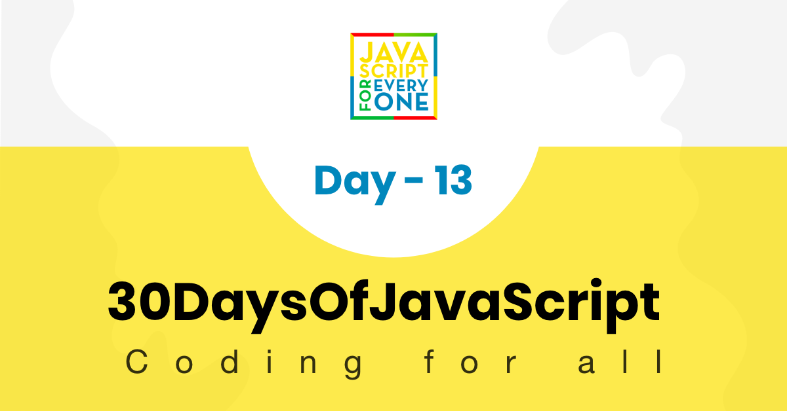

<div align="center">
  <h1> 30 天 JavaScript：Console 对象方法</h1>
  <a class="header-badge" target="_blank" href="https://www.linkedin.com/in/asabeneh/">
  
  </a>
  <a class="header-badge" target="_blank" href="https://twitter.com/Asabeneh">
  
  </a>

<sub>作者：
<a href="https://www.linkedin.com/in/asabeneh/" target="_blank">Asabeneh Yetayeh</a><br>
<small> 2020 年 1 月</small>
</sub>

</div>

[<< Day 12](../12_Day_Regular_expressions/12_day_regular_expressions.md) | [Day 14 >>](../14_Day_Error_handling/14_day_error_handling.md)



- [第 13 天](#day-13)
	- [Console 对象方法](#console-object-methods)
		- [console.log()](#consolelog)
		- [console.warn()](#consolewarn)
		- [console.error()](#consoleerror)
		- [console.table()](#consoletable)
		- [console.time()](#consoletime)
		- [console.info()](#consoleinfo)
		- [console.assert()](#consoleassert)
		- [console.group()](#consolegroup)
		- [console.count()](#consolecount)
		- [console.clear()](#consoleclear)
	- [练习](#exercises)
		- [练习：1 级](#exerciseslevel-1)
		- [练习：2 级](#exerciseslevel-2)
		- [练习：3 级](#exerciseslevel-3)

<a id="day-13"></a>
# 第 13 天

<a id="console-object-methods"></a>
## Console 对象方法

本节将介绍 Console 以及常用的 Console 对象方法。初学者常常分不清什么时候使用 `console.log()`、`document.write()` 或 `document.getElementById()`。

我们使用 Console 对象方法在浏览器控制台显示输出，使用 `document.write()` 在浏览器文档视图中显示输出。这些方法主要用于测试和调试。Console 是浏览器中最常用的调试工具之一。与 DOM 交互时，可以使用 `document.getElementById()` 等 DOM API。DOM 会在后续章节中介绍。

除了常见的 `console.log()`，Console 还提供了很多其他方法。

<a id="consolelog"></a>
### console.log()

我们使用 `console.log()` 在浏览器控制台显示输出。也可以使用占位符替换值，或使用 `%c` 设置日志输出的样式。

- 在浏览器控制台显示输出

```js
console.log('30 Days of JavaScript')
```

```sh
30 Days of JavaScript
```

- 替换

```js
console.log('%d %s of JavaScript', 30, 'Days')
```

```sh
30 Days of JavaScript
```

- CSS

可以使用 CSS 设置日志消息的样式。复制下面的代码并粘贴到浏览器控制台查看效果。

```js
console.log('%c30 Days Of JavaScript', 'color:green') // log output is green
console.log(
  '%c30 Days%c %cOf%c %cJavaScript%c',
  'color:green',
  '',
  'color:red',
  '',
  'color:yellow'
) // log output green red and yellow text
```

<a id="consolewarn"></a>
### Console.warn()

我们使用 `console.warn()` 在浏览器控制台输出警告。例如，可以用它提示某个包版本已弃用，或提醒某种写法不是好实践。复制下面的代码并粘贴到浏览器控制台查看警告信息。

```js
console.warn('这是一条警告')
console.warn(
  '你正在使用 React。不要直接操作 DOM。虚拟 DOM 会负责处理 DOM！'
)
console.warn('警告不同于错误')
```

<a id="consoleerror"></a>
### Console.error()

console.error() 方法显示错误消息。

```js
console.error('这是一条错误消息')
console.error('我们都会犯错')
```

<a id="consoletable"></a>
### Console.table()

`console.table()` 方法会在控制台中以表格形式显示数据。它接收一个必需参数 `data`（必须是数组或对象），还可以接收一个可选的列参数。

让我们首先从一个简单的数组开始。下面的代码显示一个包含两列的表格。用于显示索引的索引列和用于显示名称的值列

```js
const names = ['Asabeneh', 'Brook', 'David', 'John']
console.table(names)
```

让我们还检查一个对象的结果。这将创建具有两列的表：包含键的索引列和包含对象值的值列。

```js
const user = {
  name: 'Asabeneh',
  title: 'Programmer',
  country: 'Finland',
  city: 'Helsinki',
  age: 250
}
console.table(user)
```

可以把其余示例复制到浏览器控制台中查看结果。

```js
const countries = [
  ['Finland', 'Helsinki'],
  ['Sweden', 'Stockholm'],
  ['Norway', 'Oslo']
]
console.table(countries)
```

```js
const users = [
  {
    name: 'Asabeneh',
    title: 'Programmer',
    country: 'Finland',
    city: 'Helsinki',
    age: 250
  },
  {
    name: 'Eyob',
    title: 'Teacher',
    country: 'Sweden',
    city: 'London',
    age: 25
  },
  {
    name: 'Asab',
    title: 'Instructor',
    country: 'Norway',
    city: 'Oslo',
    age: 22
  },
  {
    name: 'Matias',
    title: 'Developer',
    country: 'Denmark',
    city: 'Copenhagen',
    age: 28
  }
]
console.table(users)
```

<a id="consoletime"></a>
### Console.time()

启动一个计时器，你可以用它来跟踪某个操作需要多长时间。你需要为每个计时器指定一个唯一名称，并且在给定页面上最多可以运行 10,000 个计时器。当你使用相同名称调用 console.timeEnd() 时，浏览器将输出自计时器启动以来经过的时间（以毫秒为单位）。

```js
const countries = [
  ['Finland', 'Helsinki'],
  ['Sweden', 'Stockholm'],
  ['Norway', 'Oslo']
]

console.time('Regular for loop')
for (let i = 0; i < countries.length; i++) {
  console.log(countries[i][0], countries[i][1])
}
console.timeEnd('Regular for loop')

console.time('for of loop')
for (const [name, city] of countries) {
  console.log(name, city)
}
console.timeEnd('for of loop')

console.time('forEach loop')
countries.forEach(([name, city]) => {
  console.log(name, city)
})
console.timeEnd('forEach loop')
```

```sh
Finland Helsinki
Sweden Stockholm
Norway Oslo
Regular for loop: 0.34716796875ms
Finland Helsinki
Sweden Stockholm
Norway Oslo
for of loop: 0.26806640625ms
Finland Helsinki
Sweden Stockholm
Norway Oslo
forEach loop: 0.358154296875ms
```

根据上面的输出，常规 for 循环比 for of 或 forEach 循环慢。

<a id="consoleinfo"></a>
### Console.info()

它会在浏览器控制台显示信息消息。

```js
console.info('30 Days Of JavaScript challenge is trending on Github')
console.info('30 Days Of fullStack challenge might be released')
console.info('30 Days Of HTML and CSS challenge might be released')
```

<a id="consoleassert"></a>
### Console.assert()

如果断言结果为 `false`，`console.assert()` 方法会向控制台写入错误消息。如果断言结果为 `true`，则不会发生任何事情。第一个参数是断言表达式，当它为 `false` 时会显示断言失败信息。

```js
console.assert(4 > 3, '4 is greater than 3') // no result
console.assert(3 > 4, '3 is not greater than 4') // Assertion failed: 3 is not greater than 4

for (let i = 0; i <= 10; i += 1) {
  let errorMessage = `${i} is not even`
  console.log('the # is ' + i)
  console.assert(i % 2 === 0, { number: i, errorMessage: errorMessage })
}
```

<a id="consolegroup"></a>
### Console.group()

`console.group()` 可以帮助我们对不同日志进行分组。复制下面的代码并粘贴到浏览器控制台中查看效果。

```js
const names = ['Asabeneh', 'Brook', 'David', 'John']
const countries = [
  ['Finland', 'Helsinki'],
  ['Sweden', 'Stockholm'],
  ['Norway', 'Oslo']
]
const user = {
  name: 'Asabeneh',
  title: 'Programmer',
  country: 'Finland',
  city: 'Helsinki',
  age: 250
}
const users = [
  {
    name: 'Asabeneh',
    title: 'Programmer',
    country: 'Finland',
    city: 'Helsinki',
    age: 250
  },
  {
    name: 'Eyob',
    title: 'Teacher',
    country: 'Sweden',
    city: 'London',
    age: 25
  },
  {
    name: 'Asab',
    title: 'Instructor',
    country: 'Norway',
    city: 'Oslo',
    age: 22
  },
  {
    name: 'Matias',
    title: 'Developer',
    country: 'Denmark',
    city: 'Copenhagen',
    age: 28
  }
]

console.group('Names')
console.log(names)
console.groupEnd()

console.group('Countries')
console.log(countries)
console.groupEnd()

console.group('Users')
console.log(user)
console.log(users)
console.groupEnd()
```

<a id="consolecount"></a>
### Console.count()

它打印调用 console.count() 的次数。它需要一个字符串标签参数。计算函数被调用的次数非常有帮助。在下面的示例中，console.count()方法将运行三次

```js
const func = () => {
  console.count('Function has been called')
}
func()
func()
func()
```

```sh
Function has been called: 1
Function has been called: 2
Function has been called: 3
```

<a id="consoleclear"></a>
### Console.clear()

`console.clear()` 用于清空浏览器控制台。

🌕 继续努力。只要继续前进，就没有固定的上限！你刚刚完成了第 13 天的挑战，并且在通往伟大之路上领先了 13 步。现在为你的大脑和肌肉做一些练习。

<a id="exercises"></a>
## 练习

<a id="exerciseslevel-1"></a>
### 练习：1 级

1. 将 `countries` 数组显示为表格。
2. 将国家对象显示为表格。
3. 使用 `console.group()` 对日志进行分组。

<a id="exerciseslevel-2"></a>
### 练习：2 级

1. 使用 `console.assert()` 检查表达式 `10 > 2 * 10`。
2. 使用 `console.warn()` 输出一条警告消息。
3. 使用 `console.error()` 输出一条错误消息。

<a id="exerciseslevel-3"></a>
### 练习：3 级

1. 检查以下循环之间的速度差异：while、for、for of、forEach

🎉 恭喜！ 🎉

[<< Day 12](../12_Day_Regular_expressions/12_day_regular_expressions.md) | [Day 14 >>](../14_Day_Error_handling/14_day_error_handling.md)
