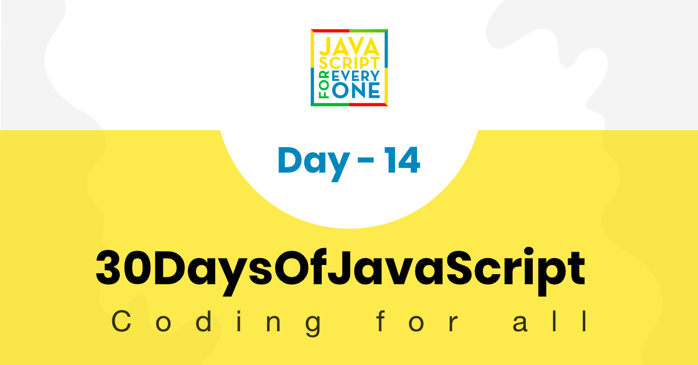

<div align="center">
  <h1> 30 天 JavaScript：错误处理</h1>
  <a class="header-badge" target="_blank" href="https://www.linkedin.com/in/asabeneh/">
  
  </a>
  <a class="header-badge" target="_blank" href="https://twitter.com/Asabeneh">
  
  </a>

<sub>作者：
<a href="https://www.linkedin.com/in/asabeneh/" target="_blank">Asabeneh Yetayeh</a><br>
<small> 2020 年 1 月</small>
</sub>

</div>

[<< Day 13](../13_Day_Console_object_methods/13_day_console_object_methods.md) | [Day 15 >>](../15_Day_Classes/15_day_classes.md)



- [第 14 天](#day-14)
	- [错误处理](#error-handling)
		- [错误类型](#error-types)
	- [练习](#exercises)
		- [练习：1 级](#exerciseslevel-1)
		- [练习：2 级](#exercises-level-2)
		- [练习：3 级](#exerciseslevel)

<a id="day-14"></a>
# 第 14 天

<a id="error-handling"></a>
## 错误处理

JavaScript 是一种弱类型语言。有时，当你尝试访问未定义的变量或调用未定义的函数时，会遇到运行时错误。

JavaScript 类似于 python 或 Java，提供了一种错误处理机制，可以使用 try-catch-finally 块捕获运行时错误。

```js
try {
  // code that may throw an error
} catch (err) {
  // code to be executed if an error occurs
} finally {
  // code to be executed regardless of an error occurs or not
}
```

**try**：将可能引发错误的代码包装在 try 块中。try 语句允许我们定义一个代码块，以便在执行时测试错误。

**catch**：在 catch 块中编写代码，用于在发生错误时执行某些操作。catch 块可以包含一个提供错误信息的参数。catch 块通常用于记录错误或向用户显示特定消息。

**finally**：无论是否发生错误，finally 块都会被执行。finally 块可用于完成剩余任务，或重置在 try 块中可能已被更改的变量。

**例子：**

```js
try {
  let lastName = 'Yetayeh'
  let fullName = fistName + ' ' + lastName
} catch (err) {
  console.log(err)
}
```

```sh
ReferenceError: fistName is not defined
    at <anonymous>:4:20
```

```js
try {
  let lastName = 'Yetayeh'
  let fullName = fistName + ' ' + lastName
} catch (err) {
  console.error(err) // we can use console.log() or console.error()
} finally {
  console.log('In any case I will be executed')
}
```

```sh
ReferenceError: fistName is not defined
    at <anonymous>:4:20
In any case it  will be executed
```
catch 块带有一个参数。通常将 e、err 或 error 作为参数传递给 catch 块。该参数是一个对象，它具有名称和消息键。让我们使用名称和消息。
```js
try {
  let lastName = 'Yetayeh'
  let fullName = fistName + ' ' + lastName
} catch (err) {
  console.log('Name of the error', err.name)
  console.log('Error message', err.message)
} finally {
  console.log('In any case I will be executed')
}
```
```sh
Name of the error ReferenceError
Error message fistName is not defined
In any case I will be executed
```
throw： throw 语句允许我们创建自定义错误。我们可以通过字符串、数字、布尔值或对象。使用 throw 语句抛出异常。当抛出异常时，表达式指定异常的值。以下每一项都会引发异常：
```js
throw 'Error2' // 生成一个字符串值异常
throw 42 // 生成值为 42 的异常
throw true // 生成值为 true 的异常
throw new Error('Required') // 生成一个消息为 Required 的错误对象
```
```js
const throwErrorExampleFun = () => {
  let message
  let x = prompt('Enter a number: ')
  try {
    if (x == '') throw 'empty'
    if (isNaN(x)) throw 'not a number'
    x = Number(x)
    if (x < 5) throw 'too low'
    if (x > 10) throw 'too high'
  } catch (err) {
    console.log(err)
  }
}
throwErrorExampleFun()
```
<a id="error-types"></a>
### 错误类型
- ReferenceError：发生了非法引用。如果我们使用尚未声明的变量，则会引发 ReferenceError。
```js
let firstName = 'Asabeneh'
let fullName = firstName + ' ' + lastName
console.log(fullName)
```
```sh
Uncaught ReferenceError: lastName is not defined
    at <anonymous>:2:35
```
- SyntaxError：发生语法错误
```js
let square = 2 x 2
console.log(square)
console.log('Hello, world")
```
```sh
Uncaught SyntaxError: Unexpected identifier
```
- TypeError：发生类型错误
```js
let num = 10
console.log(num.toLowerCase())
```
```sh
Uncaught TypeError: num.toLowerCase is not a function
    at <anonymous>:2:17
```
这些是你编写代码时可能遇到的一些常见错误。了解错误可以帮助你明白自己犯了什么错，并帮助你快速调试代码。
🌕 你很棒。现在，你知道如何处理错误，并且可以编写更健壮的应用程序来处理意外的用户输入。你刚刚完成了第 14 天的挑战，并且在通往卓越的道路上领先 14 步。现在为你的大脑和肌肉做一些练习。
<a id="exercises"></a>
## 练习
<a id="exerciseslevel-1"></a>
### 练习：1 级
练习
<a id="exercises-level-2"></a>
### 练习：2 级
练习
<a id="exerciseslevel"></a>
### 练习：3 级
练习
🎉 恭喜！ 🎉
[<< Day 13](../13_Day_Console_object_methods/13_day_console_object_methods.md) | [Day 15 >>](../15_Day_Classes/15_day_classes.md)
