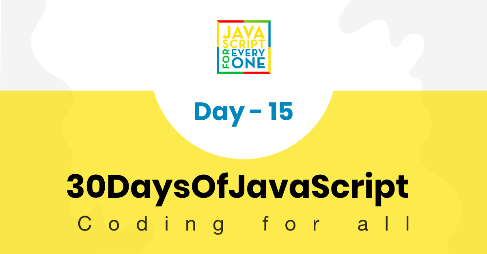

<div align="center">
  <h1> 30 天 JavaScript：类</h1>
  <a class="header-badge" target="_blank" href="https://www.linkedin.com/in/asabeneh/">
  
  </a>
  <a class="header-badge" target="_blank" href="https://twitter.com/Asabeneh">
  
  </a>

<sub>作者：
<a href="https://www.linkedin.com/in/asabeneh/" target="_blank">Asabeneh Yetayeh</a><br>
<small> 2020 年 1 月</small>
</sub>

</div>

[<< Day 14](../14_Day_Error_handling/14_day_error_handling.md) | [Day 16 >>](../16_Day_JSON/16_day_json.md)



- [第 15 天](#day-15)
	- [类](#classes)
		- [定义类](#defining-a-classes)
		- [类实例化](#class-instantiation)
		- [类构造函数](#class-constructor)
		- [带构造函数的默认值](#default-values-with-constructor)
		- [类方法](#class-methods)
		- [具有初始值的属性](#properties-with-initial-value)
		- [Getter](#getter)
		- [Setter](#setter)
		- [静态方法](#static-method)
	- [继承](#inheritance)
		- [重写方法](#overriding-methods)
	- [练习](#exercises)
		- [练习1级](#exercises-level-1)
		- [练习2级](#exercises-level-2)
		- [练习3级](#exercises-level-3)

<a id="day-15"></a>
# 第 15 天

<a id="classes"></a>
## 类

JavaScript 是一种面向对象的编程语言。JavaScript 中的很多内容都可以看作对象，对象拥有属性和方法。我们可以通过类来创建对象。类像是对象的构造模板，也可以理解为创建对象的“蓝图”。类定义对象的属性和行为，而对象是类的具体实例。

创建类之后，就可以随时基于它创建对象。从类创建对象的过程称为类实例化。

在对象章节中，我们学习了如何创建对象字面量。对象字面量通常只表示一个对象。如果想创建多个结构相似的对象，重复写对象字面量会很麻烦。类可以帮助我们批量创建结构一致的对象，从而减少重复代码。

<a id="defining-a-classes"></a>
### 定义一个类

要在 JavaScript 中定义类，我们需要关键字 _class_ 、 **CamelCase** 中的类名称和块代码（两个大括号）。让我们创建一个类名 Person。

```sh
// 语法
class ClassName {
    //  代码写在这里
}

```

**例子：**

```js
class Person {
  // 代码写在这里
}
```

我们创建了一个 Person 类，但它里面没有任何东西。

<a id="class-instantiation"></a>
### 类实例化

实例化类意味着从类创建对象。我们需要关键字 _new_，并且在 `new` 之后调用类名。

让我们从 `Person` 类创建一个 `person` 对象。

```js
class Person {
  // 代码写在这里
}
const person = new Person()
console.log(person)
```

```sh
Person {}
```

如你所见，我们创建了一个 `person` 对象。由于类里还没有定义任何属性，所以这个对象也是空的。

让我们使用类构造函数来传递类的不同属性。

<a id="class-constructor"></a>
### 类构造函数

构造函数是类中的一个特殊方法，用来初始化对象。构造函数使用 `constructor` 关键字定义，括号中可以接收创建对象时传入的参数。我们使用 `this` 关键字把这些参数保存为当前对象的属性。

下面的 `Person` 类构造函数接收 `firstName` 和 `lastName`。这些值会通过 `this` 绑定到当前实例上。这里的 `this` 指向当前创建出来的对象。

```js
class Person {
  constructor(firstName, lastName) {
    console.log(this) // 从这里查看输出
    this.firstName = firstName
    this.lastName = lastName
  }
}

const person = new Person()

console.log(person)
```

```sh
Person {firstName: undefined, lastName:undefined}
```

对象的所有键都是 undefined。实例化类时，我们应该传入属性值。接下来，让我们在实例化类时传值。

```js
class Person {
  constructor(firstName, lastName) {
    this.firstName = firstName
    this.lastName = lastName
  }
}

const person1 = new Person('Asabeneh', 'Yetayeh')

console.log(person1)
```

```sh
Person {firstName: "Asabeneh", lastName: "Yetayeh"}
```

正如我们一开始所说的，一旦创建了一个类，我们就可以使用该类创建许多对象。现在，让我们使用 Person 类创建许多人员对象。

```js
class Person {
  constructor(firstName, lastName) {
    console.log(this) // 从这里查看输出
    this.firstName = firstName
    this.lastName = lastName
  }
}

const person1 = new Person('Asabeneh', 'Yetayeh')
const person2 = new Person('Lidiya', 'Tekle')
const person3 = new Person('Abraham', 'Yetayeh')

console.log(person1)
console.log(person2)
console.log(person3)
```

```sh
Person {firstName: "Asabeneh", lastName: "Yetayeh"}
Person {firstName: "Lidiya", lastName: "Tekle"}
Person {firstName: "Abraham", lastName: "Yetayeh"}
```

使用 Person 类，我们创建了三个 person 对象。正如你所看到的，我们的类还没有太多属性，让我们向该类添加更多属性。

```js
class Person {
  constructor(firstName, lastName, age, country, city) {
    console.log(this) // 从这里查看输出
    this.firstName = firstName
    this.lastName = lastName
    this.age = age
    this.country = country
    this.city = city
  }
}

const person1 = new Person('Asabeneh', 'Yetayeh', 250, 'Finland', 'Helsinki')

console.log(person1)
```

```sh
Person {firstName: "Asabeneh", lastName: "Yetayeh", age: 250, country: "Finland", city: "Helsinki"}
```

<a id="default-values-with-constructor"></a>
### 构造函数的默认值

与其他常规函数一样，构造函数属性可能具有默认值。

```js
class Person {
  constructor(
    firstName = 'Asabeneh',
    lastName = 'Yetayeh',
    age = 250,
    country = 'Finland',
    city = 'Helsinki'
  ) {
    this.firstName = firstName
    this.lastName = lastName
    this.age = age
    this.country = country
    this.city = city
  }
}

const person1 = new Person() // it will take the default values
const person2 = new Person('Lidiya', 'Tekle', 28, 'Finland', 'Espoo')

console.log(person1)
console.log(person2)
```

```sh
Person {firstName: "Asabeneh", lastName: "Yetayeh", age: 250, country: "Finland", city: "Helsinki"}
Person {firstName: "Lidiya", lastName: "Tekle", age: 28, country: "Finland", city: "Espoo"}
```

<a id="class-methods"></a>
### 类方法

类中的构造函数是一个内置函数，它允许我们为对象创建蓝图。在类中我们可以创建类方法。方法是类内的 JavaScript 函数。让我们创建一些类方法。

```js
class Person {
  constructor(firstName, lastName, age, country, city) {
    this.firstName = firstName
    this.lastName = lastName
    this.age = age
    this.country = country
    this.city = city
  }
  getFullName() {
    const fullName = this.firstName + ' ' + this.lastName
    return fullName
  }
}

const person1 = new Person('Asabeneh', 'Yetayeh', 250, 'Finland', 'Helsinki')
const person2 = new Person('Lidiya', 'Tekle', 28, 'Finland', 'Espoo')

console.log(person1.getFullName())
console.log(person2.getFullName())
```

```sh
Asabeneh Yetayeh
test.js:19 Lidiya Tekle
```

<a id="properties-with-initial-value"></a>
### 具有初始值的属性

当我们为某些属性创建一个类时，可能会设置初始值。例如，如果你正在玩游戏，起始分数通常为零。换句话说，我们也可以有一个初始技能列表，并在一段时间后获得更多技能。

```js
class Person {
  constructor(firstName, lastName, age, country, city) {
    this.firstName = firstName
    this.lastName = lastName
    this.age = age
    this.country = country
    this.city = city
    this.score = 0
    this.skills = []
  }
  getFullName() {
    const fullName = this.firstName + ' ' + this.lastName
    return fullName
  }
}

const person1 = new Person('Asabeneh', 'Yetayeh', 250, 'Finland', 'Helsinki')
const person2 = new Person('Lidiya', 'Tekle', 28, 'Finland', 'Espoo')

console.log(person1.score)
console.log(person2.score)

console.log(person1.skills)
console.log(person2.skills)
```

```sh
0
0
[]
[]
```

方法可以是普通方法，也可以是 getter 或 setter。下面看看 getter 和 setter 的用法。

<a id="getter"></a>
### Getter

getter 方法用于读取对象中的值。定义 getter 时使用 `get` 关键字，后面跟一个方法名。调用 getter 时不需要写括号，看起来就像访问普通属性一样。

```js
class Person {
  constructor(firstName, lastName, age, country, city) {
    this.firstName = firstName
    this.lastName = lastName
    this.age = age
    this.country = country
    this.city = city
    this.score = 0
    this.skills = []
  }
  getFullName() {
    const fullName = this.firstName + ' ' + this.lastName
    return fullName
  }
  get getScore() {
    return this.score
  }
  get getSkills() {
    return this.skills
  }
}

const person1 = new Person('Asabeneh', 'Yetayeh', 250, 'Finland', 'Helsinki')
const person2 = new Person('Lidiya', 'Tekle', 28, 'Finland', 'Espoo')

console.log(person1.getScore) // We do not need parenthesis to call a getter method
console.log(person2.getScore)

console.log(person1.getSkills)
console.log(person2.getSkills)
```

```sh
0
0
[]
[]
```

<a id="setter"></a>
### Setter

setter 方法用于修改对象中的值。定义 setter 时使用 `set` 关键字，后面跟一个方法名。调用 setter 时同样像给属性赋值一样使用。

```js
class Person {
  constructor(firstName, lastName, age, country, city) {
    this.firstName = firstName
    this.lastName = lastName
    this.age = age
    this.country = country
    this.city = city
    this.score = 0
    this.skills = []
  }
  getFullName() {
    const fullName = this.firstName + ' ' + this.lastName
    return fullName
  }
  get getScore() {
    return this.score
  }
  get getSkills() {
    return this.skills
  }
  set setScore(score) {
    this.score += score
  }
  set setSkill(skill) {
    this.skills.push(skill)
  }
}

const person1 = new Person('Asabeneh', 'Yetayeh', 250, 'Finland', 'Helsinki')
const person2 = new Person('Lidiya', 'Tekle', 28, 'Finland', 'Espoo')

person1.setScore = 1
person1.setSkill = 'HTML'
person1.setSkill = 'CSS'
person1.setSkill = 'JavaScript'

person2.setScore = 1
person2.setSkill = 'Planning'
person2.setSkill = 'Managing'
person2.setSkill = 'Organizing'

console.log(person1.score)
console.log(person2.score)

console.log(person1.skills)
console.log(person2.skills)
```

```sh
1
1
["HTML", "CSS", "JavaScript"]
["Planning", "Managing", "Organizing"]
```

不要混淆普通方法和 getter。如果你知道如何定义普通方法，就已经很好了。让我们在 Person 类中添加一个名为 getPersonInfo 的普通方法。

```js
class Person {
  constructor(firstName, lastName, age, country, city) {
    this.firstName = firstName
    this.lastName = lastName
    this.age = age
    this.country = country
    this.city = city
    this.score = 0
    this.skills = []
  }
  getFullName() {
    const fullName = this.firstName + ' ' + this.lastName
    return fullName
  }
  get getScore() {
    return this.score
  }
  get getSkills() {
    return this.skills
  }
  set setScore(score) {
    this.score += score
  }
  set setSkill(skill) {
    this.skills.push(skill)
  }
  getPersonInfo() {
    let fullName = this.getFullName()
    let skills =
      this.skills.length > 0 &&
      this.skills.slice(0, this.skills.length - 1).join(', ') +
        ` and ${this.skills[this.skills.length - 1]}`
    let formattedSkills = skills ? `He knows ${skills}` : ''

    let info = `${fullName} is ${this.age}. He lives ${this.city}, ${this.country}. ${formattedSkills}`
    return info
  }
}

const person1 = new Person('Asabeneh', 'Yetayeh', 250, 'Finland', 'Helsinki')
const person2 = new Person('Lidiya', 'Tekle', 28, 'Finland', 'Espoo')
const person3 = new Person('John', 'Doe', 50, 'Mars', 'Mars city')

person1.setScore = 1
person1.setSkill = 'HTML'
person1.setSkill = 'CSS'
person1.setSkill = 'JavaScript'

person2.setScore = 1
person2.setSkill = 'Planning'
person2.setSkill = 'Managing'
person2.setSkill = 'Organizing'

console.log(person1.getScore)
console.log(person2.getScore)

console.log(person1.getSkills)
console.log(person2.getSkills)
console.log(person3.getSkills)

console.log(person1.getPersonInfo())
console.log(person2.getPersonInfo())
console.log(person3.getPersonInfo())
```

```sh
1
1
["HTML", "CSS", "JavaScript"]
["Planning", "Managing", "Organizing"]
[]
Asabeneh Yetayeh is 250. He lives Helsinki, Finland. He knows HTML, CSS and JavaScript
Lidiya Tekle is 28. He lives Espoo, Finland. He knows Planning, Managing and Organizing
John Doe is 50. He lives Mars city, Mars.
```

<a id="static-method"></a>
### 静态方法

static 关键字定义类的静态方法。不会在类的实例上调用静态方法。相反，它们是在类本身上调用的。这些通常是实用函数，例如创建或克隆对象的函数。静态方法的一个示例是 _Date.now()_。 _now_ 方法直接从类中调用。

```js
class Person {
  constructor(firstName, lastName, age, country, city) {
    this.firstName = firstName
    this.lastName = lastName
    this.age = age
    this.country = country
    this.city = city
    this.score = 0
    this.skills = []
  }
  getFullName() {
    const fullName = this.firstName + ' ' + this.lastName
    return fullName
  }
  get getScore() {
    return this.score
  }
  get getSkills() {
    return this.skills
  }
  set setScore(score) {
    this.score += score
  }
  set setSkill(skill) {
    this.skills.push(skill)
  }
  getPersonInfo() {
    let fullName = this.getFullName()
    let skills =
      this.skills.length > 0 &&
      this.skills.slice(0, this.skills.length - 1).join(', ') +
        ` and ${this.skills[this.skills.length - 1]}`

    let formattedSkills = skills ? `He knows ${skills}` : ''

    let info = `${fullName} is ${this.age}. He lives ${this.city}, ${this.country}. ${formattedSkills}`
    return info
  }
  static favoriteSkill() {
    const skills = ['HTML', 'CSS', 'JS', 'React', 'Python', 'Node']
    const index = Math.floor(Math.random() * skills.length)
    return skills[index]
  }
  static showDateTime() {
    let now = new Date()
    let year = now.getFullYear()
    let month = now.getMonth() + 1
    let date = now.getDate()
    let hours = now.getHours()
    let minutes = now.getMinutes()
    if (hours < 10) {
      hours = '0' + hours
    }
    if (minutes < 10) {
      minutes = '0' + minutes
    }

    let dateMonthYear = date + '.' + month + '.' + year
    let time = hours + ':' + minutes
    let fullTime = dateMonthYear + ' ' + time
    return fullTime
  }
}

console.log(Person.favoriteSkill())
console.log(Person.showDateTime())
```

```sh
Node
15.1.2020 23:56
```

静态方法是可以用作实用函数的方法。

<a id="inheritance"></a>
## 继承

使用继承，我们可以访问父类的所有属性和方法。这减少了代码重复。还记得的话，我们有一个 Person 父类，接下来将基于它创建子类。子类可以是学生、教师等。

```js
// 语法
class ChildClassName extends {
 // 代码写在这里
}
```

让我们从 Person 父类创建一个 Student 子类。

```js
class Student extends Person {
  saySomething() {
    console.log('I am a child of the person class')
  }
}

const s1 = new Student('Asabeneh', 'Yetayeh', 'Finland', 250, 'Helsinki')
console.log(s1)
console.log(s1.saySomething())
console.log(s1.getFullName())
console.log(s1.getPersonInfo())
```

```sh
Student {firstName: "Asabeneh", lastName: "Yetayeh", age: "Finland", country: 250, city: "Helsinki", …}
I am a child of the person class
Asabeneh Yetayeh
Student {firstName: "Asabeneh", lastName: "Yetayeh", age: "Finland", country: 250, city: "Helsinki", …}
Asabeneh Yetayeh is Finland. He lives Helsinki, 250.
```

<a id="overriding-methods"></a>
### 重写方法

正如你所看到的，我们成功访问了 Person 类中的所有方法，并在 Student 子类中使用它们。我们可以自定义父类方法，也可以向子类添加其他属性。如果想自定义方法并添加额外属性，也需要使用子类的构造函数。在构造函数内部，我们调用 super() 函数来访问父类的所有属性。Person 类没有性别属性，现在让我们为 Student 子类添加 gender 属性。如果子类中使用了相同的方法名，父类的方法将会被覆盖。

```js
class Student extends Person {
  constructor(firstName, lastName, age, country, city, gender) {
    super(firstName, lastName, age, country, city)
    this.gender = gender
  }

  saySomething() {
    console.log('I am a child of the person class')
  }
  getPersonInfo() {
    let fullName = this.getFullName()
    let skills =
      this.skills.length > 0 &&
      this.skills.slice(0, this.skills.length - 1).join(', ') +
        ` and ${this.skills[this.skills.length - 1]}`

    let formattedSkills = skills ? `He knows ${skills}` : ''
    let pronoun = this.gender == 'Male' ? 'He' : 'She'

    let info = `${fullName} is ${this.age}. ${pronoun} lives in ${this.city}, ${this.country}. ${formattedSkills}`
    return info
  }
}

const s1 = new Student(
  'Asabeneh',
  'Yetayeh',
  250,
  'Finland',
  'Helsinki',
  'Male'
)
const s2 = new Student('Lidiya', 'Tekle', 28, 'Finland', 'Helsinki', 'Female')
s1.setScore = 1
s1.setSkill = 'HTML'
s1.setSkill = 'CSS'
s1.setSkill = 'JavaScript'

s2.setScore = 1
s2.setSkill = 'Planning'
s2.setSkill = 'Managing'
s2.setSkill = 'Organizing'

console.log(s1)

console.log(s1.saySomething())
console.log(s1.getFullName())
console.log(s1.getPersonInfo())

console.log(s2.saySomething())
console.log(s2.getFullName())
console.log(s2.getPersonInfo())
```

```sh
Student {firstName: "Asabeneh", lastName: "Yetayeh", age: 250, country: "Finland", city: "Helsinki", …}
Student {firstName: "Lidiya", lastName: "Tekle", age: 28, country: "Finland", city: "Helsinki", …}
I am a child of the person class
Asabeneh Yetayeh
Student {firstName: "Asabeneh", lastName: "Yetayeh", age: 250, country: "Finland", city: "Helsinki", …}
Asabeneh Yetayeh is 250. He lives in Helsinki, Finland. He knows HTML, CSS and JavaScript
I am a child of the person class
Lidiya Tekle
Student {firstName: "Lidiya", lastName: "Tekle", age: 28, country: "Finland", city: "Helsinki", …}
Lidiya Tekle is 28. She lives in Helsinki, Finland. He knows Planning, Managing and Organizing
```

现在， getPersonInfo 方法已被重写，它可以识别该人是男性还是女性。

🌕 你做得很棒。现在你已经了解了类，并且可以用类来组织对象和行为。你已经完成了一半的挑战。接下来做一些练习巩固一下。

<a id="exercises"></a>
## 练习

<a id="exercises-level-1"></a>
### 练习 1 级

1. 创建一个 `Animal` 类。这个类应包含名称、年龄、颜色、腿数量等属性，并创建几个不同的方法。
2. 从 Animal 类创建 Dog 和 Cat 子类。

<a id="exercises-level-2"></a>
### 练习 2 级

1. 重写你在 `Animal` 类中创建的方法。

<a id="exercises-level-3"></a>
### 练习 3 级

1. 尝试开发一个程序，用来计算样本的集中趋势指标（均值、中位数、众数）和离散程度指标（极差、方差、标准差）。除此之外，还需要计算最小值、最大值、计数、百分位数和频率分布。你可以创建一个名为 `Statistics` 的类，并把所有统计计算函数都写成这个类的方法。参考下面的输出。

```JS
ages = [31, 26, 34, 37, 27, 26, 32, 32, 26, 27, 27, 24, 32, 33, 27, 25, 26, 38, 37, 31, 34, 24, 33, 29, 26]

console.log('Count:', statistics.count()) // 25
console.log('Sum: ', statistics.sum()) // 744
console.log('Min: ', statistics.min()) // 24
console.log('Max: ', statistics.max()) // 38
console.log('Range: ', statistics.range() // 14
console.log('Mean: ', statistics.mean()) // 30
console.log('Median: ',statistics.median()) // 29
console.log('Mode: ', statistics.mode()) // {'mode': 26, 'count': 5}
console.log('Variance: ',statistics.var()) // 17.5
console.log('Standard Deviation: ', statistics.std()) // 4.2
console.log('Variance: ',statistics.var()) // 17.5
console.log('Frequency Distribution: ',statistics.freqDist()) // [(20.0, 26), (16.0, 27), (12.0, 32), (8.0, 37), (8.0, 34), (8.0, 33), (8.0, 31), (8.0, 24), (4.0, 38), (4.0, 29), (4.0, 25)]
```

```sh
// your output should look like this
console.log(statistics.describe())
Count: 25
Sum:  744
Min:  24
Max:  38
Range:  14
Mean:  30
Median:  29
Mode:  (26, 5)
Variance:  17.5
Standard Deviation:  4.2
Frequency Distribution: [(20.0, 26), (16.0, 27), (12.0, 32), (8.0, 37), (8.0, 34), (8.0, 33), (8.0, 31), (8.0, 24), (4.0, 38), (4.0, 29), (4.0, 25)]
```

2. 创建一个名为 `PersonAccount` 的类。它应包含名字、姓氏、收入和支出属性，并提供 `totalIncome`、`totalExpense`、`accountInfo`、`addIncome`、`addExpense`、`accountBalance` 方法。收入是一组金额和描述，支出也是一组金额和描述。

🎉 恭喜！ 🎉

[<< Day 14](../14_Day_Error_handling/14_day_error_handling.md) | [Day 16 >>](../16_Day_JSON/16_day_json.md)
