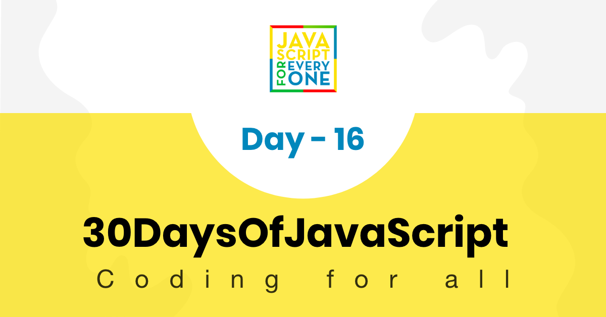

<div align="center">
  <h1> 30 天 JavaScript：JSON</h1>
  <a class="header-badge" target="_blank" href="https://www.linkedin.com/in/asabeneh/">
  
  </a>
  <a class="header-badge" target="_blank" href="https://twitter.com/Asabeneh">
  
  </a>

<sub>作者：
<a href="https://www.linkedin.com/in/asabeneh/" target="_blank">Asabeneh Yetayeh</a><br>
<small> 2020 年 1 月</small>
</sub>

</div>

[<< Day 15](../15_Day_Classes/15_day_classes.md) | [Day 17 >>](../17_Day_Web_storages/17_day_web_storages.md)



- [第 16 天](#day-16)
	- [JSON](#json)
		- [将 JSON 转换为 JavaScript 对象](#converting-json-to-javascript-object)
			- [JSON.parse()](#jsonparse)
		- [通过 JSON.parse() 使用 reviver 函数](#using-a-reviver-function-with-jsonparse)
		- [将对象转换为 JSON](#converting-object-to-json)
		- [通过 JSON.stringify 使用过滤器数组](#using-a-filter-array-with-jsonstringify)
	- [练习](#exercises)
		- [练习1级](#exercises-level-1)
		- [练习2级](#exercises-level-2)
		- [练习3级](#exercises-level-3)

<a id="day-16"></a>
# 第 16 天

<a id="json"></a>
## JSON

JSON 代表 JavaScript 对象表示法。 JSON 语法源自 JavaScript 对象表示法语法，但 JSON 格式仅为文本或字符串。 JSON 是一种用于存储和传输的轻量级数据格式。 JSON 主要在数据从服务器发送到客户端时使用。 JSON 是 XML 的更易于使用的替代方案。

**例子：**

```js
{
"users":[
  {
    "firstName":"Asabeneh",
    "lastName":"Yetayeh",
    "age":250,
    "email":"asab@asb.com"
  },
  {
    "firstName":"Alex",
    "lastName":"James",
    "age":25,
    "email":"alex@alex.com"
  },
  {
  "firstName":"Lidiya",
  "lastName":"Tekle",
  "age":28,
  "email":"lidiya@lidiya.com"
  }
]
}
```

上面的 JSON 示例与普通对象没有太大区别。那么，有什么区别呢？区别在于 JSON 对象的键应该带双引号或者应该是字符串。 JavaScript 对象和 JSON 非常相似，我们可以将 JSON 更改为 Object，将 Object 更改为 JSON。

让我们更详细地看看上面的例子，它以大括号开头。在大括号内，有一个 `"users"` 键，它的值是一个数组。数组内部有不同的对象，每个对象都有键，并且每个键都必须使用双引号。例如，在 JSON 中我们使用 `"firstName"`，而不是不带引号的 `firstName`；但在普通对象中，我们可以使用不带双引号的键。这是对象和 JSON 之间的主要区别。让我们看更多有关 JSON 的示例。

**例子：**

```js
{
    "Alex": {
        "email": "alex@alex.com",
        "skills": [
            "HTML",
            "CSS",
            "JavaScript"
        ],
        "age": 20,
        "isLoggedIn": false,
        "points": 30
    },
    "Asab": {
        "email": "asab@asab.com",
        "skills": [
            "HTML",
            "CSS",
            "JavaScript",
            "Redux",
            "MongoDB",
            "Express",
            "React",
            "Node"
        ],
        "age": 25,
        "isLoggedIn": false,
        "points": 50
    },
    "Brook": {
        "email": "daniel@daniel.com",
        "skills": [
            "HTML",
            "CSS",
            "JavaScript",
            "React",
            "Redux"
        ],
        "age": 30,
        "isLoggedIn": true,
        "points": 50
    },
    "Daniel": {
        "email": "daniel@alex.com",
        "skills": [
            "HTML",
            "CSS",
            "JavaScript",
            "Python"
        ],
        "age": 20,
        "isLoggedIn": false,
        "points": 40
    },
    "John": {
        "email": "john@john.com",
        "skills": [
            "HTML",
            "CSS",
            "JavaScript",
            "React",
            "Redux",
            "Node.js"
        ],
        "age": 20,
        "isLoggedIn": true,
        "points": 50
    },
    "Thomas": {
        "email": "thomas@thomas.com",
        "skills": [
            "HTML",
            "CSS",
            "JavaScript",
            "React"
        ],
        "age": 20,
        "isLoggedIn": false,
        "points": 40
    },
    "Paul": {
        "email": "paul@paul.com",
        "skills": [
            "HTML",
            "CSS",
            "JavaScript",
            "MongoDB",
            "Express",
            "React",
            "Node"
        ],
        "age": 20,
        "isLoggedIn": false,
        "points": 40
    }
}
```

<a id="converting-json-to-javascript-object"></a>
### 将 JSON 转换为 JavaScript 对象

大多数情况下，我们从 HTTP 响应或文件中获取 JSON 数据，但我们可以将 JSON 存储为字符串，并且为了演示，我们可以更改为对象。在 JavaScript 中，关键字 _JSON_ 具有 _parse()_ 和 _stringify()_ 方法。当我们想要将 JSON 更改为对象时，我们使用 _JSON.parse()_ 解析 JSON。当我们想要将对象更改为 JSON 时，我们使用 _JSON.stringify()_。

<a id="jsonparse"></a>
#### JSON.parse()

```js
JSON.parse(json[, reviver])
// json or text , the data
// reviver is an optional callback function
/* JSON.parse(json, (key, value) => {

})
*/
```

```js
const usersText = `{
"users":[
  {
    "firstName":"Asabeneh",
    "lastName":"Yetayeh",
    "age":250,
    "email":"asab@asb.com"
  },
  {
    "firstName":"Alex",
    "lastName":"James",
    "age":25,
    "email":"alex@alex.com"
  },
  {
  "firstName":"Lidiya",
  "lastName":"Tekle",
  "age":28,
  "email":"lidiya@lidiya.com"
  }
]
}`

const usersObj = JSON.parse(usersText, undefined, 4)
console.log(usersObj)
```

<a id="using-a-reviver-function-with-jsonparse"></a>
### 将 reviver 函数与 JSON.parse() 结合使用

要将 reviver 函数用作格式化程序，我们输入要格式化名字和姓氏值的键。假设我们有兴趣格式化 JSON 数据的 `firstName` 和 `lastName`。

```js
const usersText = `{
"users":[
  {
    "firstName":"Asabeneh",
    "lastName":"Yetayeh",
    "age":250,
    "email":"asab@asb.com"
  },
  {
    "firstName":"Alex",
    "lastName":"James",
    "age":25,
    "email":"alex@alex.com"
  },
  {
  "firstName":"Lidiya",
  "lastName":"Tekle",
  "age":28,
  "email":"lidiya@lidiya.com"
  }
]
}`

const usersObj = JSON.parse(usersText, (key, value) => {
  let newValue =
    typeof value == 'string' && key != 'email' ? value.toUpperCase() : value
  return newValue
})
console.log(usersObj)
```

_JSON.parse()_ 使用起来非常方便。你不必传递可选参数，只需传入必需参数，就可以得到解析后的结果。

<a id="converting-object-to-json"></a>
### 将对象转换为 JSON

当我们想要将对象更改为 JSON 时，我们使用 _JSON.stringify()_。 stringify 方法采用一个必需参数和两个可选参数。替换物用作过滤器，空间是凹痕。如果我们不想从对象中过滤掉任何键，我们可以传递 undefined。

```js
JSON.stringify(obj, replacer, space)
// json or text , the data
// reviver is an optional callback function
```

让我们将以下对象转换为字符串。首先让 use 保留所有键，并让我们有 4 个空格缩进。

```js
const users = {
  Alex: {
    email: 'alex@alex.com',
    skills: ['HTML', 'CSS', 'JavaScript'],
    age: 20,
    isLoggedIn: false,
    points: 30
  },
  Asab: {
    email: 'asab@asab.com',
    skills: [
      'HTML',
      'CSS',
      'JavaScript',
      'Redux',
      'MongoDB',
      'Express',
      'React',
      'Node'
    ],
    age: 25,
    isLoggedIn: false,
    points: 50
  },
  Brook: {
    email: 'daniel@daniel.com',
    skills: ['HTML', 'CSS', 'JavaScript', 'React', 'Redux'],
    age: 30,
    isLoggedIn: true,
    points: 50
  },
  Daniel: {
    email: 'daniel@alex.com',
    skills: ['HTML', 'CSS', 'JavaScript', 'Python'],
    age: 20,
    isLoggedIn: false,
    points: 40
  },
  John: {
    email: 'john@john.com',
    skills: ['HTML', 'CSS', 'JavaScript', 'React', 'Redux', 'Node.js'],
    age: 20,
    isLoggedIn: true,
    points: 50
  },
  Thomas: {
    email: 'thomas@thomas.com',
    skills: ['HTML', 'CSS', 'JavaScript', 'React'],
    age: 20,
    isLoggedIn: false,
    points: 40
  },
  Paul: {
    email: 'paul@paul.com',
    skills: [
      'HTML',
      'CSS',
      'JavaScript',
      'MongoDB',
      'Express',
      'React',
      'Node'
    ],
    age: 20,
    isLoggedIn: false,
    points: 40
  }
}

const txt = JSON.stringify(users, undefined, 4)
console.log(txt) // text means JSON- because json is a string form of an object.
```

```sh
{
    "Alex": {
        "email": "alex@alex.com",
        "skills": [
            "HTML",
            "CSS",
            "JavaScript"
        ],
        "age": 20,
        "isLoggedIn": false,
        "points": 30
    },
    "Asab": {
        "email": "asab@asab.com",
        "skills": [
            "HTML",
            "CSS",
            "JavaScript",
            "Redux",
            "MongoDB",
            "Express",
            "React",
            "Node"
        ],
        "age": 25,
        "isLoggedIn": false,
        "points": 50
    },
    "Brook": {
        "email": "daniel@daniel.com",
        "skills": [
            "HTML",
            "CSS",
            "JavaScript",
            "React",
            "Redux"
        ],
        "age": 30,
        "isLoggedIn": true,
        "points": 50
    },
    "Daniel": {
        "email": "daniel@alex.com",
        "skills": [
            "HTML",
            "CSS",
            "JavaScript",
            "Python"
        ],
        "age": 20,
        "isLoggedIn": false,
        "points": 40
    },
    "John": {
        "email": "john@john.com",
        "skills": [
            "HTML",
            "CSS",
            "JavaScript",
            "React",
            "Redux",
            "Node.js"
        ],
        "age": 20,
        "isLoggedIn": true,
        "points": 50
    },
    "Thomas": {
        "email": "thomas@thomas.com",
        "skills": [
            "HTML",
            "CSS",
            "JavaScript",
            "React"
        ],
        "age": 20,
        "isLoggedIn": false,
        "points": 40
    },
    "Paul": {
        "email": "paul@paul.com",
        "skills": [
            "HTML",
            "CSS",
            "JavaScript",
            "MongoDB",
            "Express",
            "React",
            "Node"
        ],
        "age": 20,
        "isLoggedIn": false,
        "points": 40
    }
}
```

<a id="using-a-filter-array-with-jsonstringify"></a>
### 将过滤器数组与 JSON.stringify 结合使用

现在，让我们使用替换器作为过滤器。用户对象有很长的键列表，但我们只对其中的几个感兴趣。我们将要保留的键放入数组中，如示例所示，并将其用于替换器的位置。

```js
const user = {
  firstName: 'Asabeneh',
  lastName: 'Yetayeh',
  country: 'Finland',
  city: 'Helsinki',
  email: 'alex@alex.com',
  skills: ['HTML', 'CSS', 'JavaScript', 'React', 'Python'],
  age: 250,
  isLoggedIn: false,
  points: 30
}

const txt = JSON.stringify(user,['firstName', 'lastName', 'country', 'city', 'age'],4)
console.log(txt)
```

```sh
{
    "firstName": "Asabeneh",
    "lastName": "Yetayeh",
    "country": "Finland",
    "city": "Helsinki",
    "age": 250
}
```

🌕 你很出色。现在，你已经了解了一种轻量级数据格式，可以使用它来存储数据或将数据发送到 HTTP 服务器。你距离伟大之路还有 16 步。现在为你的大脑和肌肉做一些练习。

<a id="exercises"></a>
## 练习

```js
const skills = ['HTML', 'CSS', 'JS', 'React','Node', 'Python']
let age = 250;
let isMarried = true
const student = {
  firstName:'Asabeneh',
  lastName:'Yetayehe',
  age:250,
  isMarried:true,
  skills:['HTML', 'CSS', 'JS', 'React','Node', 'Python', ]
}
const txt = `{
    "Alex": {
        "email": "alex@alex.com",
        "skills": [
            "HTML",
            "CSS",
            "JavaScript"
        ],
        "age": 20,
        "isLoggedIn": false,
        "points": 30
    },
    "Asab": {
        "email": "asab@asab.com",
        "skills": [
            "HTML",
            "CSS",
            "JavaScript",
            "Redux",
            "MongoDB",
            "Express",
            "React",
            "Node"
        ],
        "age": 25,
        "isLoggedIn": false,
        "points": 50
    },
    "Brook": {
        "email": "daniel@daniel.com",
        "skills": [
            "HTML",
            "CSS",
            "JavaScript",
            "React",
            "Redux"
        ],
        "age": 30,
        "isLoggedIn": true,
        "points": 50
    },
    "Daniel": {
        "email": "daniel@alex.com",
        "skills": [
            "HTML",
            "CSS",
            "JavaScript",
            "Python"
        ],
        "age": 20,
        "isLoggedIn": false,
        "points": 40
    },
    "John": {
        "email": "john@john.com",
        "skills": [
            "HTML",
            "CSS",
            "JavaScript",
            "React",
            "Redux",
            "Node.js"
        ],
        "age": 20,
        "isLoggedIn": true,
        "points": 50
    },
    "Thomas": {
        "email": "thomas@thomas.com",
        "skills": [
            "HTML",
            "CSS",
            "JavaScript",
            "React"
        ],
        "age": 20,
        "isLoggedIn": false,
        "points": 40
    },
    "Paul": {
        "email": "paul@paul.com",
        "skills": [
            "HTML",
            "CSS",
            "JavaScript",
            "MongoDB",
            "Express",
            "React",
            "Node"
        ],
        "age": 20,
        "isLoggedIn": false,
        "points": 40
    }
}
`
```

<a id="exercises-level-1"></a>
### 练习 1 级

1. 使用 `JSON.stringify()` 将 `skills` 数组转换为 JSON 字符串。
2. 将 `age` 变量转换为 JSON 字符串。
3. 将 `isMarried` 变量转换为 JSON 字符串。
4. 将 `student` 对象转换为 JSON 字符串。

<a id="exercises-level-2"></a>
### 练习 2 级

1. 只保留 `firstName`、`lastName` 和 `skills` 属性，将 `student` 对象转换为 JSON 字符串。

<a id="exercises-level-3"></a>
### 练习 3 级

1. 将 `txt` 中的 JSON 字符串解析为对象。
2. 从 `txt` 解析得到的数据中，找出拥有多项技能的用户。

🎉 恭喜！ 🎉

[<< Day 15](../15_Day_Classes/15_day_classes.md) | [Day 17 >>](../17_Day_Web_storages/17_day_web_storages.md)
