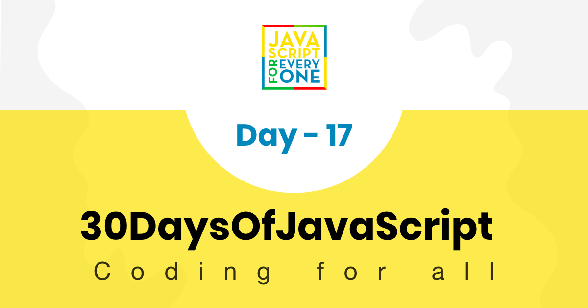
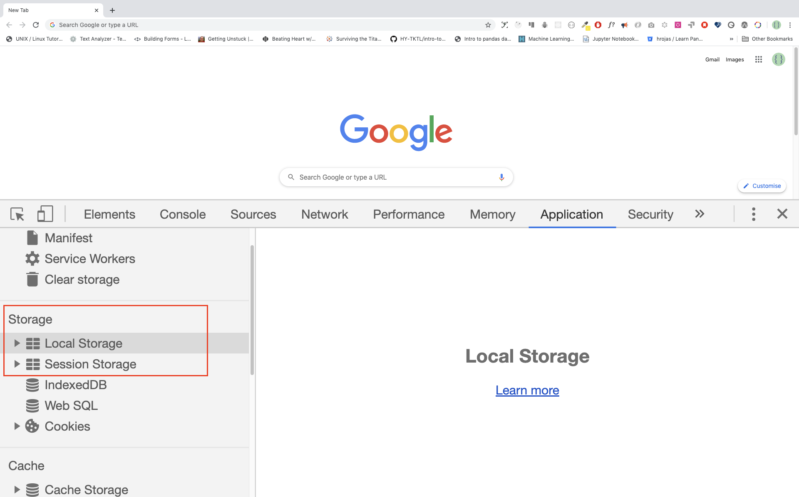
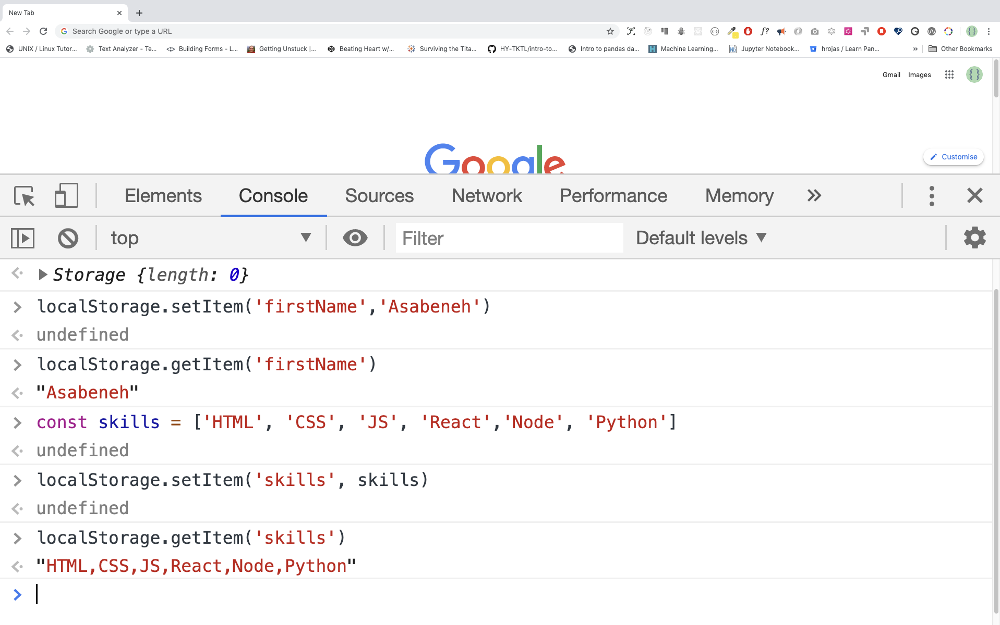

<div align="center">
  <h1> 30 天 JavaScript：Web 存储</h1>
  <a class="header-badge" target="_blank" href="https://www.linkedin.com/in/asabeneh/">
  
  </a>
  <a class="header-badge" target="_blank" href="https://twitter.com/Asabeneh">
  
  </a>

<sub>作者：
<a href="https://www.linkedin.com/in/asabeneh/" target="_blank">Asabeneh Yetayeh</a><br>
<small> 2020 年 1 月</small>
</sub>

</div>

[<< Day 16](../16_Day_JSON/16_day_json.md) | [Day 18 >>](../18_Day_Promises/18_day_promises.md)



- [第 17 天](#day-17)
	- [HTML5 Web Storage](#html5-web-storage)
		- [sessionStorage](#sessionstorage)
		- [localStorage](#localstorage)
		- [Web Storage 的用例](#use-case-of-web-storages)
	- [HTML5 Web 存储对象](#html5-web-storage-objects)
		- [向 localStorage 写入数据](#setting-item-to-the-localstorage)
		- [从 localStorage 读取数据](#getting-item-from-localstorage)
		- [清空 localStorage](#clearing-the-localstorage)
	- [练习](#exercises)
		- [练习：1 级](#exercises-level-1)
		- [练习：2 级](#exercises-level-2)
		- [练习：3 级](#exercises-level-3)

<a id="day-17"></a>
# 第 17 天

<a id="html5-web-storage"></a>
## HTML5 Web Storage

Web 存储（sessionStorage 和 localStorage）是一种 HTML5 API，与传统 cookie 相比具有明显优势。在 HTML5 之前，应用程序数据通常需要存储在 cookie 中，并随每个服务器请求一起发送。Web 存储更加安全，可以在本地保存大量数据，而且不会影响网站性能。许多浏览器中 cookie 的数据存储限制约为每个 cookie 4 KB，而 Web 存储可以保存更大的数据量（至少 5 MB），并且不会自动传输到服务器。同源的所有页面都可以存储和访问相同的数据。

可以使用 JavaScript 访问存储的数据，这使你能够利用客户端脚本完成许多传统上需要服务器端编程和关系数据库参与的事情。有两个 Web 存储对象：

- sessionStorage
- localStorage

localStorage 与 sessionStorage 类似，不同之处在于 localStorage 中存储的数据没有过期时间，而 sessionStorage 中存储的数据会在页面会话结束（即页面关闭时）时被清除。

应该注意的是，存储在 localStorage 或 sessionStorage 中的数据特定于页面的协议。

键和值始终是字符串（请注意，与对象一样，整数键将自动转换为字符串）。



<a id="sessionstorage"></a>
### sessionStorage

sessionStorage 仅在浏览器标签页或窗口会话中可用，用于在单个页面会话中存储数据。这意味着如果窗口关闭，会话数据将被删除。由于 sessionStorage 和 localStorage 具有类似的方法，因此我们将重点关注 localStorage。

<a id="localstorage"></a>
### localStorage

HTML5 localStorage 是 Web 存储 API 的一部分，用于在浏览器中存储没有过期时间的数据。即使浏览器关闭后，这些数据仍然保留。也就是说，关闭并重新打开浏览器后，localStorage 中的数据仍然可用，并且可以在同源页面的不同标签页和窗口之间共享。

在这两种情况下，Web 存储数据都不能跨浏览器共享。例如，在 Firefox 中创建的存储对象无法在 Internet Explorer 中访问，这一点和 cookie 类似。localStorage 常用的五个方法如下：
_setItem()、getItem()、removeItem()、clear()、key()_

<a id="use-case-of-web-storages"></a>
### Web 存储的用例

Web 存储的一些用例是

- 临时存储数据
- 保存用户放入购物车的产品
- 可以在页面请求、多个浏览器选项卡之间以及使用 localStorage 的浏览器会话之间提供数据
- 可以使用 localStorage 完全离线使用
- 当一些静态数据存储在客户端上以最大程度地减少后续请求的数量时，Web 存储可以带来巨大的性能提升。甚至图像也可以使用 Base64 编码存储在字符串中。
- 可用于用户身份验证方法

对于上面提到的示例，使用 localStorage 是有意义的。那么，你可能会想什么时候应该使用 sessionStorage。

在某些情况下，我们希望在窗口关闭后立即删除数据。或者，我们不希望同一应用在不同窗口中的数据互相干扰。这些场景更适合使用 sessionStorage。

现在，让我们看看如何使用这些 Web Storage API。

<a id="html5-web-storage-objects"></a>
## HTML5 Web 存储对象

HTML Web 存储提供了两个用于在客户端存储数据的对象：

- window.localStorage - 存储没有过期时间的数据
- window.sessionStorage - 存储一个会话的数据（关闭浏览器标签页时数据会丢失）

大多数现代浏览器都支持 Web 存储，不过最好仍然检查浏览器对 localStorage 和 sessionStorage 的支持情况。让我们看看 Web 存储对象的可用方法。

Web Storage 对象：

- _localStorage_ - 显示 localStorage 对象
- _localStorage.clear()_ - 删除 localStorage 中的所有内容
- _localStorage.setItem()_ - 将数据存储在 localStorage 中。它需要一个键和一个值参数。
- _localStorage.getItem()_ - 显示存储在 localStorage 中的数据。它需要一个键作为参数。
- _localStorage.removeItem()_ - 从 localStorage 中删除指定数据。它以 key 作为参数。
- _localStorage.key()_ - 根据索引返回 localStorage 中对应的键名。



<a id="setting-item-to-the-localstorage"></a>
### 向 localStorage 写入数据

写入 localStorage 的数据会以字符串形式保存。如果要存储数组或对象，应先使用 JSON.stringify() 将其转换为字符串，否则会丢失原始的数组结构或对象结构。

我们使用 _localStorage.setItem_ 方法将数据存储在 localStorage 中。

```js
// 语法
localStorage.setItem('key', 'value')
```

- 将字符串存储在 localStorage 中

```js
localStorage.setItem('firstName', 'Asabeneh') // since the value is string we do not stringify it
console.log(localStorage)
```

```sh
Storage {firstName: 'Asabeneh', length: 1}
```

- 将数字存储在 localStorage 中

```js
localStorage.setItem('age', 200)
console.log(localStorage)
```

```sh
 Storage {age: '200', firstName: 'Asabeneh', length: 2}
```

- 将数组存储在 localStorage 中。如果要存储数组、对象或对象数组，应先将其字符串化。请参阅下面的示例。

```js
const skills = ['HTML', 'CSS', 'JS', 'React']
//Skills array has to be stringified first to keep the format.
const skillsJSON = JSON.stringify(skills, undefined, 4)
localStorage.setItem('skills', skillsJSON)
console.log(localStorage)
```

```sh
Storage {age: '200', firstName: 'Asabeneh', skills: 'HTML,CSS,JS,React', length: 3}
```

```js
let skills = [
  { tech: 'HTML', level: 10 },
  { tech: 'CSS', level: 9 },
  { tech: 'JS', level: 8 },
  { tech: 'React', level: 9 },
  { tech: 'Redux', level: 10 },
  { tech: 'Node', level: 8 },
  { tech: 'MongoDB', level: 8 }
]

let skillJSON = JSON.stringify(skills)
localStorage.setItem('skills', skillJSON)
```

- 将对象存储在 localStorage 中。在将对象存储到 localStorage 之前，必须先将对象字符串化。

```js
const user = {
  firstName: 'Asabeneh',
  age: 250,
  skills: ['HTML', 'CSS', 'JS', 'React']
}

const userText = JSON.stringify(user, undefined, 4)
localStorage.setItem('user', userText)
```

<a id="getting-item-from-localstorage"></a>
### 从 localStorage 读取数据

我们使用 _localStorage.getItem()_ 方法从 localStorage 读取数据。

```js
// 语法
localStorage.getItem('key')
```

```js
let firstName = localStorage.getItem('firstName')
let age = localStorage.getItem('age')
let skills = localStorage.getItem('skills')
console.log(firstName, age, skills)
```

```sh
 'Asabeneh', '200', '['HTML','CSS','JS','React']'
```

正如你所看到的，skills 是字符串格式。让我们使用 JSON.parse() 将其解析为普通数组。

```js
let skills = localStorage.getItem('skills')
let skillsObj = JSON.parse(skills, undefined, 4)
console.log(skillsObj)
```

```sh
['HTML','CSS','JS','React']
```

<a id="clearing-the-localstorage"></a>
### 清空 localStorage

clear 方法会清除 localStorage 中存储的所有内容。

```js
localStorage.clear()
```

🌕 你下定决心了。现在，你了解了 Web Storage，并且知道如何在客户端浏览器中存储少量数据。你距离伟大之路还有 17 步。现在为你的大脑和肌肉做一些练习。

<a id="exercises"></a>
## 练习

<a id="exercises-level-1"></a>
### 练习：1 级

1. 将你的名字、姓氏、年龄、国家和城市存储在浏览器的 localStorage 中。

<a id="exercises-level-2"></a>
### 练习：2 级

1. 创建一个学生对象。该对象包含名字、姓氏、年龄、技能、国家和是否已注册等键值。将学生对象存储在浏览器的 localStorage 中。

<a id="exercises-level-3"></a>
### 练习：3 级

1. 创建一个名为 `personAccount` 的对象。它有名字、姓氏、收入、费用属性，并且有 `totalIncome`、`totalExpense`、`accountInfo`、`addIncome`、`addExpense` 和 `accountBalance` 方法。收入是一组收入及其描述，支出也是一组支出及其描述。

🎉 恭喜！ 🎉

[<< Day 16](../16_Day_JSON/16_day_json.md) | [Day 18 >>](../18_Day_Promises/18_day_promises.md)
