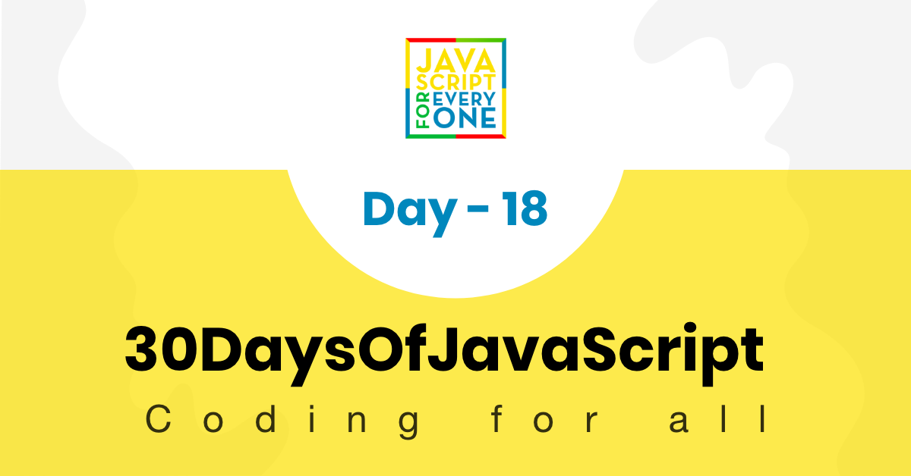

<div align="center">
  <h1> 30 天 JavaScript：Promises</h1>
  <a class="header-badge" target="_blank" href="https://www.linkedin.com/in/asabeneh/">
  
  </a>
  <a class="header-badge" target="_blank" href="https://twitter.com/Asabeneh">
  
  </a>

<sub>作者：
<a href="https://www.linkedin.com/in/asabeneh/" target="_blank">Asabeneh Yetayeh</a><br>
<small> 2020 年 1 月</small>
</sub>

</div>

[<< Day 17](../17_Day_Web_storages/17_day_web_storages.md) | [Day 19 >>](../19_Day_Closures/19_day_closures.md)



- [第 18 天](#day-18)
	- [Promise](#promise)
	- [回调](#callbacks)
		- [Promise 构造函数](#promise-constructor)
	- [Fetch API](#fetch-api)
	- [async 和 await](#async-and-await)
	- [练习](#exercises)
		- [练习：1 级](#exercises-level-1)
		- [练习：2 级](#exercises-level-2)
		- [练习：3 级](#exercises-level-3)

<a id="day-18"></a>
# 第 18 天

<a id="promise"></a>
## Promise

我们在生活中也会作出或接受承诺：约定在某个时间做某件事。如果兑现了承诺，别人会感到高兴；如果没有兑现，可能会带来失望。JavaScript 中的 Promise 与这个例子有一些共同点。

Promise 是 JavaScript 中处理异步操作的一种方法。它允许处理程序使用异步操作的最终成功值或失败原因。这使得异步方法可以像同步方法一样返回值：异步方法不是立即返回最终值，而是返回一个在未来某个时刻提供该值的 Promise。

Promise 处于以下状态之一：

- pending：初始状态，既未 fulfilled，也未 rejected。
- fulfilled：表示操作成功完成。
- rejected：表示操作失败。

pending 状态的 Promise 可以用某个值 fulfilled，也可以因为某个原因（错误）rejected。当其中任一状态发生时，都会调用 Promise 的 then 方法中排队的相关处理程序。（如果在添加处理程序时 Promise 已经 fulfilled 或 rejected，该处理程序仍会被调用，因此异步操作完成和添加处理程序之间不存在竞争条件。）

由于 Promise.prototype.then() 和 Promise.prototype.catch() 方法返回 Promise，因此它们可以被链接起来。

<a id="callbacks"></a>
## 回调

为了更好地理解 Promise，我们首先要理解回调。让我们看看下面的回调。从以下代码块中，你将注意到回调和 Promise 之间的区别。

- 回调
  让我们看一个带有两个参数的回调函数。第一个参数是 err，第二个参数是 result。如果 err 参数为 false，则表示没有错误，否则会返回错误。

在这种情况下，错误有一个值，它将返回错误块。

```js
// 回调
const doSomething = callback => {
  setTimeout(() => {
    const skills = ['HTML', 'CSS', 'JS']
    callback('It did not go well', skills)
  }, 2000)
}

const callback = (err, result) => {
  if (err) {
    return console.log(err)
  }
  return console.log(result)
}

doSomething(callback)
```

```sh
// after 2 seconds it will print
It did not go well
```

在这种情况下， err 为 false，它将返回 else 块，即结果。

```js
const doSomething = callback => {
  setTimeout(() => {
    const skills = ['HTML', 'CSS', 'JS']
    callback(false, skills)
  }, 2000)
}

doSomething((err, result) => {
  if (err) {
    return console.log(err)
  }
  return console.log(result)
})
```

```sh
// after 2 seconds it will print the skills
["HTML", "CSS", "JS"]
```

<a id="promise-constructor"></a>
### Promise 构造函数

我们可以使用 Promise 构造函数创建一个 Promise。我们可以使用关键字 `new` 后跟单词 `Promise` 和括号来创建一个新的 Promise。在括号内，它采用 `callback` 函数。 Promise 回调函数有两个参数，即 _`resolve`_ 和 _`reject`_ 函数。

```js
// 语法
const promise = new Promise((resolve, reject) => {
  resolve('success')
  reject('failure')
})
```

```js
// Promise
const doPromise = new Promise((resolve, reject) => {
  setTimeout(() => {
    const skills = ['HTML', 'CSS', 'JS']
    if (skills.length > 0) {
      resolve(skills)
    } else {
      reject('Something wrong has happened')
    }
  }, 2000)
})

doPromise
  .then(result => {
    console.log(result)
  })
  .catch(error => console.log(error))
```

```sh
["HTML", "CSS", "JS"]
```

上面的 Promise 被成功 fulfilled。
让我们再举一个例子，当 Promise 被拒绝时。

```js
// Promise
const doPromise = new Promise((resolve, reject) => {
  setTimeout(() => {
    const skills = ['HTML', 'CSS', 'JS']
    if (skills.includes('Node')) {
      resolve('fullstack developer')
    } else {
      reject('Something wrong has happened')
    }
  }, 2000)
})

doPromise
  .then(result => {
    console.log(result)
  })
  .catch(error => console.error(error))
```

```sh
Something wrong has happened
```

<a id="fetch-api"></a>
## Fetch API

Fetch API 提供了用于获取资源的接口，包括通过网络请求资源。用过 XMLHttpRequest 的人会觉得它很熟悉，但 Fetch API 提供了更强大、更灵活的功能。在本次挑战中，我们将使用 fetch 请求 URL 和 API。接下来，让我们看看使用 Fetch API 访问网络资源时 Promise 的示例。

```js
const url = 'https://restcountries.com/v2/all' // countries api
fetch(url)
  .then(response => response.json()) // accessing the API data as JSON
  .then(data => {
    // getting the data
    console.log(data)
  })
  .catch(error => console.error(error)) // handling error if something wrong happens
```

<a id="async-and-await"></a>
## async 和 await

async 和 await 是处理 Promise 的优雅方式。它容易理解，写出来的代码也更清晰。

```js
const square = async function (n) {
  return n * n
}

square(2)
```

```sh
Promise {<resolved>: 4}
```

函数前面的 _async_ 表示该函数将返回一个 Promise。上面的 square 函数返回的是一个 Promise，而不是普通值。

我们如何从 Promise 中获取值？要访问 Promise 中的值，需要使用关键字 _await_。

```js
const square = async function (n) {
  return n * n
}
const value = await square(2)
console.log(value)
```

```sh
4
```

现在，正如你从上面的示例中看到的，在函数前面编写 async 会创建一个 Promise，使用 await 可以从 Promise 中获取值。async 和 await 通常配合使用。

让我们分别使用 Promise 写法以及 async/await 写法来获取 API 数据。

- Promise

```js
const url = 'https://restcountries.com/v2/all'
fetch(url)
  .then(response => response.json())
  .then(data => {
    console.log(data)
  })
  .catch(error => console.error(error))
```

- async 和 await

```js
const fetchData = async () => {
  try {
    const response = await fetch(url)
    const countries = await response.json()
    console.log(countries)
  } catch (err) {
    console.error(err)
  }
}
console.log('===== async and await')
fetchData()
```

🌕 你很可靠，兑现了承诺，已经到达第 18 天。继续保持这份坚持，稳稳完成挑战。你距离伟大之路还有 18 步。现在为你的大脑和肌肉做一些练习。

<a id="exercises"></a>
## 练习

```js
const countriesAPI = 'https://restcountries.com/v2/all'
const catsAPI = 'https://api.thecatapi.com/v1/breeds'
```

<a id="exercises-level-1"></a>
### 练习：1 级

1. 使用 fetch 读取国家 API 并打印国家名称、首都、语言、人口和地区。

<a id="exercises-level-2"></a>
### 练习：2 级

1. 将所有猫的名字打印到 catNames 变量中。

<a id="exercises-level-3"></a>
### 练习：3 级

1. 读取 cats API，并找出猫的平均体重（公制单位）。
2. 读取国家 API，并找出面积最大的 10 个国家。
3. 阅读国家 API 并统计世界上官方使用的语言总数。

🎉 恭喜！ 🎉

[<< Day 17](../17_Day_Web_storages/17_day_web_storages.md) | [Day 19 >>](../19_Day_Closures/19_day_closures.md)
