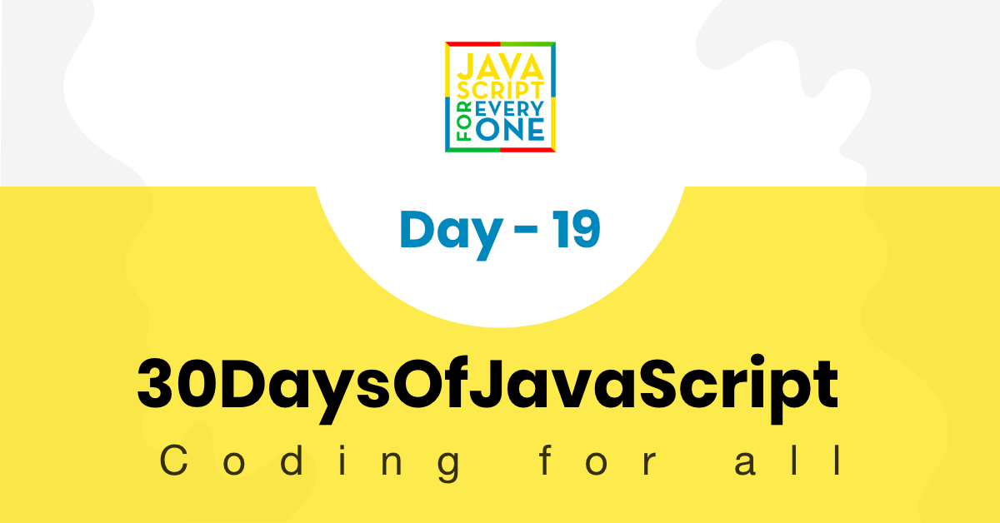

<div align="center">
  <h1> 30 天 JavaScript：闭包</h1>
  <a class="header-badge" target="_blank" href="https://www.linkedin.com/in/asabeneh/">
  
  </a>
  <a class="header-badge" target="_blank" href="https://twitter.com/Asabeneh">
  
  </a>

<sub>作者：
<a href="https://www.linkedin.com/in/asabeneh/" target="_blank">Asabeneh Yetayeh</a><br>
<small> 2020 年 1 月</small>
</sub>

</div>

[<< Day 18](../18_Day_Promises/18_day_promises.md) | [Day 20 >>](../20_Day_Writing_clean_codes/20_day_writing_clean_codes.md)


- [第 19 天](#day-19)
	- [闭包](#closure)
	- [练习](#exercises)
		- [练习：1 级](#exercises-level-1)
		- [练习：2 级](#exercises-level-2)
		- [练习：3 级](#exercises-level-3)

<a id="day-19"></a>
# 第 19 天

<a id="closure"></a>
## 闭包

JavaScript 允许在外部函数内部编写函数。我们可以编写任意数量的内部函数。如果内部函数访问外部函数的变量，则称为闭包。

```js
function outerFunction() {
    let count = 0;
    function innerFunction() {
        count++
        return count
    }

    return innerFunction
}
const innerFunc = outerFunction()

console.log(innerFunc())
console.log(innerFunc())
console.log(innerFunc())
```

```sh
1
2
3
```

让我们再看一个包含多个内部函数的例子。

```js
function outerFunction() {
    let count = 0;
    function plusOne() {
        count++
        return count
    }
    function minusOne() {
        count--
        return count
    }

    return {
        plusOne:plusOne(),
        minusOne:minusOne()
    }
}
const innerFuncs = outerFunction()

console.log(innerFuncs.plusOne)
console.log(innerFuncs.minusOne)
```

```sh
1
0
```

🌕 你正在进步。保持动力，继续保持良好的状态。现在为你的大脑和肌肉做一些练习。

<a id="exercises"></a>
## 练习

<a id="exercises-level-1"></a>
### 练习：1 级

1. 创建一个具有一个内部函数的闭包。

<a id="exercises-level-2"></a>
### 练习：2 级

1. 创建一个具有三个内部函数的闭包。

<a id="exercises-level-3"></a>
### 练习：3 级

1. 创建一个 personAccount 外部函数。它包含名字、姓氏、收入、支出等内部变量，并包含 totalIncome、totalExpense、accountInfo、addIncome、addExpense 和 accountBalance 等内部函数。收入是一组收入及其描述，支出也是一组支出及其描述。

🎉 恭喜！ 🎉

[<< Day 18](../18_Day_Promises/18_day_promises.md) | [Day 20 >>](../20_Day_Writing_clean_codes/20_day_writing_clean_codes.md)
