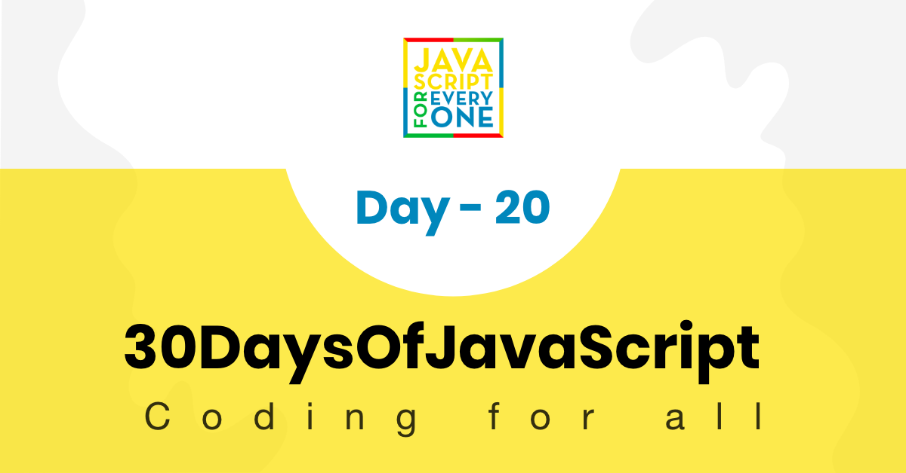

<div align="center">
  <h1> 30 天 JavaScript：编写干净的代码</h1>
  <a class="header-badge" target="_blank" href="https://www.linkedin.com/in/asabeneh/">
  
  </a>
  <a class="header-badge" target="_blank" href="https://twitter.com/Asabeneh">
  
  </a>

<sub>作者：
<a href="https://www.linkedin.com/in/asabeneh/" target="_blank">Asabeneh Yetayeh</a><br>
<small> 2020 年 1 月</small>
</sub>

</div>

[<< Day 19](../19_Day_Closures/19_day_closures.md) | [Day 21 >>](../21_Day_DOM/21_day_dom.md)


- [第 20 天](#day-20)
	- [编写干净的代码](#writing-clean-code)
		- [JavaScript 风格指南](#javascript-style-guide)
		- [为什么我们需要风格指南](#why-we-need-style-guide)
			- [Airbnb JavaScript 风格指南](#airbnb-javascript-style-guide)
			- [标准 JavaScript 风格指南](#standard-javascript-style-guide)
			- [Google JavaScript 风格指南](#google-javascript-style-guide)
		- [JavaScript 编码约定](#javascript-coding-conventions)
			- [30DaysOfJavaScript 中使用的约定](#conventions-use-in-30daysofjavascript)
			- [变量](#variables)
			- [数组](#arrays)
			- [函数](#functions)
			- [循环](#loops)
			- [对象](#objects)
			- [条件语句](#conditional)
			- [类](#classes)

<a id="day-20"></a>
# 第 20 天

<a id="writing-clean-code"></a>
## 编写干净的代码

<a id="javascript-style-guide"></a>
### JavaScript 风格指南

JavaScript 风格指南是一组标准，用于说明如何编写和组织 JavaScript 代码。在本节中，我们将讨论 JavaScript 风格指南以及如何编写干净的代码。

JavaScript 是一种编程语言，就像人类语言一样，它也有语法。为了令人信服和简单起见，JavaScript 的语法必须遵循一定的风格指南来编写。

<a id="why-we-need-style-guide"></a>
### 为什么我们需要风格指南

你已经独自编码这么久了，但现在似乎可以在团队中工作了。无论如何，只要代码能运行，你编写的代码并不重要，但是，当你在一个项目和相同的代码库上与 10 名或 20 名或更多开发人员组成的团队一起工作时，如果没有任何指导方针可遵循，代码将变得混乱且难以管理。

你可以制定自己的指南和约定，也可以采用成熟的指南。让我们了解最常见的指南。
最常见的 JavaScript 样式指南

- Airbnb JavaScript 风格指南
- JavaScript 标准风格指南
- 谷歌 JavaScript 风格指南

<a id="airbnb-javascript-style-guide"></a>
#### Airbnb JavaScript 风格指南

Airbnb 拥有互联网上最流行的 JavaScript 风格指南之一。它几乎涵盖了 JavaScript 的各个方面，并被许多开发人员和公司采用。你可以查看 [Airbnb 风格指南](https://github.com/airbnb/javascript)。我也建议尝试一下，它的风格非常易用且容易理解。

<a id="standard-javascript-style-guide"></a>
#### 标准 JavaScript 风格指南

这个指南不像 Airbnb 那么受欢迎，但值得一看。他们删除了[样式指南](https://standardjs.com/) 中的分号。

<a id="google-javascript-style-guide"></a>
#### Google JavaScript 风格指南

我没有过多谈论谷歌的指南，我也没有使用过，但我建议你看看这个[链接](https://google.github.io/styleguide/jsguide.html)。

<a id="javascript-coding-conventions"></a>
### JavaScript 编码约定

在本次挑战中，我们还使用了通用的 JavaScript 编码编写约定和指南。编码约定是由个人、团队或公司开发的编程风格指南。

编码约定有助于：

- 编写干净的代码
- 提高代码可读性
- 提高代码的可重用性和可维护性

编码约定包括

- 变量的命名和声明规则
- 函数的命名和声明规则
- 空格、缩进和注释的使用规则
- 编程实践和原则

<a id="conventions-use-in-30daysofjavascript"></a>
#### 30DaysOfJavaScript 中使用的约定

在本次挑战中，我们遵循常规的 JavaScript 约定，但我还添加了我对写作的偏好。 

- 我们对变量和函数使用驼峰命名法。
- 所有变量名称均以字母开头。
- 我们选择对常量、数组、对象和函数使用 *const*。我们选择使用单引号或反引号代替双引号。单引号正变得流行。
- 我们还从代码中删除了分号，但这是个人喜好的问题。
- 算术运算符、赋值运算符和逗号后的空格
- 箭头函数代替函数声明
- 如果函数是单行函数，则显式返回而不是隐式返回
- 对象的最后一个值中没有尾随逗号
- 我们更喜欢这个 +=、-=、*= /=、**= 而不是更长的版本
- 使用 console.log() 时，最好同时打印一个标签字符串，便于识别日志来自哪里

<a id="variables"></a>
#### 变量

```js

let firstName = 'Asabeneh'
let lastName = 'Yetayeh'
let country = 'Finland'
let city = 'Helsinki'

const PI = Math.PI
const gravity = 9.81
```

<a id="arrays"></a>
#### 数组

我们选择将数组名称设为复数

- 名字
- 数字
- 国家
- 语言
- 技能
- 水果
- 蔬菜

```js
// arrays
const names = ['Asabeneh', 'Mathias', 'Elias', 'Brook']
const numbers = [0, 3.14, 9.81, 37, 98.6, 100]
const countries = ['Finland', 'Denmark', 'Sweden', 'Norway', 'Iceland']
const languages = ['Amharic', 'Arabic', 'English', 'French', 'Spanish']
const skills = ['HTML', 'CSS', 'JavaScript', 'React', 'Python']
const fruits = ['banana', 'orange', 'mango', 'lemon']
const vegetables = ['Tomato', 'Potato', 'Cabbage', 'Onion', 'Carrot']
```

<a id="functions"></a>
#### 函数

现在你已经非常熟悉函数声明、表达式函数、箭头函数和匿名函数了。在这个挑战中，我们倾向于使用箭头函数而不是其他函数。箭头函数不能替代其他函数。另外，箭头函数和函数声明并不完全相同。所以你应该知道什么时候使用，什么时候不使用。我将在其他部分详细介绍差异。如果函数是单行函数，我们将使用显式返回而不是隐式返回

```js
// 返回一个人的全名
const printFullName = (firstName, lastName) => firstName + ' ' + lastName

// 计算数字的平方
const square = (n) => n * n

// 生成随机十六进制颜色
const hexaColor = () => {
  const str = '0123456789abcdef'
  let hexa = '#'
  let index
  for (let i = 0; i < 6; i++) {
    index = Math.floor(Math.random() * str.length)
    hexa += str[index]
  }
  return hexa
}

// 显示日期和时间
const showDateTime = () => {
  const now = new Date()
  const year = now.getFullYear()
  const month = now.getMonth() + 1
  const date = now.getDate()
  let hours = now.getHours()
  let minutes = now.getMinutes()
  if (hours < 10) {
    hours = '0' + hours
  }
  if (minutes < 10) {
    minutes = '0' + minutes
  }

  const dateMonthYear = date + '.' + month + '.' + year
  const time = hours + ':' + minutes
  const fullTime = dateMonthYear + ' ' + time
  return fullTime
}
```

`new Date().toLocaleString()` 也可用于显示当前日期时间。`toLocaleString()` 方法可以接收不同的参数。你可以从此[链接](https://developer.mozilla.org/en-US/docs/Web/JavaScript/Reference/Global_Objects/Date/toLocaleString)了解有关日期和时间的更多信息。

<a id="loops"></a>
#### 循环

我们在此挑战中涵盖了多种类型的循环。常规的 for 循环、while 循环、do while 循环、for of 循环、forEach 循环和 for in 循环。
让我们看看我们如何使用它们：

```js
for (let i = 0; i < n; i++){
    console.log()
}

// 声明数组变量
const names = ['Asabeneh', 'Mathias', 'Elias', 'Brook']

// 使用常规 for 循环遍历数组
let len = names.length;
for(let i = 0; i < len; i++){
    console.log(names[i].toUpperCase())
}


// 使用 for...of 遍历数组
for( const name of names) {
    console.log(name.toUpperCase())
}

// 使用 forEach 遍历数组
names.forEach((name) => name.toUpperCase())


const person = {
  firstName: 'Asabeneh',
  lastName: 'Yetayeh',
  age: 250,
  country: 'Finland',
  city: 'Helsinki',
  skills: ['HTML','CSS','JavaScript','React','Node','MongoDB','Python','D3.js'],
  isMarried: true
}
for(const key in person) {
    console.log(key)
}

```

<a id="objects"></a>
#### 对象

我们用 *const* 声明对象字面量。

```js
// 声明对象字面量
const person = {
  firstName: 'Asabeneh',
  lastName: 'Yetayeh',
  age: 250,
  country: 'Finland',
  city: 'Helsinki',
  skills: ['HTML','CSS','JavaScript','TypeScript', 'React','Node','MongoDB','Python','D3.js'],
  isMarried: true
}
// 遍历对象键
for(const key in person) {
    console.log(key, person[key])
}

```

<a id="conditional"></a>
#### 条件语句

 我们在之前的挑战中介绍过 if、if else、if else if else、switch 和三元运算符。

 ```js
 // 语法
if (condition) {
  // this part of code run for truthy condition
} else {
  // this part of code run for false condition
}
 ```

 ```js
 // if else
let num = 3
if (num > 0) {
  console.log(`${num} is a positive number`)
} else {
  console.log(`${num} is a negative number`)
}
//  3 is a positive number
 ```

 ```js
 // if else if else if else

let a = 0
if (a > 0) {
  console.log(`${a} is a positive number`)
} else if (a < 0) {
  console.log(`${a} is a negative number`)
} else if (a == 0) {
  console.log(`${a} is zero`)
} else {
  console.log(`${a} is not a number`)
}
 ```

 ```js
 // 更多 switch 示例
let dayUserInput = prompt('今天星期几？')
let day = dayUserInput.toLowerCase()

switch (day) {
  case 'monday':
    console.log('今天是星期一')
    break
  case 'tuesday':
    console.log('今天是星期二')
    break
  case 'wednesday':
    console.log('今天是星期三')
    break
  case 'thursday':
    console.log('今天是星期四')
    break
  case 'friday':
    console.log('今天是星期五')
    break
  case 'saturday':
    console.log('今天是星期六')
    break
  case 'sunday':
    console.log('今天是星期日')
    break
  default:
    console.log('这不是有效的星期名称。')
}
 ```

 ```js
 // ternary

 let isRaining = true
isRaining
  ? console.log('你需要雨衣。')
  : console.log('不需要雨衣。')
 ```

<a id="classes"></a>
#### 类

我们使用以大写字母开头的驼峰命名法来声明类。

```js
// 语法
class ClassName {
    // 代码写在这里
}
```

```js
// defining class
class Person {
  constructor(firstName, lastName) {
    console.log(this) // 从这里查看输出
    this.firstName = firstName
    this.lastName = lastName
  }
}

```

无论你遵循什么风格指南，都要保持一致。遵循一些编程范式和设计模式。请记住，如果你不按照一定的顺序或方式编写代码，代码将很难阅读。因此，编写可读的代码，就是在帮助自己，也是在帮助之后阅读代码的人。

🌕 你很严谨。现在，你知道如何编写干净的代码，让其他开发者也能理解你的代码。你一直在进步，并且在通往伟大的道路上领先 20 步。

🎉 恭喜！ 🎉

[<< Day 19](../19_Day_Closures/19_day_closures.md) | [Day 21 >>](../21_Day_DOM/21_day_dom.md)
