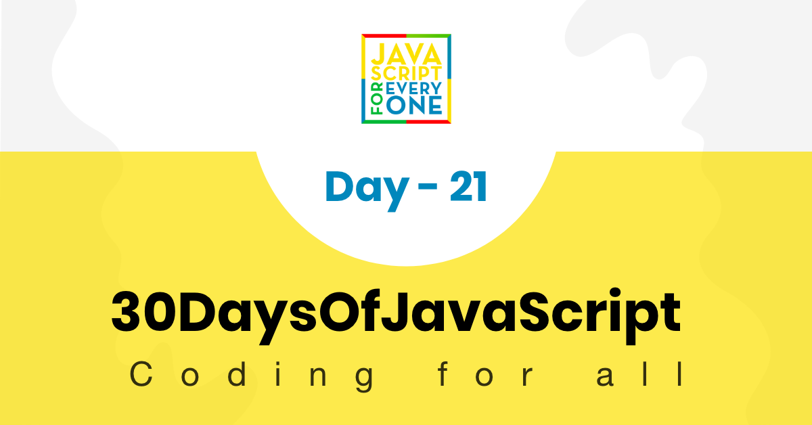
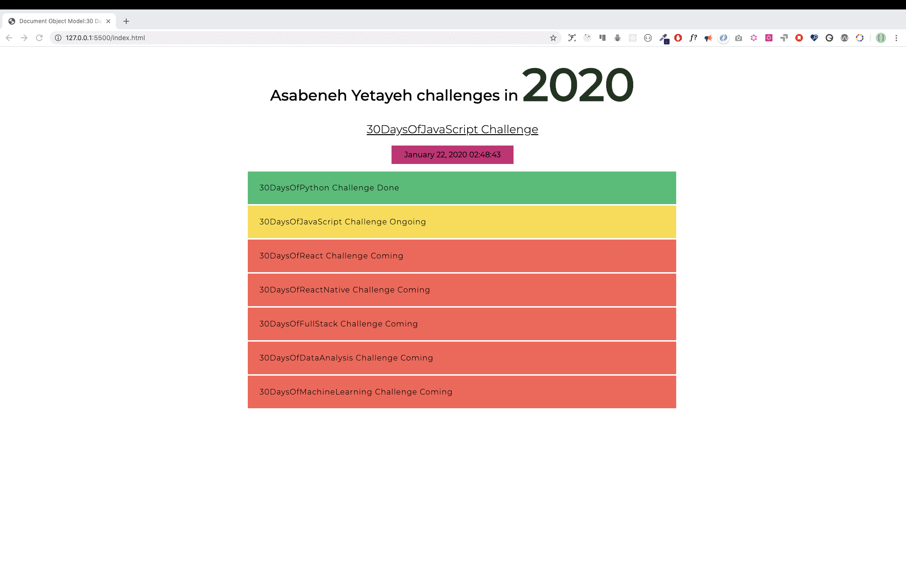
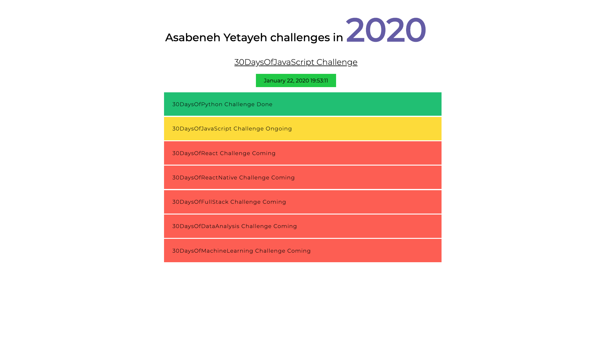

<div align="center">
  <h1> 30 天 JavaScript：文档对象模型(DOM)</h1>
  <a class="header-badge" target="_blank" href="https://www.linkedin.com/in/asabeneh/">
  
  </a>
  <a class="header-badge" target="_blank" href="https://twitter.com/Asabeneh">
  
  </a>

<sub>作者：
<a href="https://www.linkedin.com/in/asabeneh/" target="_blank">Asabeneh Yetayeh</a><br>
<small> 2020 年 1 月</small>
</sub>

</div>

[<< Day 20](../20_Day_Writing_clean_codes/20_day_writing_clean_codes.md) | [Day 22 >>](../22_Day_Manipulating_DOM_object/22_day_manipulating_DOM_object.md)



- [第 21 天](#day-21)
	- [文档对象模型 (DOM) - 第 1 天](#document-object-model-dom---day-1)
		- [获取元素](#getting-element)
			- [通过标签名称获取元素](#getting-elements-by-tag-name)
			- [通过类名获取元素](#getting-elements-by-class-name)
			- [通过id获取元素](#getting-an-element-by-id)
			- [使用querySelector方法获取元素](#getting-elements-by-using-queryselector-methods)
		- [添加属性](#adding-attribute)
			- [使用setAttribute添加属性](#adding-attribute-using-setattribute)
			- [不使用setAttribute添加属性](#adding-attribute-without-setattribute)
			- [使用classList添加类](#adding-class-using-classlist)
			- [使用remove删除类](#removing-class-using-remove)
		- [向 HTML 元素添加文本](#adding-text-to-html-element)
			- [使用textContent添加文本内容](#adding-text-content-using-textcontent)
			- [使用innerHTML添加文本内容](#adding-text-content-using-innerhtml)
				- [文字内容](#text-content)
				- [内部 HTML](#inner-html)
		- [添加样式](#adding-style)
			- [添加样式颜色](#adding-style-color)
			- [添加样式背景颜色](#adding-style-background-color)
			- [添加样式字体大小](#adding-style-font-size)
	- [练习](#exercises)
		- [练习：1 级](#exercise-level-1)
		- [练习：2 级](#exercise-level-2)
		- [练习：3 级](#exercise-level-3)
			- [DOM：小项目1](#dom-mini-project-1)

<a id="day-21"></a>
# 第 21 天

<a id="document-object-model-dom---day-1"></a>
## 文档对象模型 (DOM) - 第 1 天

HTML 文档被构造为 JavaScript 对象。每个 HTML 元素都有不同的属性，可以帮助操作它。可以使用 JavaScript 获取、创建、附加或删除 HTML 元素。检查下面的示例。使用 JavaScript 选择 HTML 元素与使用 CSS 选择类似。要选择 HTML 元素，我们使用标签名称、id、类名称或其他属性。

<a id="getting-element"></a>
### 获取元素

我们可以使用 JavaScript 访问已经创建的一个或多个元素。为了访问或获取元素，我们使用不同的方法。下面的代码有四个 _h1_ 元素。让我们看看访问 _h1_ 元素的不同方法。

```html
<!DOCTYPE html>
  <html lang="en">
    <head>
      <title>Document Object Model</title>
    </head>
    <body>

     <h1 class='title' id='first-title'>First Title</h1>
     <h1 class='title' id='second-title'>Second Title</h1>
     <h1 class='title' id='third-title'>Third Title</h1>
     <h1></h1>

    </body>
  </html>
```

<a id="getting-elements-by-tag-name"></a>
#### 通过标签名称获取元素

**_getElementsByTagName()_**：将标签名称作为字符串参数，此方法返回一个 HTMLCollection 对象。HTMLCollection 是一个类似数组的 HTML 元素集合。length 属性提供集合的大小。使用此方法时，我们通常通过索引或 for 循环遍历集合，逐个访问元素。HTMLCollection 不支持所有数组方法，因此应该使用常规 for 循环，而不是 forEach。

```js
// 语法
document.getElementsByTagName('tagname')
```

```js
const allTitles = document.getElementsByTagName('h1')

console.log(allTitles) // HTMLCollection
console.log(allTitles.length) // 4

for (let i = 0; i < allTitles.length; i++) {
  console.log(allTitles[i]) // 打印 HTMLCollection 中的每个元素
}
```

<a id="getting-elements-by-class-name"></a>
#### 通过类名获取元素

**_getElementsByClassName()_** 方法返回 HTMLCollection 对象。HTMLCollection 是一个类似数组的 HTML 元素列表。length 属性提供集合的大小。可以循环遍历所有 HTMLCollection 元素。请参阅下面的示例。

```js
// 语法
document.getElementsByClassName('classname')
```

```js
const allTitles = document.getElementsByClassName('title')

console.log(allTitles) // HTMLCollection
console.log(allTitles.length) // 4

for (let i = 0; i < allTitles.length; i++) {
  console.log(allTitles[i]) // 打印 HTMLCollection 中的每个元素
}
```

<a id="getting-an-element-by-id"></a>
#### 通过 id 获取元素

**_getElementsById()_** 针对单个 HTML 元素。我们传递 id 时不带 # 作为参数。

```js
// 语法
document.getElementById('id')
```

```js
let firstTitle = document.getElementById('first-title')
console.log(firstTitle) // <h1>First Title</h1>
```

<a id="getting-elements-by-using-queryselector-methods"></a>
#### 使用 querySelector 方法获取元素

_document.querySelector_ 方法可以按标签名称、ID 或类名称选择 HTML 或 HTML 元素。

**_querySelector_**：可用于通过标签名称、id 或类来选择 HTML 元素。如果使用标签名称，则仅选择第一个元素。

```js
let firstTitle = document.querySelector('h1') // 选择第一个可用的 h1 元素
let firstTitle = document.querySelector('#first-title') // 选择 id 为 first-title 的元素
let firstTitle = document.querySelector('.title') // 选择第一个 class 为 title 的元素
```

**_querySelectorAll_**：可用于通过标签名称或类选择 HTML 元素。它返回一个 NodeList，这是一个支持数组方法的类数组对象。我们可以使用 **_for 循环_** 或 **_forEach_** 来循环遍历每个 NodeList 元素。

```js
const allTitles = document.querySelectorAll('h1') // 选择页面中所有可用的 h1 元素

console.log(allTitles.length) // 4
for (let i = 0; i < allTitles.length; i++) {
  console.log(allTitles[i])
}

allTitles.forEach(title => console.log(title))
const allTitles = document.querySelectorAll('.title') // 使用 class 选择元素也是同样的方式
```

<a id="adding-attribute"></a>
### 添加属性

HTML 的开始标记中添加了一个属性，它提供了有关元素的附加信息。常见的 HTML 属性：id、class、src、style、href、disabled、title、alt。让我们为第四个标题添加 id 和 class。

```js
const titles = document.querySelectorAll('h1')
titles[3].className = 'title'
titles[3].id = 'fourth-title'
```

<a id="adding-attribute-using-setattribute"></a>
#### 使用 setAttribute 添加属性

**_setAttribute()_** 方法设置任何 html 属性。它有两个参数：属性的类型和属性的名称。
让我们为第四个标题添加 class 和 id 属性。

```js
const titles = document.querySelectorAll('h1')
titles[3].setAttribute('class', 'title')
titles[3].setAttribute('id', 'fourth-title')
```

<a id="adding-attribute-without-setattribute"></a>
#### 添加属性而不使用 setAttribute

我们可以使用普通的对象设置方法来设置属性，但这并不适用于所有元素。有些属性是 DOM 对象属性，可以直接设置。例如 id 和 class

```js
//another way to setting an attribute
titles[3].className = 'title'
titles[3].id = 'fourth-title'
```

<a id="adding-class-using-classlist"></a>
#### 使用 classList 添加类

类列表方法是附加附加类的好方法。如果类存在，它不会覆盖原始类，而是为元素添加附加类。

```js
//another way to setting an attribute: append the class, doesn't over ride
titles[3].classList.add('title', 'header-title')
```

<a id="removing-class-using-remove"></a>
#### 使用remove删除类

与添加类似，我们也可以从元素中删除类。我们可以从元素中删除特定的类。

```js
//another way to setting an attribute: append the class, doesn't over ride
titles[3].classList.remove('title', 'header-title')
```

<a id="adding-text-to-html-element"></a>
### 添加文本到 HTML 元素

HTML 是由开始标签、结束标签和文本内容组成的构建块。我们可以使用属性 _textContent_ 或 \*innerHTML 添加文本内容。

<a id="adding-text-content-using-textcontent"></a>
#### 使用 textContent 添加文本内容

_textContent_ 属性用于将文本添加到 HTML 元素。

```js
const titles = document.querySelectorAll('h1')
titles[3].textContent = 'Fourth Title'
```

<a id="adding-text-content-using-innerhtml"></a>
#### 使用innerHTML 添加文本内容

大多数人对 _textContent_ 和 _innerHTML_ 感到困惑。 _textContent_ 旨在将​​文本添加到 HTML 元素，但是 innerHTML 可以添加文本或 HTML 元素作为子元素。

<a id="text-content"></a>
##### 文字内容

我们将 *textContent* HTML 对象属性分配给文本

```js
const titles = document.querySelectorAll('h1')
titles[3].textContent = 'Fourth Title'
```

<a id="inner-html"></a>
##### 内部 HTML

当我们想要替换父元素或全新的子内容时，我们使用 `innerHTML` 属性。
我们分配的值将是一个 HTML 元素字符串。

```html
<!DOCTYPE html>
<html lang="en">
  <head>
    <title>JavaScript for Everyone:DOM</title>
  </head>
  <body>
    <div class="wrapper">
        <h1>Asabeneh Yetayeh challenges in 2020</h1>
        <h2>30DaysOfJavaScript Challenge</h2>
        <ul></ul>
    </div>
    <script>
    const lists = `
    <li>30DaysOfPython Challenge Done</li>
            <li>30DaysOfJavaScript Challenge Ongoing</li>
            <li>30DaysOfReact Challenge Coming</li>
            <li>30DaysOfFullStack Challenge Coming</li>
            <li>30DaysOfDataAnalysis Challenge Coming</li>
            <li>30DaysOfReactNative Challenge Coming</li>
            <li>30DaysOfMachineLearning Challenge Coming</li>`
  const ul = document.querySelector('ul')
  ul.innerHTML = lists
    </script>
  </body>
</html>
```

`innerHTML` 属性还允许我们删除父元素的所有子元素。我建议使用以下方法，而不是使用 `removeChild()`。

```html
<!DOCTYPE html>
<html lang="en">
  <head>
    <title>JavaScript for Everyone:DOM</title>
  </head>
  <body>
    <div class="wrapper">
        <h1>Asabeneh Yetayeh challenges in 2020</h1>
        <h2>30DaysOfJavaScript Challenge</h2>
        <ul>
            <li>30DaysOfPython Challenge Done</li>
            <li>30DaysOfJavaScript Challenge Ongoing</li>
            <li>30DaysOfReact Challenge Coming</li>
            <li>30DaysOfFullStack Challenge Coming</li>
            <li>30DaysOfDataAnalysis Challenge Coming</li>
            <li>30DaysOfReactNative Challenge Coming</li>
            <li>30DaysOfMachineLearning Challenge Coming</li>
        </ul>
    </div>
    <script>
  const ul = document.querySelector('ul')
  ul.innerHTML = ''
    </script>
  </body>
</html>
```

<a id="adding-style"></a>
### 添加样式

<a id="adding-style-color"></a>
#### 添加样式颜色

让我们为我们的标题添加一些风格。如果元素有偶数索引，我们给它绿色，否则为红色。

```js
const titles = document.querySelectorAll('h1')
titles.forEach((title, i) => {
  title.style.fontSize = '24px' // all titles will have 24px font size
  if (i % 2 === 0) {
    title.style.color = 'green'
  } else {
    title.style.color = 'red'
  }
})
```

<a id="adding-style-background-color"></a>
#### 添加样式背景颜色

让我们为我们的标题添加一些风格。如果元素有偶数索引，我们给它绿色，否则为红色。

```js
const titles = document.querySelectorAll('h1')
titles.forEach((title, i) => {
  title.style.fontSize = '24px' // all titles will have 24px font size
  if (i % 2 === 0) {
    title.style.backgroundColor = 'green'
  } else {
    title.style.backgroundColor = 'red'
  }
})
```

<a id="adding-style-font-size"></a>
#### 添加样式字体大小

让我们为我们的标题添加一些风格。如果元素有偶数索引，我们给它 20px 否则 30px

```js
const titles = document.querySelectorAll('h1')
titles.forEach((title, i) => {
  title.style.fontSize = '24px' // all titles will have 24px font size
  if (i % 2 === 0) {
    title.style.fontSize = '20px'
  } else {
    title.style.fontSize = '30px'
  }
})
```

正如你所注意到的，当我们在 JavaScript 中使用 CSS 时，CSS 属性会采用驼峰命名法。比如 background-color 会写成 backgroundColor，font-size 会写成 fontSize，font-family 会写成 fontFamily，margin-bottom 会写成 marginBottom。

---

🌕 现在，你已经掌握了很强的能力，完成了 JavaScript 挑战中最重要、也最具挑战性的部分。你学习了 DOM，现在已经有能力构建和开发应用程序。现在为你的大脑和肌肉做一些练习。

<a id="exercises"></a>
## 练习

<a id="exercise-level-1"></a>
### 练习：1 级

1. 创建一个 `index.html` 文件，放入四个 `p` 元素，如上：通过 **_document.querySelector(tagname)_** 和标签名称获取第一段
2. 使用 **_document.querySelector('#id')_** 并通过其 id 获取每个段落
3. 使用 **_document.querySelectorAll(tagname)_** 及其标签名称获取所有 `p` 元素，结果为 NodeList
4. 循环 NodeList，获取每一段的文本内容
5. 设置第四段的文本内容为 **_第四段_**
6. 使用不同的属性设置方法为所有段落设置 `id` 和 `class` 属性

<a id="exercise-level-2"></a>
### 练习：2 级

1. 使用 JavaScript 更改每个段落的样式（例如颜色、背景、边框、字体大小、字体系列）
1. 选择所有段落并循环遍历每个元素，将第一段和第三段的颜色设置为绿色，将第二段和第四段的颜色设置为红色
1. 为每个段落设置文本内容、`id` 和 `class`

<a id="exercise-level-3"></a>
### 练习：3 级

<a id="dom-mini-project-1"></a>
#### DOM：小项目 1

1. 开发以下应用程序，从下面的 HTML 元素开始。你可以在起始文件夹中获得相同的代码。仅使用 JavaScript 添加所有样式和功能。

   - 年份颜色每1秒改变一次
   - 日期和时间背景颜色每秒都在变化
   - 已完成的挑战背景为绿色
   - 正在进行的挑战背景为黄色
   - 即将到来的挑战有红色背景

```html
<!-- index.html -->
<!DOCTYPE html>
<html lang="en">
  <head>
    <title>JavaScript for Everyone:DOM</title>
  </head>
  <body>
    <div class="wrapper">
        <h1>Asabeneh Yetayeh challenges in 2020</h1>
        <h2>30DaysOfJavaScript Challenge</h2>
        <ul>
            <li>30DaysOfPython Challenge Done</li>
            <li>30DaysOfJavaScript Challenge Ongoing</li>
            <li>30DaysOfReact Challenge Coming</li>
            <li>30DaysOfFullStack Challenge Coming</li>
            <li>30DaysOfDataAnalysis Challenge Coming</li>
            <li>30DaysOfReactNative Challenge Coming</li>
            <li>30DaysOfMachineLearning Challenge Coming</li>
        </ul>
    </div>
  </body>
</html>
```





🎉 恭喜！ 🎉

[<< Day 20](../20_Day_Writing_clean_codes/20_day_writing_clean_codes.md) | [Day 22 >>](../22_Day_Manipulating_DOM_object/22_day_manipulating_DOM_object.md)
