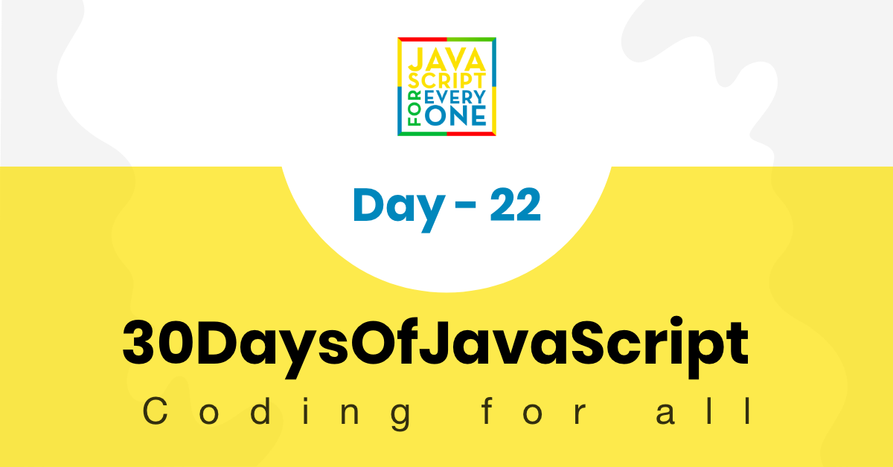
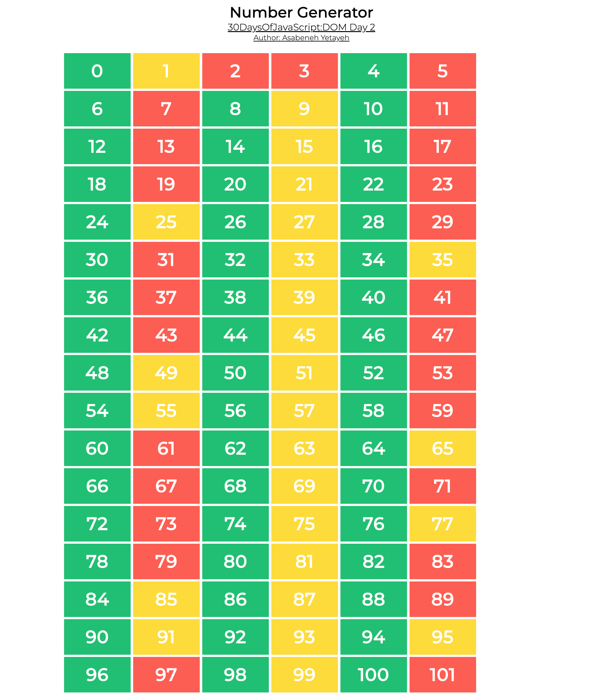
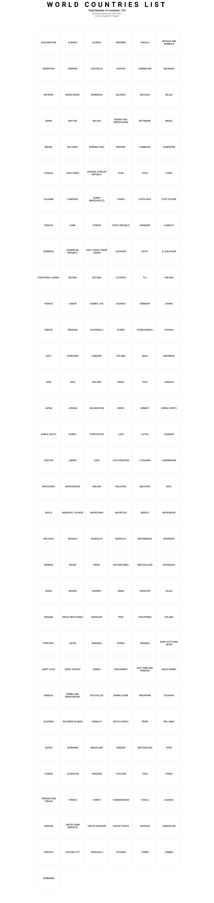
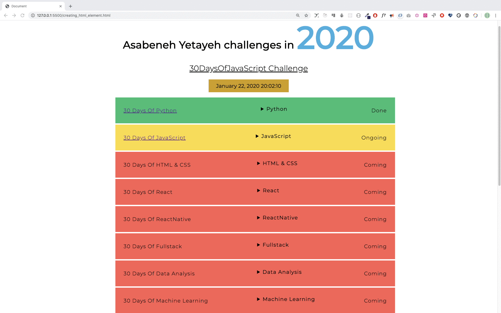
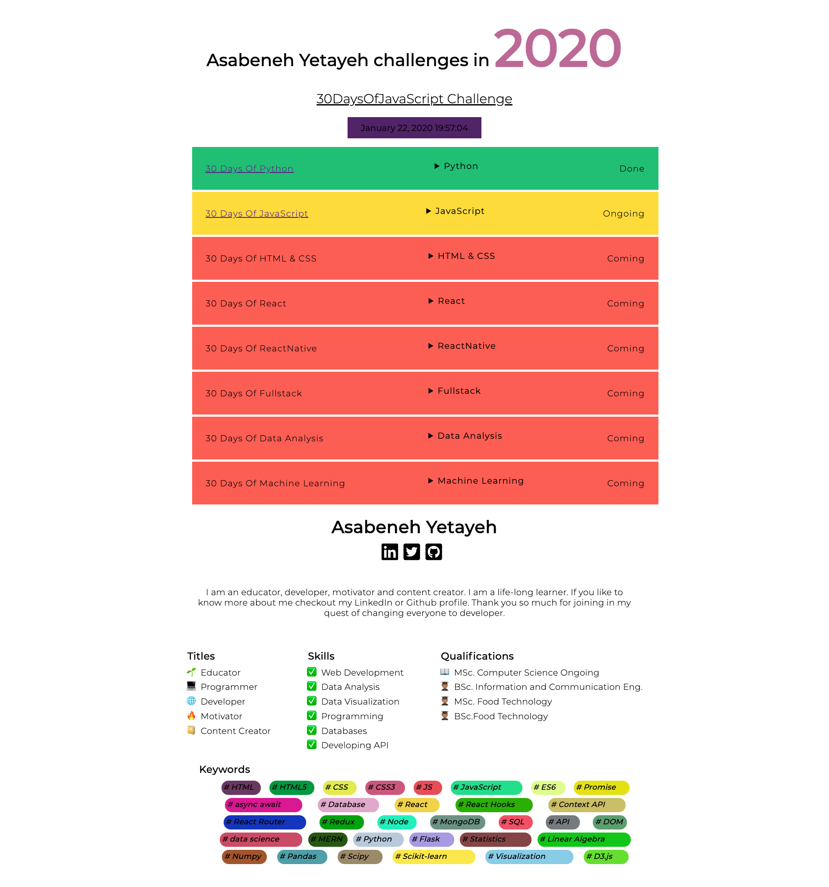

<div align="center">
  <h1> 30 天 JavaScript：操作 DOM 对象</h1>
  <a class="header-badge" target="_blank" href="https://www.linkedin.com/in/asabeneh/">
  
  </a>
  <a class="header-badge" target="_blank" href="https://twitter.com/Asabeneh">
  
  </a>

<sub>作者：
<a href="https://www.linkedin.com/in/asabeneh/" target="_blank">Asabeneh Yetayeh</a><br>
<small> 2020 年 1 月</small>
</sub>

</div>

[<< Day 21](../21_Day_DOM/21_day_dom.md) | [Day 23 >>](../23_Day_Event_listeners/23_day_event_listeners.md)


- [第 22 天](#day-22)
  - [DOM（文档对象模型）- 第 2 天](#domdocument-object-model-day-2)
    - [创建元素](#creating-an-element)
    - [创建元素](#creating-elements)
    - [将子元素附加到父元素](#appending-child-to-a-parent-element)
    - [从父节点中删除子元素](#removing-a-child-element-from-a-parent-node)
  - [练习](#exercises)
    - [练习：1 级](#exercises-level-1)
    - [练习：2 级](#exercises-level-2)
    - [练习：3 级](#exercises-level-3)

<a id="day-22"></a>
# 第 22 天

<a id="domdocument-object-model-day-2"></a>
## DOM（文档对象模型）- 第 2 天

### 创建一个元素

为了创建 HTML 元素，我们使用标签名称。使用 JavaScript 创建 HTML 元素非常简单且直接。我们使用方法_document.createElement()_。该方法将 HTML 元素标签名称作为字符串参数。

```js
// 语法
document.createElement('tagname')
```

```html
<!DOCTYPE html>
<html>

<head>
    <title>Document Object Model:30 Days Of JavaScript</title>
</head>

<body>

    <script>
        let title = document.createElement('h1')
        title.className = 'title'
        title.style.fontSize = '24px'
        title.textContent = 'Creating HTML element DOM Day 2'

        console.log(title)
    </script>
</body>

</html>
```

<a id="creating-an-element"></a>
<a id="creating-elements"></a>
### 创建元素

要创建多个元素，我们应该使用循环。使用循环我们可以创建任意数量的 HTML 元素。
创建元素后，我们可以为 HTML 对象的不同属性赋值。

```html
<!DOCTYPE html>
<html>

<head>
    <title>Document Object Model:30 Days Of JavaScript</title>
</head>

<body>

    <script>
        let title
        for (let i = 0; i < 3; i++) {
            title = document.createElement('h1')
            title.className = 'title'
            title.style.fontSize = '24px'
            title.textContent = i
            console.log(title)
        }
    </script>
</body>

</html>
```

<a id="appending-child-to-a-parent-element"></a>
### 将子元素附加到父元素

要查看 HTML 文档上创建的元素，我们应该将其作为子元素附加到父元素。我们可以使用 *document.body* 访问 HTML 文档正文。 *document.body* 支持 *appendChild()* 方法。请参阅下面的示例。

```html
<!DOCTYPE html>
<html>

<head>
    <title>Document Object Model:30 Days Of JavaScript</title>
</head>

<body>

    <script>
        // creating multiple elements and appending to parent element
        let title
        for (let i = 0; i < 3; i++) {
            title = document.createElement('h1')
            title.className = 'title'
            title.style.fontSize = '24px'
            title.textContent = i
            document.body.appendChild(title)
        }
    </script>
</body>
</html>
```

<a id="removing-a-child-element-from-a-parent-node"></a>
### 从父节点中删除子元素

创建 HTML 后，我们可能想要删除一个或多个元素，可以使用 *removeChild()* 方法。

**例子：**

```html
<!DOCTYPE html>
<html>

<head>
    <title>Document Object Model:30 Days Of JavaScript</title>
</head>

<body>
    <h1>Removing child Node</h1>
    <h2>Asabeneh Yetayeh challenges in 2020</h1>
    <ul>
        <li>30DaysOfPython Challenge Done</li>
        <li>30DaysOfJavaScript Challenge Done</li>
        <li>30DaysOfReact Challenge Coming</li>
        <li>30DaysOfFullStack Challenge Coming</li>
        <li>30DaysOfDataAnalysis Challenge Coming</li>
        <li>30DaysOfReactNative Challenge Coming</li>
        <li>30DaysOfMachineLearning Challenge Coming</li>
    </ul>

    <script>
        const ul = document.querySelector('ul')
        const lists = document.querySelectorAll('li')
        for (const list of lists) {
            ul.removeChild(list)

        }
    </script>
</body>

</html>
```

正如我们在上一节中看到的，有一种更好的方法可以使用 *innerHTML* 属性方法消除所有内部 HTML 元素或父元素的子元素。

```html
<!DOCTYPE html>
<html>

<head>
    <title>Document Object Model:30 Days Of JavaScript</title>
</head>

<body>
    <h1>Removing child Node</h1>
    <h2>Asabeneh Yetayeh challenges in 2020</h1>
    <ul>
        <li>30DaysOfPython Challenge Done</li>
        <li>30DaysOfJavaScript Challenge Done</li>
        <li>30DaysOfReact Challenge Coming</li>
        <li>30DaysOfFullStack Challenge Coming</li>
        <li>30DaysOfDataAnalysis Challenge Coming</li>
        <li>30DaysOfReactNative Challenge Coming</li>
        <li>30DaysOfMachineLearning Challenge Coming</li>
    </ul>

    <script>
        const ul = document.querySelector('ul')
        ul.innerHTML = ''
    </script>
</body>

</html>
```

上面的代码片段清除了所有子元素。

---

🌕 你很特别，而且每天都在进步。现在你已经知道如何创建 DOM 元素，也知道如何在需要时删除它们。学习 DOM 之后，你已经具备构建交互式应用的能力。距离完成挑战只剩 8 天了，现在做一些练习巩固一下。

<a id="exercises"></a>
## 练习

<a id="exercises-level-1"></a>
### 练习：1 级

1. 在 HTML 文档中创建一个 `div` 容器，并动态生成 0 到 100 的数字，再把它们添加到这个容器中。
   - 偶数背景为绿色
   - 奇数背景为黄色
   - 质数背景为红色



<a id="exercises-level-2"></a>
### 练习：2 级

1. 使用 `countries` 数组显示所有国家。请参考下面的设计图。



<a id="exercises-level-3"></a>
### 练习：3 级

根据下面的图片和 GIF 完成项目需求。所有数据和样式都只通过 JavaScript 创建和设置。数据可以在起始文件夹 `project_3` 中找到。下拉按钮使用 HTML 的 [`details`](https://www.w3schools.com/tags/tag_details.asp) 元素实现。





🎉 恭喜！ 🎉

[<< Day 21](../21_Day_DOM/21_day_dom.md) | [Day 23 >>](../23_Day_Event_listeners/23_day_event_listeners.md)
