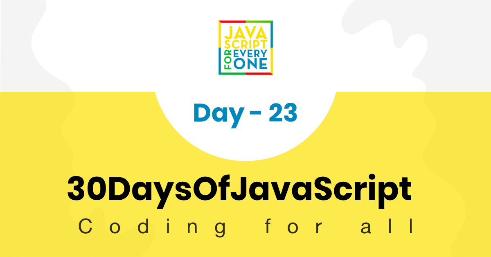
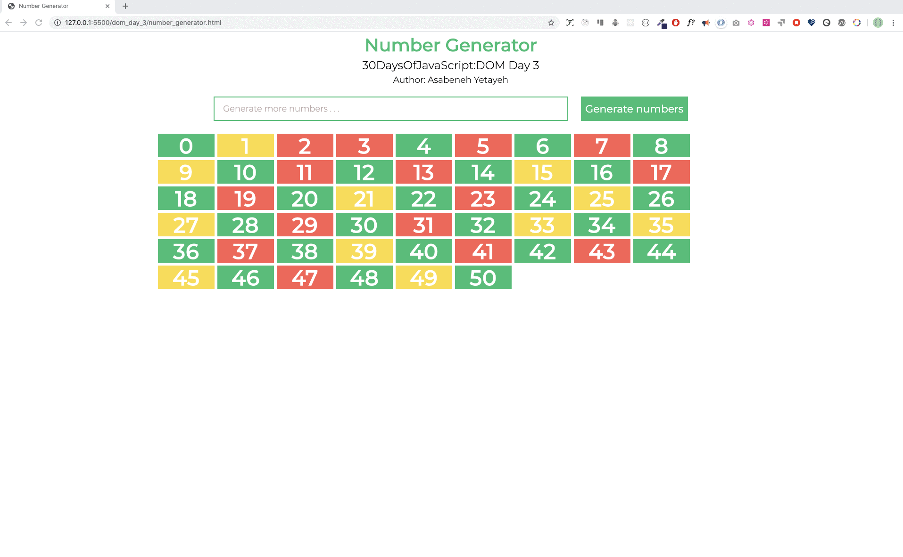
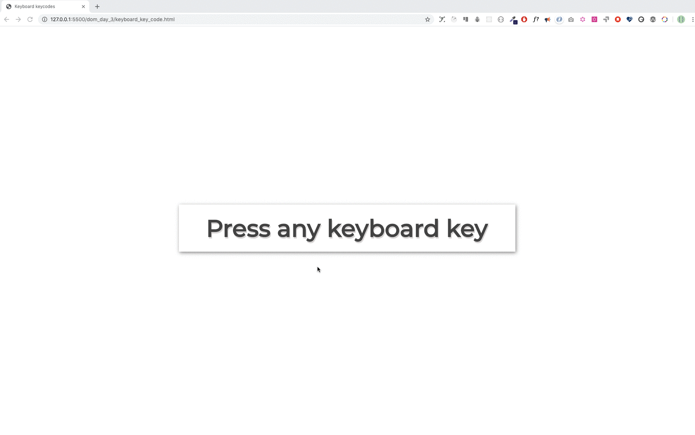

<div align="center">
  <h1> 30 天 JavaScript：事件监听器</h1>
  <a class="header-badge" target="_blank" href="https://www.linkedin.com/in/asabeneh/">
  
  </a>
  <a class="header-badge" target="_blank" href="https://twitter.com/Asabeneh">
  
  </a>

<sub>作者：
<a href="https://www.linkedin.com/in/asabeneh/" target="_blank">Asabeneh Yetayeh</a><br>
<small> 2020 年 1 月</small>
</sub>

</div>

[<< Day 22](../22_Day_Manipulating_DOM_object/22_day_manipulating_DOM_object.md) | [Day 24 >>](../24_Day_Project_solar_system/24_day_project_solar_system.md)



- [第 23 天](#day-23)
	- [DOM（文档对象模型）- 第 3 天](#domdocument-object-model-day-3)
		- [事件监听器](#event-listeners)
			- [点击](#click)
			- [双击](#double-click)
			- [鼠标移入](#mouse-enter)
		- [从输入元素获取值](#getting-value-from-an-input-element)
		- [输入值](#input-value)
			- [input 和 change 事件](#input-event-and-change)
			- [模糊事件](#blur-event)
			- [keypress、keydown 和 keyup](#keypress-keydown-and-keyup)
	- [练习](#exercises)
		- [练习：1 级](#exercise-level-1)

<a id="day-23"></a>
# 第 23 天

<a id="domdocument-object-model-day-3"></a>
## DOM（文档对象模型）- 第 3 天

<a id="event-listeners"></a>
### 事件监听器

常见的 HTML 事件：onclick、onchange、onmouseover、onmouseout、onkeydown、onkeyup、onload。
我们可以向任何 DOM 对象添加事件监听器。我们使用 **_addEventListener()_** 方法来监听 HTML 元素上的不同事件类型。_addEventListener()_ 方法接收两个参数：事件类型和回调函数。

```js
selectedElement.addEventListener('event', function(e) {
  // the activity you want to occur after the event will be in here
})
// or

selectedElement.addEventListener('event', e => {
  // the activity you want to occur after the event will be in here
})
```

<a id="click"></a>
#### 点击

要将事件监听器附加到元素，首先选择该元素，然后调用 addEventListener 方法。事件监听器将事件类型和回调函数作为参数。

以下是点击类型事件的示例。

**示例：点击**

```html
<!DOCTYPE html>
<html>
  <head>
    <title>Document Object Model</title>
  </head>

  <body>
    <button>点我</button>

    <script>
      const button = document.querySelector('button')
      button.addEventListener('click', e => {
        console.log('e gives the event listener object:', e)
        console.log('e.target gives the selected element: ', e.target)
        console.log(
          'e.target.textContent gives content of selected element: ',
          e.target.textContent
        )
      })
    </script>
  </body>
</html>
```

事件还可以作为内联脚本直接附加到 HTML 元素。

**示例：onclick**

```html
<!DOCTYPE html>
<html>
  <head>
    <title>Document Object Model</title>
  </head>

  <body>
    <button onclick="clickMe()">点我</button>
    <script>
      const clickMe = () => {
        alert('We can attach event on HTML element')
      }
    </script>
  </body>
</html>
```

<a id="double-click"></a>
#### 双击

要将事件监听器附加到元素，首先选择该元素，然后调用 addEventListener 方法。事件监听器将事件类型和回调函数作为参数。

以下是点击类型事件的示例。
**示例：dblclick**

```html
<!DOCTYPE html>
<html>
  <head>
    <title>Document Object Model</title>
  </head>

  <body>
    <button>点我</button>
    <script>
      const button = document.querySelector('button')
      button.addEventListener('dblclick', e => {
        console.log('e gives the event listener object:', e)
        console.log('e.target gives the selected element: ', e.target)
        console.log(
          'e.target.textContent gives content of selected element: ',
          e.target.textContent
        )
      })
    </script>
  </body>
</html>
```

<a id="mouse-enter"></a>
#### 鼠标移入

要将事件监听器附加到元素，首先选择该元素，然后调用 addEventListener 方法。事件监听器将事件类型和回调函数作为参数。

以下是点击类型事件的示例。

**示例：鼠标移入**

```html
<!DOCTYPE html>
<html>
  <head>
    <title>Document Object Model</title>
  </head>

  <body>
    <button>点我</button>
    <script>
      const button = document.querySelector('button')
      button.addEventListener('mouseenter', e => {
        console.log('e gives the event listener object:', e)
        console.log('e.target gives the selected element: ', e.target)
        console.log(
          'e.target.textContent gives content of selected element: ',
          e.target.textContent
        )
      })
    </script>
  </body>
</html>
```

现在你已经熟悉了 addEventListener 方法，以及如何添加事件监听器。事件监听器有多种类型，但在本次挑战中，我们将关注最常见、最重要的事件。
活动列表：

- 单击 - 单击元素时
- dblclick - 当双击元素时
- mouseenter - 当鼠标点进入元素时
- mouseleave - 当鼠标指针离开元素时
- mousemove - 当鼠标指针在元素上移动时
- mouseover - 当鼠标指针在元素上移动时
- mouseout - 当鼠标指针移出元素时
- 输入 - 当值输入到输入字段时
- 更改 - 当输入字段上的值更改时
- 模糊 - 当元素未聚焦时
- keydown - 当按下某个键时触发
- keyup - 当松开某个键时触发
- keypress - 当按下会产生字符输入的键时触发
- onload - 当浏览器完成加载页面时

通过替换上述代码片段中的事件类型来测试上述事件类型。

<a id="getting-value-from-an-input-element"></a>
### 从输入元素获取值

我们通常填写表格，表格接受数据。表单字段是使用输入 HTML 元素创建的。让我们构建一个小型应用程序，它允许我们使用两个输入字段（一个按钮和一个 p 标签）来计算一个人的身体指数。

<a id="input-value"></a>
### 输入值

```html
<!DOCTYPE html>
<html>
  <head>
    <title>Document Object Model:30 Days Of JavaScript</title>
  </head>

  <body>
    <h1>Body Mass Index Calculator</h1>

    <input type="text" id="mass" placeholder="质量（千克）" />
    <input type="text" id="height" placeholder="Height in meters" />
    <button>Calculate BMI</button>

    <script>
      const mass = document.querySelector('#mass')
      const height = document.querySelector('#height')
      const button = document.querySelector('button')

      let bmi
      button.addEventListener('click', () => {
        bmi = mass.value / height.value ** 2
        alert(`your bmi is ${bmi.toFixed(2)}`)
        console.log(bmi)
      })
    </script>
  </body>
</html>
```

<a id="input-event-and-change"></a>
#### input 和 change 事件

在上面的示例中，我们设法通过单击按钮从两个输入字段获取输入值。如果我们想在不点击按钮的情况下获得价值怎么样？当字段获得焦点时，我们可以使用 _change_ 或 _input_ 事件类型立即从输入字段获取数据。让我们看看我们将如何处理。

```html
<!DOCTYPE html>
<html>
  <head>
    <title>Document Object Model:30 Days Of JavaScript</title>
  </head>

  <body>
    <h1>Data Binding using input or change event</h1>

    <input type="text" placeholder="say something" />
    <p></p>

    <script>
      const input = document.querySelector('input')
      const p = document.querySelector('p')

      input.addEventListener('input', e => {
        p.textContent = e.target.value
      })
    </script>
  </body>
</html>
```

<a id="blur-event"></a>
#### 模糊事件

与 _input_ 或 _change_ 相比，_blur_ 事件在输入字段未获得焦点时发生。

```js
<!DOCTYPE html>
<html>

<head>
    <title>Document Object Model:30 Days Of JavaScript</title>
</head>

<body>
    <h1>Giving feedback using blur event</h1>

    <input type="text" id="mass" placeholder="say something" />
    <p></p>

    <script>
        const input = document.querySelector('input')
        const p = document.querySelector('p')

        input.addEventListener('blur', (e) => {
            p.textContent = 'Field is required'
            p.style.color = 'red'

        })
    </script>
</body>

</html>
```

<a id="keypress-keydown-and-keyup"></a>
#### keypress、keydown 和 keyup

我们可以使用不同的事件监听器类型访问键盘按键的键码。让我们使用 keypress 并获取每个键盘按键的 keyCode。

```html
<!DOCTYPE html>
<html>
  <head>
    <title>Document Object Model:30 Days Of JavaScript</title>
  </head>

  <body>
    <h1>键盘事件：按下任意键</h1>

    <script>
      document.body.addEventListener('keypress', e => {
        alert(e.keyCode)
      })
    </script>
  </body>
</html>
```

---

🌕 你很特别，每天都在进步。现在，你知道如何处理各种 DOM 事件。距离你的伟大之路只剩下 7 天了。现在为你的大脑和肌肉做一些练习。

<a id="exercises"></a>
## 练习

<a id="exercise-level-1"></a>
### 练习：1 级

1. 生成数字并用三种不同的颜色标记偶数、奇数和质数。请参见下图。



1.使用偶数监听器生成键盘代码代码。如下图。



🎉 恭喜！ 🎉

[<< Day 22](../22_Day_Manipulating_DOM_object/22_day_manipulating_DOM_object.md) | [Day 24 >>](../24_Day_Project_solar_system/24_day_project_solar_system.md)
