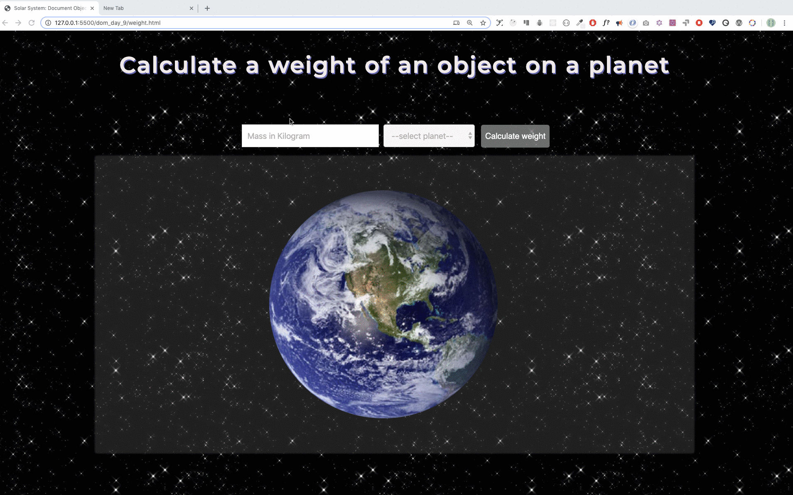



  <h1> 30 天 JavaScript：小项目 - 太阳系</h1>
  
  

作者：
<a href="https://www.linkedin.com/in/asabeneh/" target="_blank">Asabeneh Yetayeh</a> 
<small> 2020 年 1 月</small>

[<< Day 23](../23_Day_Event_listeners/23_day_event_listeners.md) | [Day 25 >>](../25_Day_World_countries_data_visualization_1/25_day_world_countries_data_visualization_1.md)

- [第 24 天](#第-24-天)
  - [练习](#练习)
    - [练习：1 级](#练习1-级)

# 第 24 天

## 练习

### 练习：1 级

1. 使用 HTML、CSS 和 JavaScript 开发一个太阳系小应用，用来计算物体在不同星球上的重量。

   实现要求：

   - 用户可以输入物体在地球上的重量。
   - 用户可以从下拉列表中选择一个星球。
   - 点击按钮后，页面显示该物体在所选星球上的重量。
   - 根据用户选择展示对应的星球图片。
   - 如果用户没有输入重量或没有选择星球，需要给出清晰的提示。

   下面的 GIF 只是效果预览。如果动画显示不完整，可以查看起始文件中的视频素材。

🎉 恭喜！ 🎉

[<< Day 23](../23_Day_Event_listeners/23_day_event_listeners.md) | [Day 25 >>](../25_Day_World_countries_data_visualization_1/25_day_world_countries_data_visualization_1.md)
