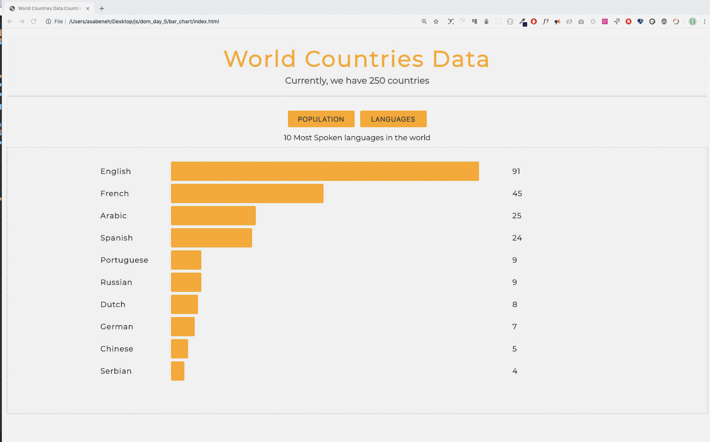
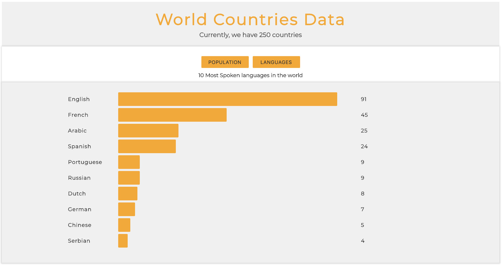



  <h1> 30 天 JavaScript：世界各国数据可视化</h1>
  
  

作者：
<a href="https://www.linkedin.com/in/asabeneh/" target="_blank">Asabeneh Yetayeh</a> 
<small> 2020 年 1 月</small>

[<< Day 24](../24_Day_Project_solar_system/24_day_project_solar_system.md) | [Day 26 >>](../26_Day_World_countries_data_visualization_2/26_day_world_countries_data_visualization_2.md)

- [第 25 天](#第-25-天)
  - [练习](#练习)
    - [练习：1 级](#练习1-级)

# 第 25 天

## 练习

### 练习：1 级

1. 使用 DOM、HTML、CSS 和 JavaScript 完成一个数据可视化页面，展示世界上人口最多的十个国家，以及使用人数最多的十种语言。

   实现要求：

   - 根据给定的国家数据统计人口和语言数据。
   - 使用条形图展示排名结果。
   - 用户可以在“人口”和“语言”两种视图之间切换。
   - 每一项都应显示名称、数值和相对比例。
   - 页面布局要清晰，数据排序要正确。

🎉 恭喜！ 🎉

[<< Day 24](../24_Day_Project_solar_system/24_day_project_solar_system.md) | [Day 26 >>](../26_Day_World_countries_data_visualization_2/26_day_world_countries_data_visualization_2.md)
