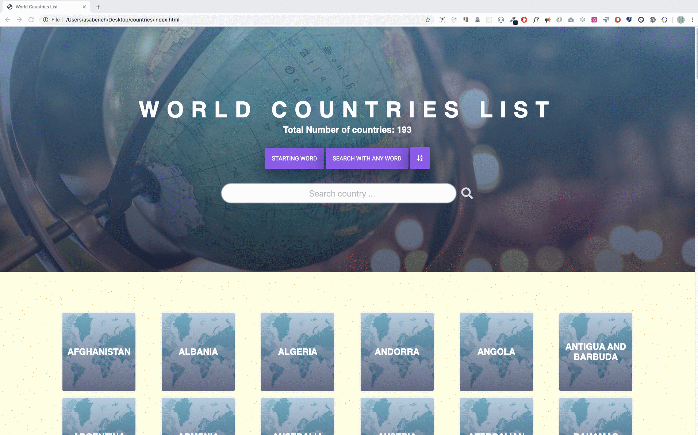



  <h1> 30 天 JavaScript：世界各国数据可视化 2 </h1>
  
  

作者：
<a href="https://www.linkedin.com/in/asabeneh/" target="_blank">Asabeneh Yetayeh</a> 
<small> 2020 年 1 月</small>

[<< Day 25](../25_Day_World_countries_data_visualization_1/25_day_world_countries_data_visualization_1.md) | [Day 27 >>](../27_Day_Mini_project_portfolio/27_day_mini_project_portfolio.md)

- [第 26 天](#第-26-天)
  - [练习](#练习)
    - [练习：1 级](#练习1-级)

# 第 26 天

## 练习

### 练习：1 级

1. 将国家数组可视化成一个可搜索、可排序的国家列表页面。

   实现要求：

   - 页面显示国家总数。
   - 支持按国家名称搜索。
   - 支持按首字母、包含字符等方式筛选。
   - 支持按名称、首都或人口等字段排序。
   - 使用清晰的卡片或列表展示每个国家。
   - 交互变化时，结果数量和列表内容要同步更新。

🎉 恭喜！ 🎉

[<< Day 25](../25_Day_World_countries_data_visualization_1/25_day_world_countries_data_visualization_1.md) | [Day 27 >>](../27_Day_Mini_project_portfolio/27_day_mini_project_portfolio.md)
