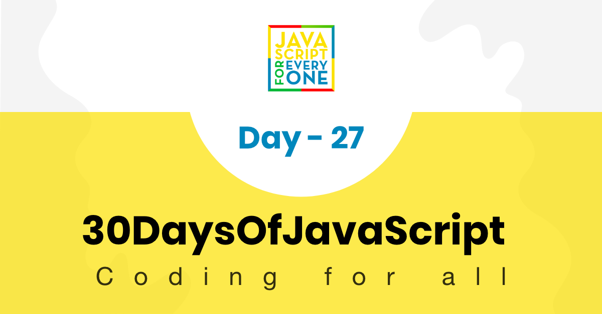
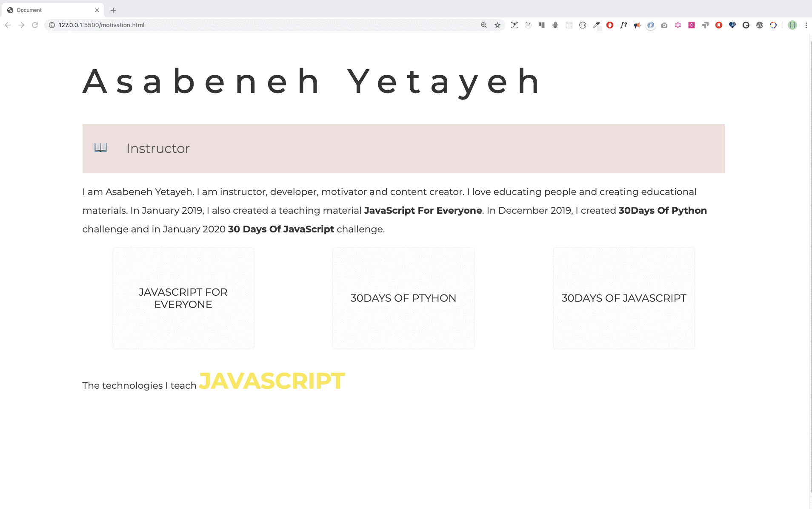



  <h1> 30 天 JavaScript：小项目 - 作品集</h1>
  
  

作者：
<a href="https://www.linkedin.com/in/asabeneh/" target="_blank">Asabeneh Yetayeh</a> 
<small> 2020 年 1 月</small>

[<< Day 26](../26_Day_World_countries_data_visualization_2/26_day_world_countries_data_visualization_2.md) | [Day 28 >>](../28_Day_Mini_project_leaderboard/28_day_mini_project_leaderboard.md)

- [第 27 天](#第-27-天)
  - [练习](#练习)
    - [练习：1 级](#练习1-级)

# 第 27 天

## 练习

### 练习：1 级

1. 使用 HTML、CSS 和 JavaScript 创建一个个人作品集页面。

   实现要求：

   - 页面应包含姓名、简介、技能、教学内容或项目展示等信息。
   - 使用 JavaScript 实现动态文字或内容切换效果。
   - 使用颜色、排版和动画增强页面表现力。
   - 页面在不同屏幕宽度下都应保持良好的可读性。
   - 作品集内容可以替换成你自己的真实信息。

🎉 恭喜！ 🎉

[<< Day 26](../26_Day_World_countries_data_visualization_2/26_day_world_countries_data_visualization_2.md) | [Day 28 >>](../28_Day_Mini_project_leaderboard/28_day_mini_project_leaderboard.md)
