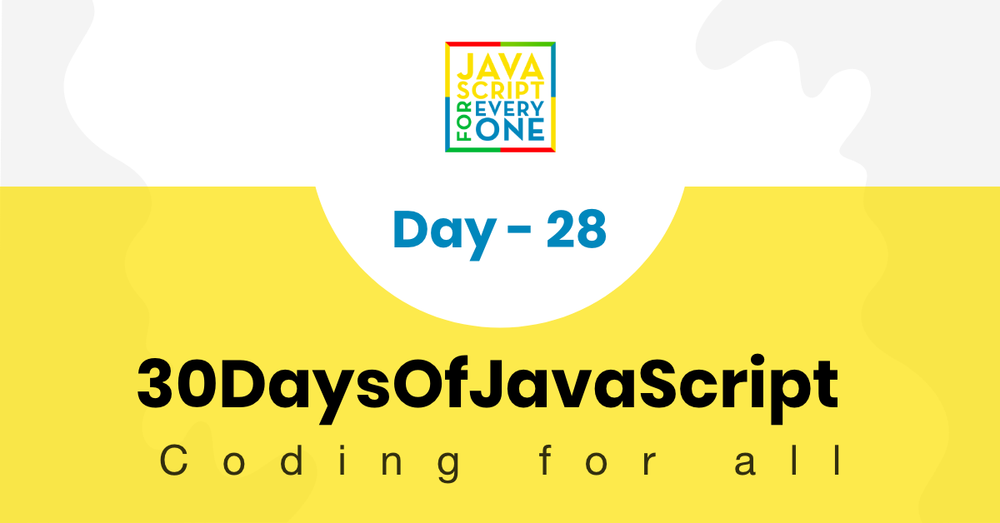
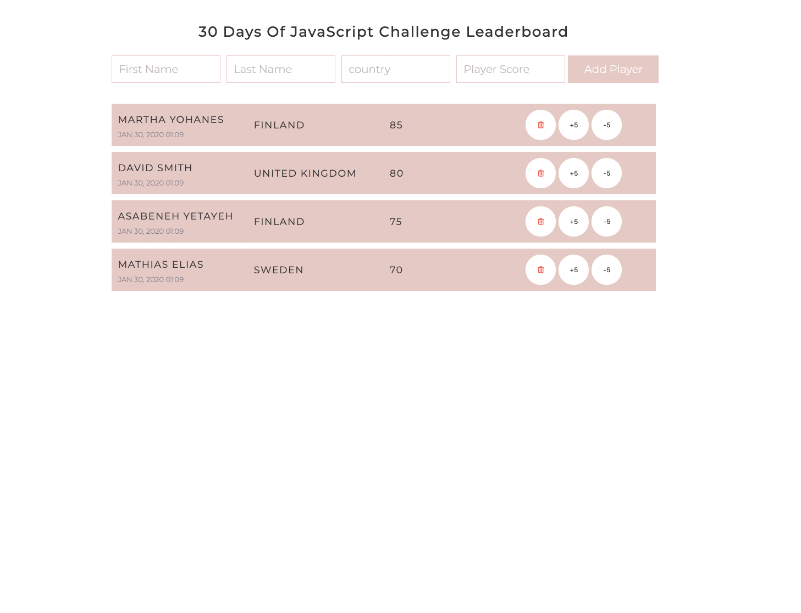



  <h1> 30 天 JavaScript：小项目 - 排行榜</h1>
  
  

作者：
<a href="https://www.linkedin.com/in/asabeneh/" target="_blank">Asabeneh Yetayeh</a> 
<small> 2020 年 1 月</small>

[<< Day 27](../27_Day_Mini_project_portfolio/27_day_mini_project_portfolio.md) | [Day 29 >>](../29_Day_Mini_project_animating_characters/29_day_mini_project_animating_characters.md)

- [第 28 天](#第-28-天)
  - [练习](#练习)
    - [练习：1 级](#练习1-级)

# 第 28 天

## 练习

### 练习：1 级

1. 使用 HTML、CSS 和 JavaScript 创建一个排行榜应用。

   实现要求：

   - 用户可以输入名字、姓氏、国家和分数。
   - 点击按钮后，将新选手添加到排行榜中。
   - 排行榜按照分数从高到低排序。
   - 每一项都提供删除按钮。
   - 每一项都可以增加或减少分数，分数变化后排行榜应重新排序。
   - 表单输入不完整时，需要给出提示。

🎉 恭喜！ 🎉

[<< Day 27](../27_Day_Mini_project_portfolio/27_day_mini_project_portfolio.md) | [Day 29 >>](../29_Day_Mini_project_animating_characters/29_day_mini_project_animating_characters.md)
