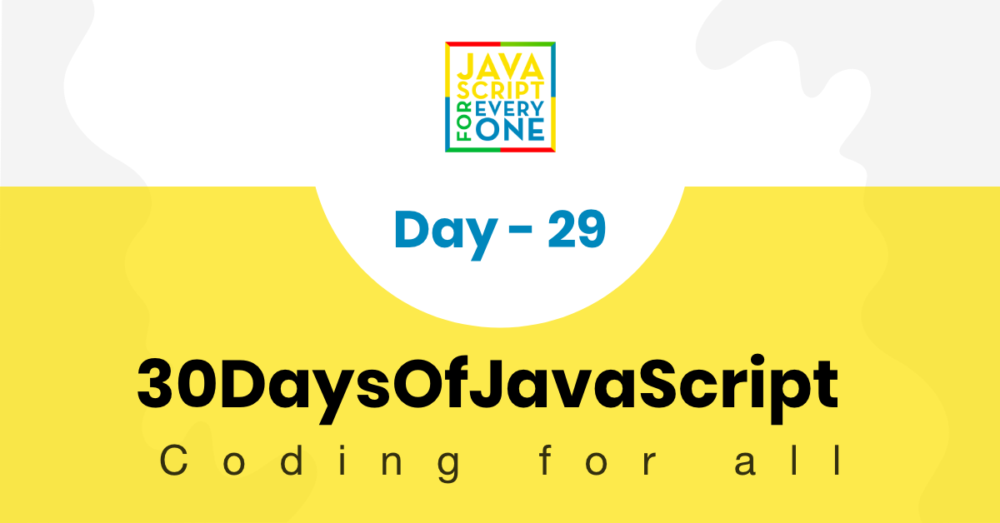
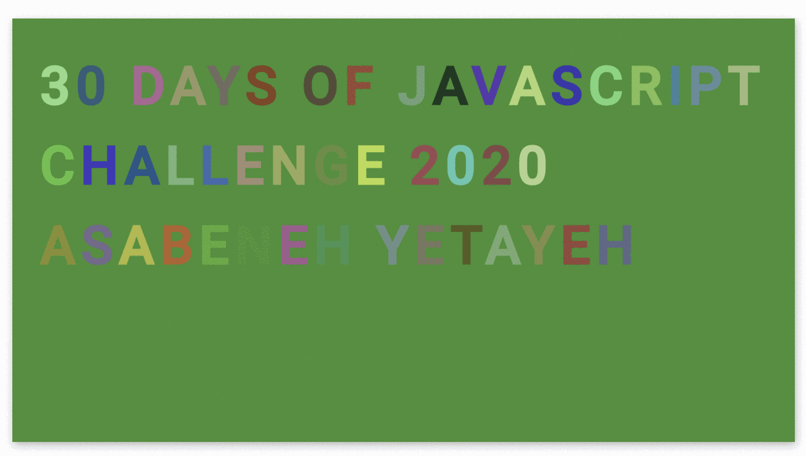



  <h1> 30 天 JavaScript：小项目 - 动态字符</h1>
  
  

作者：
<a href="https://www.linkedin.com/in/asabeneh/" target="_blank">Asabeneh Yetayeh</a> 
<small> 2020 年 1 月</small>

[<< Day 28](../28_Day_Mini_project_leaderboard/28_day_mini_project_leaderboard.md) | [Day 30 >>](../30_Day_Mini_project_final/30_day_mini_project_final.md)

- [第 29 天](#第-29-天)
  - [练习](#练习)
    - [练习：1 级](#练习1-级)
    - [练习：2 级](#练习2-级)
    - [练习：3 级](#练习3-级)

# 第 29 天

## 练习

### 练习：1 级

1. 使用 HTML、CSS 和 JavaScript 创建一个动态字符动画页面。

   实现要求：

   - 页面显示 `30 Days Of JavaScript` 文本。
   - 文本中的字符颜色应持续变化。
   - 背景颜色也可以周期性变化。
   - 动画应使用 JavaScript 定时器或 CSS 动画实现。
   - 整体效果应流畅、醒目，并接近下面的预览。

### 练习：2 级

在第 1 级的基础上进行扩展：

1. 为每个字符设置不同的颜色变化节奏。
2. 增加字体大小、字重或间距的动态变化。
3. 尝试让动画效果在刷新页面后仍然随机生成。

### 练习：3 级

继续优化页面体验：

1. 添加控制按钮，用来开始、暂停或重置动画。
2. 添加颜色主题切换功能。
3. 保持代码结构清晰，将颜色生成、DOM 更新和事件处理拆分成独立函数。

🎉 恭喜！ 🎉

[<< Day 28](../28_Day_Mini_project_leaderboard/28_day_mini_project_leaderboard.md) | [Day 30 >>](../30_Day_Mini_project_final/30_day_mini_project_final.md)
