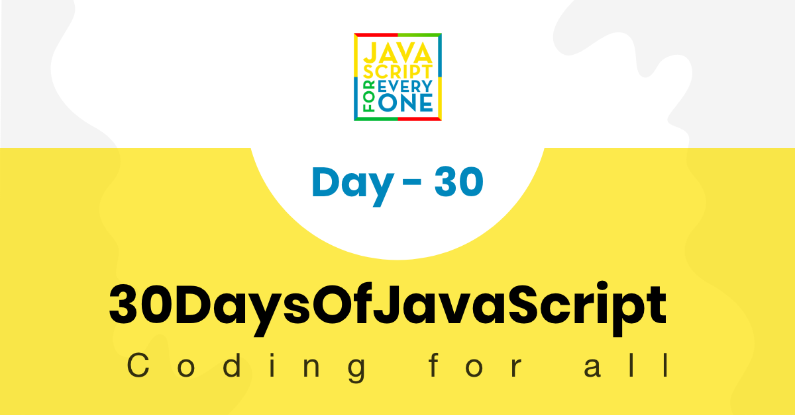
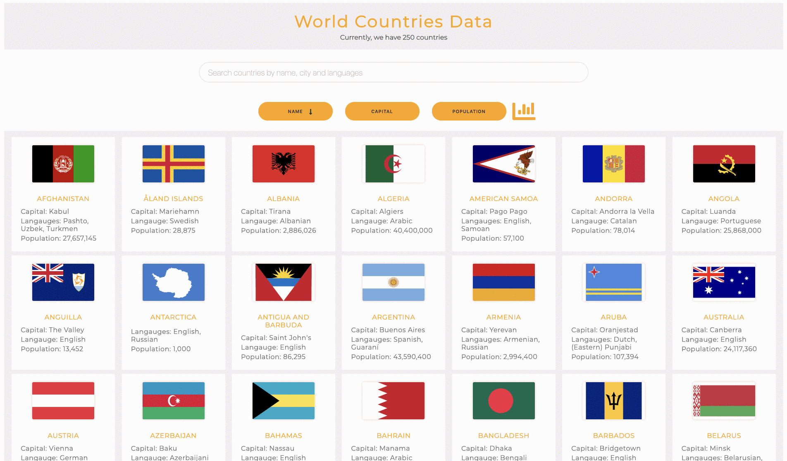
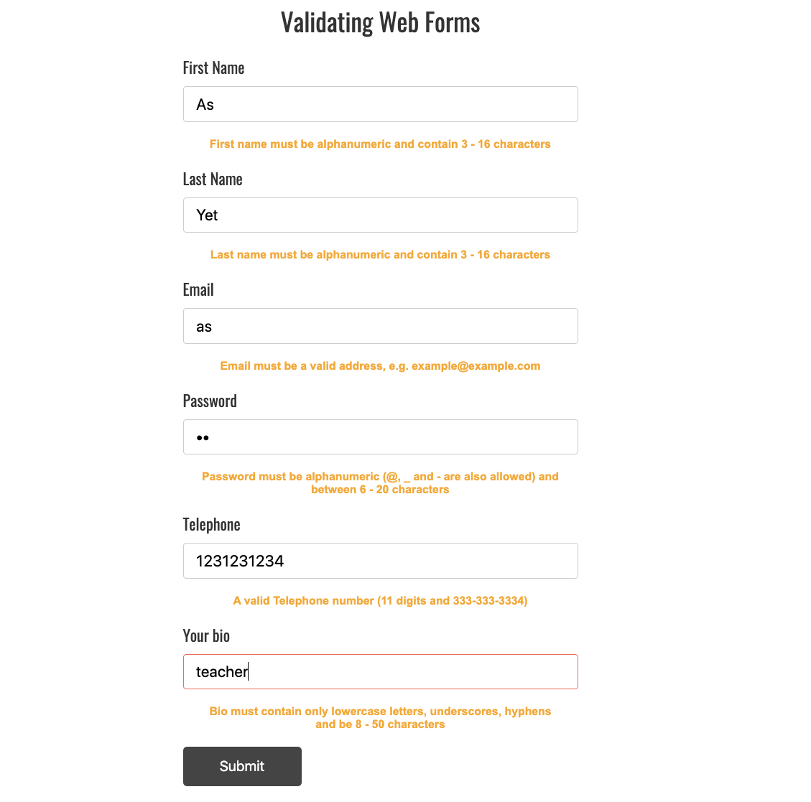
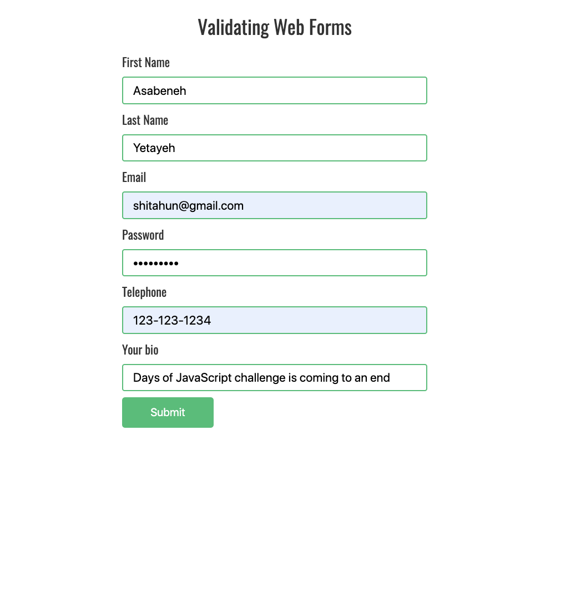
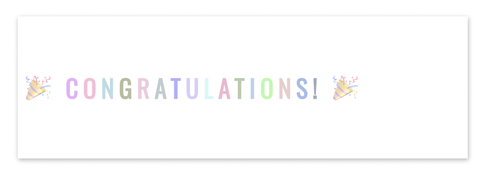



  <h1> 30 天 JavaScript：最终项目</h1>
  
  

作者：
<a href="https://www.linkedin.com/in/asabeneh/" target="_blank">Asabeneh Yetayeh</a> 
<small> 2020 年 1 月</small>

<small>支持<strong>作者</strong>创作更多教育资料</small>    

[<< 第 29 天](../29_Day_Mini_project_animating_characters/29_day_mini_project_animating_characters.md)

- [第 30 天](#第-30-天)
  - [练习](#练习)
    - [练习：1 级](#练习1-级)
    - [练习：2 级](#练习2-级)
    - [练习：3 级](#练习3-级)
  - [感言](#感言)
  - [支持](#支持)

# 第 30 天

## 练习

### 练习：1 级

1. 使用 HTML、CSS 和 JavaScript 创建一个国家数据展示项目。

   实现要求：

   - 使用国家数据渲染国家列表。
   - 每个国家至少展示国名、首都、语言、人口和国旗等信息。
   - 支持搜索、排序或筛选，让用户可以快速查找国家。
   - 页面结构要清晰，交互要及时响应用户操作。
   - 注意把数据处理逻辑和 DOM 操作逻辑拆分清楚。

2. 使用正则表达式验证下面的表单。

   实现要求：

   - 为每个输入框编写对应的验证规则。
   - 输入不符合要求时，显示明确的错误提示。
   - 输入符合要求时，显示通过状态或移除错误提示。
   - 表单提交前应检查所有字段是否有效。
   - 保持提示文案简洁，样式状态清楚。

   

   

### 练习：2 级

在第 1 级的基础上继续完善项目：

1. 优化页面响应式布局，让项目在移动端和桌面端都能正常使用。
2. 将常用逻辑拆分成函数，避免重复代码。
3. 给重要交互添加过渡动画或状态反馈。

### 练习：3 级

继续打磨最终项目：

1. 整理项目目录，区分 `data`、`scripts`、`styles` 等文件。
2. 检查边界情况，例如空搜索结果、非法输入和重复提交。
3. 为项目写一份简短说明，记录功能、用法和你在挑战中学到的内容。

🌕 你的 30 天 JavaScript 之旅已经完成。能坚持到这里并不容易，你已经跨过了非常重要的一步。现在可以和朋友或家人一起庆祝这段学习成果了。期待在后续挑战中继续见到你。

## 感言

现在，你可以通过分享自己对作者和 30DaysOfJavaScript 挑战的看法来支持这个项目。你可以在这个[链接](https://www.asabeneh.com/testimonials)留下感言。

## 支持

你也可以支持作者继续创作更多教育资料。

[<< 第 29 天](../29_Day_Mini_project_animating_characters/29_day_mini_project_animating_characters.md)  
