<a id="30-days-of-javascript"></a>
# 30 天 JavaScript

 <!--  <strong>加入即将推出的 [<em>CODING BOOTCAMP</em>](https://docs.google.com/forms/d/e/1FAIpQLSf0oNIYR9XU1DCctfl-pY36KbWse-SQX5aQaUgetqSinFYnmQ/viewform) </strong> --> 与 Asabeneh 一起学习


| # 天数 | 主题 |
| ----- | :---: |
| 01 | [介绍](./01_Day_Introduction/01_day_introduction.md) |
| 02 | [数据类型](./02_Day_Data_types/02_day_data_types.md) |
| 03 | [布尔值、运算符、日期](./03_Day_Booleans_operators_date/03_booleans_operators_date.md) |
| 04 | [条件语句](./04_Day_Conditionals/04_day_conditionals.md) |
| 05 | [数组](./05_Day_Arrays/05_day_arrays.md) |
| 06 | [循环](./06_Day_Loops/06_day_loops.md) |
| 07 | [函数](./07_Day_Functions/07_day_functions.md) |
| 08 | [对象](./08_Day_Objects/08_day_objects.md) |
| 09 | [高阶函数](./09_Day_Higher_order_functions/09_day_higher_order_functions.md) |
| 10 | [Set 和 Map](./10_Day_Sets_and_Maps/10_day_Sets_and_Maps.md) |
| 11 | [解构和展开](./11_Day_Destructuring_and_spreading/11_day_destructuring_and_spreading.md) |
| 12 | [正则表达式](./12_Day_Regular_expressions/12_day_regular_expressions.md) |
| 13 | [Console 对象方法](./13_Day_Console_object_methods/13_day_console_object_methods.md) |
| 14 | [错误处理](./14_Day_Error_handling/14_day_error_handling.md) |
| 15 | [类](./15_Day_Classes/15_day_classes.md) |
| 16 | [JSON](./16_Day_JSON/16_day_json.md) |
| 17 | [Web Storage](./17_Day_Web_storages/17_day_web_storages.md) |
| 18 | [Promise](./18_Day_Promises/18_day_promises.md) |
| 19 | [闭包](./19_Day_Closures/19_day_closures.md) |
| 20 | [编写整洁代码](./20_Day_Writing_clean_codes/20_day_writing_clean_codes.md) |
| 21 | [DOM](./21_Day_DOM/21_day_dom.md) |
| 22 | [操作 DOM 对象](./22_Day_Manipulating_DOM_object/22_day_manipulating_DOM_object.md) |
| 23 | [事件监听器](./23_Day_Event_listeners/23_day_event_listeners.md) |
| 24 | [小项目：太阳系](./24_Day_Project_solar_system/24_day_project_solar_system.md) |
| 25 | [小项目：世界各国数据可视化 1](./25_Day_World_countries_data_visualization_1/25_day_world_countries_data_visualization_1.md) |
| 26 | [小项目：世界各国数据可视化 2](./26_Day_World_countries_data_visualization_2/26_day_world_countries_data_visualization_2.md) |
| 27 | [小项目：作品集](./27_Day_Mini_project_portfolio/27_day_mini_project_portfolio.md) |
| 28 | [小项目：排行榜](./28_Day_Mini_project_leaderboard/28_day_mini_project_leaderboard.md) |
| 29 | [小项目：角色动画](./29_Day_Mini_project_animating_characters/29_day_mini_project_animating_characters.md) |
| 30 | [最终项目](./30_Day_Mini_project_final/30_day_mini_project_final.md) |

  <!-- <strong>加入即将推出的 [<em>CODING BOOTCAMP</em>](https://docs.google.com/forms/d/e/1FAIpQLSf0oNIYR9XU1DCctfl-pY36KbWse-SQX5aQaUgetqSinFYnmQ/viewform) </strong> --> 与 Asabeneh 一起学习

🧡🧡🧡快乐编码🧡🧡🧡

<div>
<h2>💖 赞助商</h2>

<p>感谢这些优秀赞助商支持我的开源贡献和 <strong>30 天挑战</strong>系列！</p>

<h3>当前赞助商</h3>
<hr />
<div align="center">
  <a href="https://ref.wisprflow.ai/MPMzRGE" target="_blank" rel="noopener noreferrer">
    <picture>
      <!-- Dark mode -->
      <source media="(prefers-color-scheme: dark)" srcset="https://raw.githubusercontent.com/Asabeneh/asabeneh/master/images/Wispr_Flow-Logo-white.png" />
      <!-- Light mode (fallback) -->
      
    </picture>
  </a>

  <h1>
    <a href="https://ref.wisprflow.ai/MPMzRGE" target="_blank" rel="noopener noreferrer">
      与代码对话，保持在流程中。
    </a>
  </h1>

  <h2>
    <a href="https://ref.wisprflow.ai/MPMzRGE" target="_blank" rel="noopener noreferrer">
      Flow 是为那些依赖工具的开发人员而构建的。说话并提供更多背景信息，可以获得更好的结果。
    </a>
  </h2>
</div>


---

<a id="-become-a-sponsor"></a>
### 🙌 成为赞助商

你可以通过 **[GitHub Sponsors](https://github.com/sponsors/asabeneh)** 或 [PayPal](https://www.paypal.me/asabeneh) 支持该项目。

每一项贡献，无论大小，都会产生重要影响。感谢你的支持！ 🌟

---
>

<div align="center">
  <h1> 30 天 JavaScript：简介</h1>
  <a class="header-badge" target="_blank" href="https://www.linkedin.com/in/asabeneh/">
  
  </a>
  <a class="header-badge" target="_blank" href="https://twitter.com/Asabeneh">
  
  </a>

<sub>作者：
<a href="https://www.linkedin.com/in/asabeneh/" target="_blank">Asabeneh Yetayeh</a><br>
<small> 2020 年 1 月</small>
</sub>

<div>

当前版本：[中文](./readMe.md)

</div>

</div>
</div>

[第 2 天 >>](./02_Day_Data_types/02_day_data_types.md)

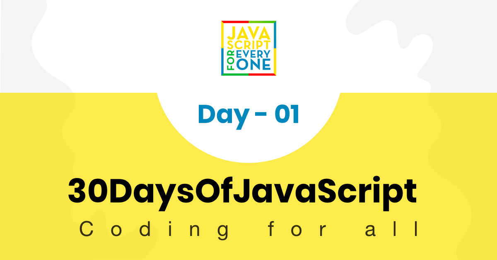

- [30 天 JavaScript](#30-days-of-javascript)
    - [🙌 成为赞助商](#-become-a-sponsor)
- [📔 第一天](#-day-1)
  - [简介](#introduction)
  - [要求](#requirements)
  - [设置](#setup)
    - [安装 Node.js](#install-nodejs)
    - [浏览器](#browser)
      - [安装谷歌浏览器](#installing-google-chrome)
      - [打开 Google Chrome Console](#opening-google-chrome-console)
      - [在浏览器控制台中编写代码](#writing-code-on-browser-console)
        - [console.log](#consolelog)
        - [带有多个参数的 console.log](#consolelog-with-multiple-arguments)
        - [注释](#comments)
        - [语法](#syntax)
      - [算术](#arithmetics)
    - [代码编辑器](#code-editor)
        - [安装 Visual Studio Code](#installing-visual-studio-code)
        - [如何使用 Visual Studio Code](#how-to-use-visual-studio-code)
  - [在网页中添加 JavaScript](#adding-javascript-to-a-web-page)
    - [内联脚本](#inline-script)
    - [内部脚本](#internal-script)
    - [外部脚本](#external-script)
    - [多个外部脚本](#multiple-external-scripts)
  - [数据类型介绍](#introduction-to-data-types)
    - [数字](#numbers)
    - [字符串](#strings)
    - [布尔值](#booleans)
    - [undefined](#undefined)
    - [null](#null)
  - [检查数据类型](#checking-data-types)
  - [再次介绍注释](#comments-again)
  - [变量](#variables)
- [💻 第一天：练习](#-day-1-exercises)

<a id="-day-1"></a>
# 📔 第一天

<a id="introduction"></a>
## 简介

**恭喜**你决定参加 30 天 JavaScript 编程挑战。在这个挑战中，你将学习成为 JavaScript 程序员所需的基础知识，以及编程的核心概念。挑战结束后，你将获得 30DaysOfJavaScript 编程挑战完成证书。为了获得证书，你必须注册 [DevOsome](https://www.devosome.com/)，这是一个互动且引人入胜的在线教育平台。

如果你需要帮助，或者想帮助他人，可以加入专门的 [Telegram 群组](https://t.me/ThirtyDaysOfJavaScript)。

**30DaysOfJavaScript** 挑战是面向初学者和进阶 JavaScript 开发人员的指南。欢迎来到 JavaScript。JavaScript 是 Web 的语言。我喜欢使用和教授 JavaScript，希望你也会喜欢它。

在这个循序渐进的 JavaScript 挑战中，你将学习 JavaScript，这是一门非常流行的编程语言。
JavaScript 用于**_为网站添加交互性，开发移动应用程序、桌面应用程序、游戏_**，如今 JavaScript 可用于**服务器端编程**、**_机器学习_** 和 **_AI_**。

**_JavaScript (JS)_** 近年来越来越受欢迎，并且一直处于领先地位
过去十年的编程语言，是最常用的编程语言
GitHub。

这个挑战易读，采用对话式语言写成，内容引人入胜、鼓舞人心，同时也有一定要求。你需要投入足够多的时间来完成它。如果你更喜欢通过视频学习，可以在 <a href="https://www.youtube.com/channel/UC7PNRuno1rzYPb1xLa4yktw">Washera</a> YouTube 频道观看视频课程。订阅频道，在 YouTube 视频下评论、提问并积极参与，作者也许会看到你的反馈。

作者很乐意听到你对挑战的看法。你可以在这个[链接](https://www.asabeneh.com/testimonials)中留下对 30DaysOfJavaScript 挑战的感言。

<a id="requirements"></a>
## 要求

完成这项挑战不需要任何编程基础。你只需要：

1. 动机
2. 电脑一台
3、互联网
4.浏览器
5. 代码编辑器

<a id="setup"></a>
## 设置

我相信你有动力，也强烈希望成为一名开发者，并了解计算机和互联网。如果你具备这些，那么你已经拥有开始所需的一切。

<a id="install-nodejs"></a>
### 安装 Node.js

你现在可能还不需要 Node.js，但稍后可能会用到它。请安装 [Node.js](https://nodejs.org/en/)。

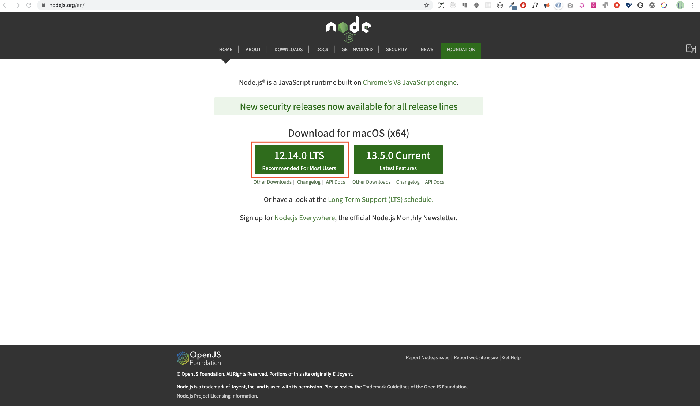

下载后双击安装

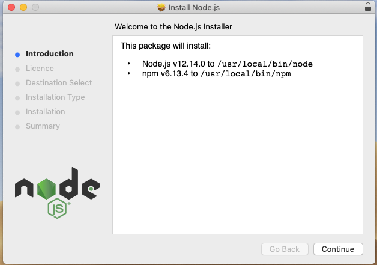

我们可以通过打开设备终端或命令提示符来检查本地计算机上是否安装了 Node.js。

```sh
asabeneh $ node -v
v12.14.0
```

在制作本教程时，我使用的是 Node 12.14.0。当你使用本材料时，Node.js 的推荐版本可能已经更高。

<a id="browser"></a>
### 浏览器

有很多浏览器。不过，我强烈推荐谷歌浏览器。

<a id="installing-google-chrome"></a>
#### 安装谷歌浏览器

如果你还没有 [Google Chrome](https://www.google.com/chrome/)，请先安装。我们可以在浏览器控制台中编写少量 JavaScript 代码，但不会用浏览器控制台来开发完整应用。

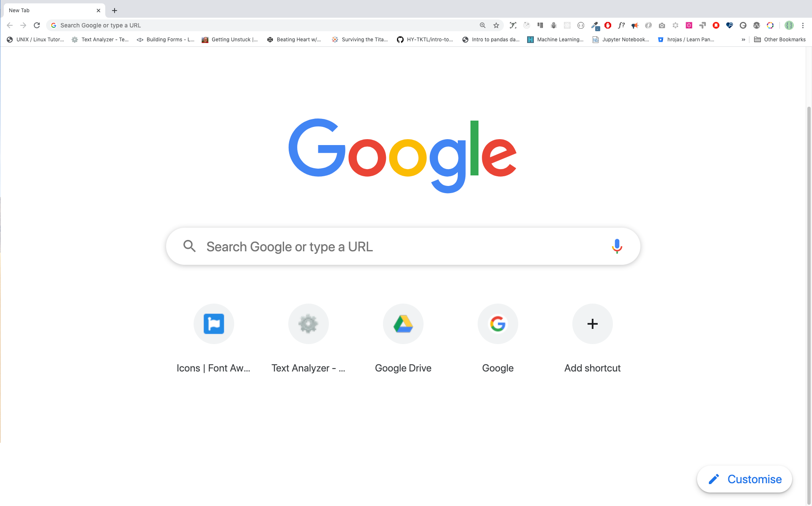

<a id="opening-google-chrome-console"></a>
#### 打开 Google Chrome Console

你可以单击浏览器右上角的三个点，选择_更多工具 -> 开发者工具_，或使用键盘快捷键打开 Google Chrome 控制台。我更喜欢使用快捷键。

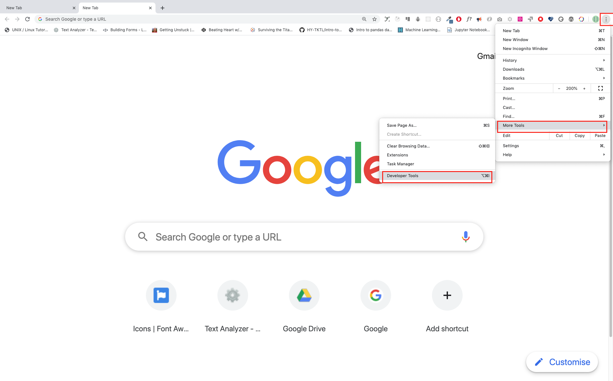

使用键盘快捷键打开 Chrome Console。

```sh
Mac
Command+Option+J

Windows/Linux:
Ctl+Shift+J
```

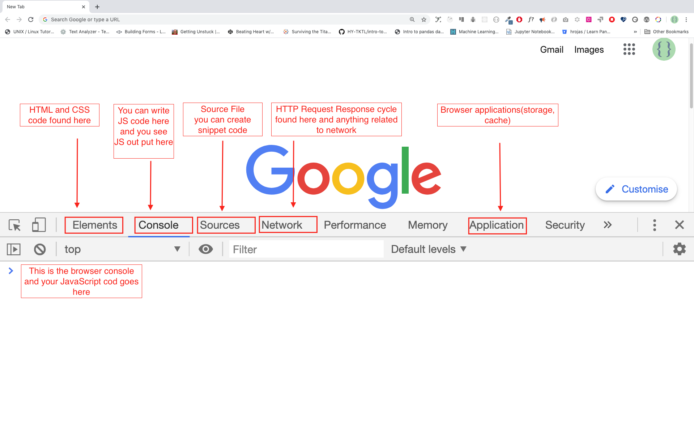

打开 Google Chrome 控制台后，尝试浏览标记的按钮。我们会花不少时间在控制台中。控制台是运行 JavaScript 代码的地方，Google Chrome 的 V8 引擎会将你的 JavaScript 代码转换为机器代码。
让我们在 Google Chrome 控制台中编写一段 JavaScript 代码：

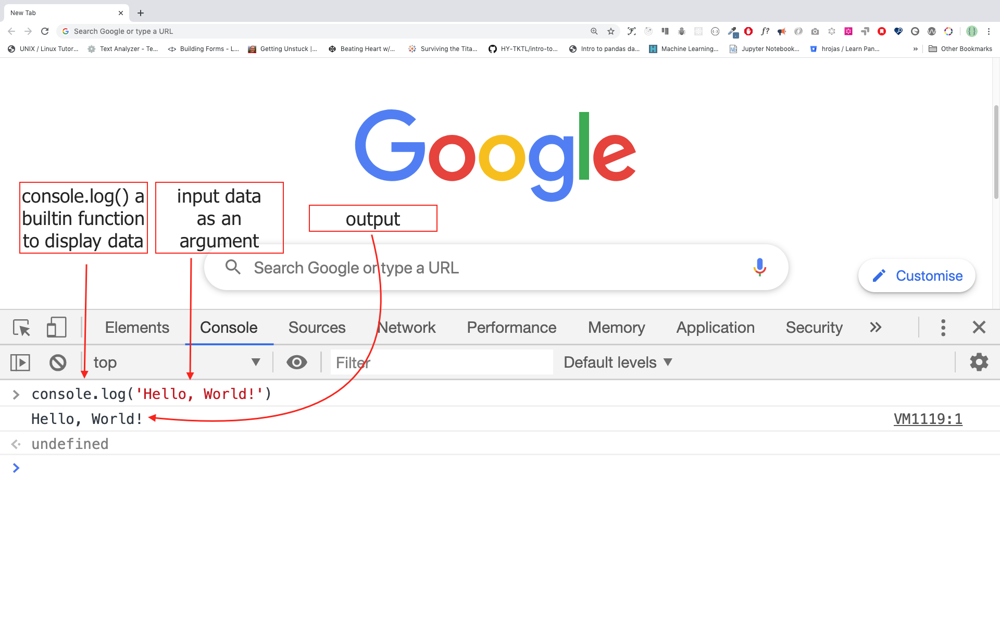

<a id="writing-code-on-browser-console"></a>
#### 在浏览器控制台中编写代码

我们可以在 Google Chrome 控制台或任何浏览器控制台中编写 JavaScript 代码。不过，在这个挑战中，我们只关注 Google Chrome 控制台。使用以下快捷键打开控制台：

```sh
Mac
Command+Option+I

Windows:
Ctl+Shift+I
```

<a id="consolelog"></a>
##### console.log

为了编写第一段 JavaScript 代码，我们使用内置函数 **console.log()**。我们传递一个参数作为输入数据，函数会显示输出。这里我们向 console.log() 函数传入 `'你好，世界！'` 作为输入数据或参数。

```js
console.log('你好，世界！')
```

<a id="consolelog-with-multiple-arguments"></a>

##### 带有多个参数的 console.log

**`console.log()`** 函数可以采用多个参数，以逗号分隔。语法如下所示：**`console.log(param1, param2, param3)`**

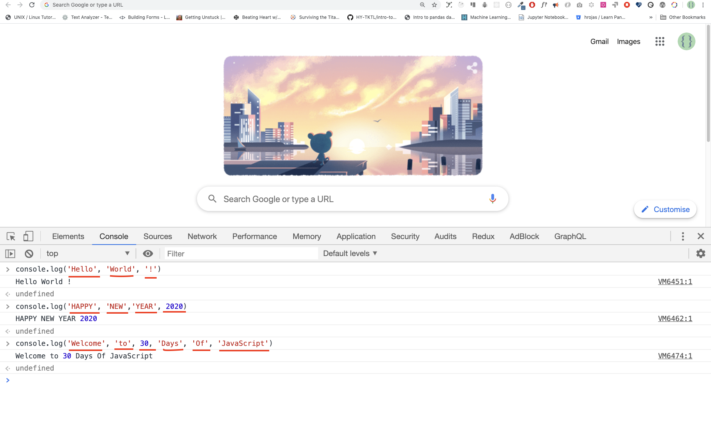

```js
console.log('Hello', 'World', '!')
console.log('HAPPY', 'NEW', 'YEAR', 2020)
console.log('Welcome', 'to', 30, 'Days', 'Of', 'JavaScript')
```

从上面的代码片段中可以看出，_`console.log()`_ 可以采用多个参数。

恭喜！你使用 _`console.log()`_ 编写了第一段 JavaScript 代码。

<a id="comments"></a>

##### 注释

我们可以在代码中添加注释。注释可以提高代码的可读性，也可以帮助我们记录说明。JavaScript 不会执行代码中的注释部分。在 JavaScript 中，任何以 `//` 开头的文本行都是单行注释。

**示例：单行注释**

```js
// 这是第一条注释
// 这是第二条注释
// 我是一条单行注释
```

**示例：多行注释**

```js
/*
这是一条多行注释
多行注释可以占据多行
JavaScript 是 Web 的语言
 */
```

<a id="syntax"></a>
##### 语法

编程语言与人类语言相似。英语和许多其他语言会使用单词、短语、句子、复合句等来传达有意义的信息。语法指的是词语和短语如何排列，从而组成结构良好的句子。在计算机语言中，语法指的是语句的结构。JavaScript 是一种编程语言，和其他编程语言一样，它也有自己的语法。如果我们写出的代码不符合 JavaScript 能理解的语法，就会引发不同类型的错误。稍后我们将探讨不同类型的 JavaScript 错误。现在，让我们看看语法错误。

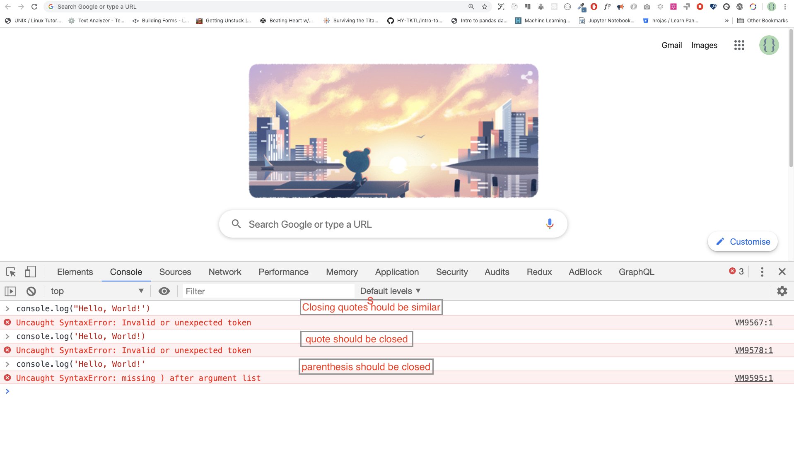

我故意犯了一个错误。因此，控制台会显示语法错误。实际上，语法错误信息通常很有帮助，它会告诉我们错误类型。通过阅读错误反馈，我们可以修正语法并解决问题。识别并消除程序中错误的过程称为调试。让我们修复错误：

```js
console.log('你好，世界！')
console.log('你好，世界！')
```

到目前为止，我们了解了如何使用 _`console.log()`_ 显示文本。如果我们使用 _`console.log()`_ 打印文本或字符串，则文本必须位于单引号、双引号或反引号内。
**例子：**

```js
console.log('你好，世界！')
console.log("你好，世界！")
console.log(`你好，世界！`)
```

<a id="arithmetics"></a>
#### 算术

现在，让我们在 Google Chrome 控制台中针对数字数据类型练习更多 _`console.log()`_ 用法。
除了文本之外，我们还可以使用 JavaScript 进行数学计算。让我们做以下简单的计算。
可以直接在 Google Chrome 控制台中编写 JavaScript 代码，不一定需要 **_`console.log()`_** 函数。不过，本介绍仍会使用它，因为挑战中的大多数代码会在文本编辑器中编写，此时需要通过该函数查看输出。你也可以直接在控制台中跟着示例操作。

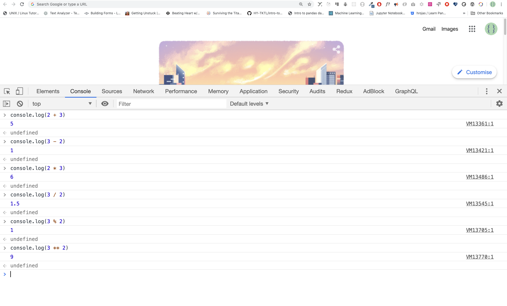

```js
console.log(2 + 3) // 加法
console.log(3 - 2) // 减法
console.log(2 * 3) // 乘法
console.log(3 / 2) // 除法
console.log(3 % 2) // 取模，求余数
console.log(3 ** 2) // 幂运算，3 ** 2 == 3 * 3
```

<a id="code-editor"></a>
### 代码编辑器

我们可以在浏览器控制台中编写代码，但这不适合较大的项目。在真实工作环境中，开发人员会使用不同的代码编辑器编写代码。在 30 天 JavaScript 挑战中，我们将使用 Visual Studio Code。

<a id="installing-visual-studio-code"></a>
#### 安装 Visual Studio Code

Visual Studio Code 是一个非常流行的开源文本编辑器。我建议[下载 Visual Studio Code](https://code.visualstudio.com/)，但如果你偏好其他编辑器，也可以继续使用自己熟悉的工具。

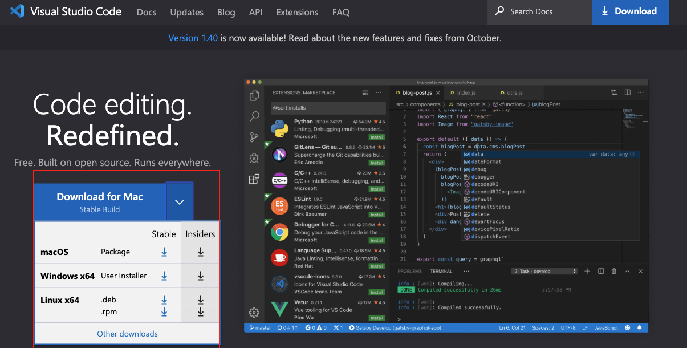

如果你已经安装了 Visual Studio Code，让我们开始使用它。

<a id="how-to-use-visual-studio-code"></a>
#### 如何使用 Visual Studio Code

双击 Visual Studio Code 图标打开它。当你打开它时，你会看到这样的界面。尝试与带标签的图标进行交互。


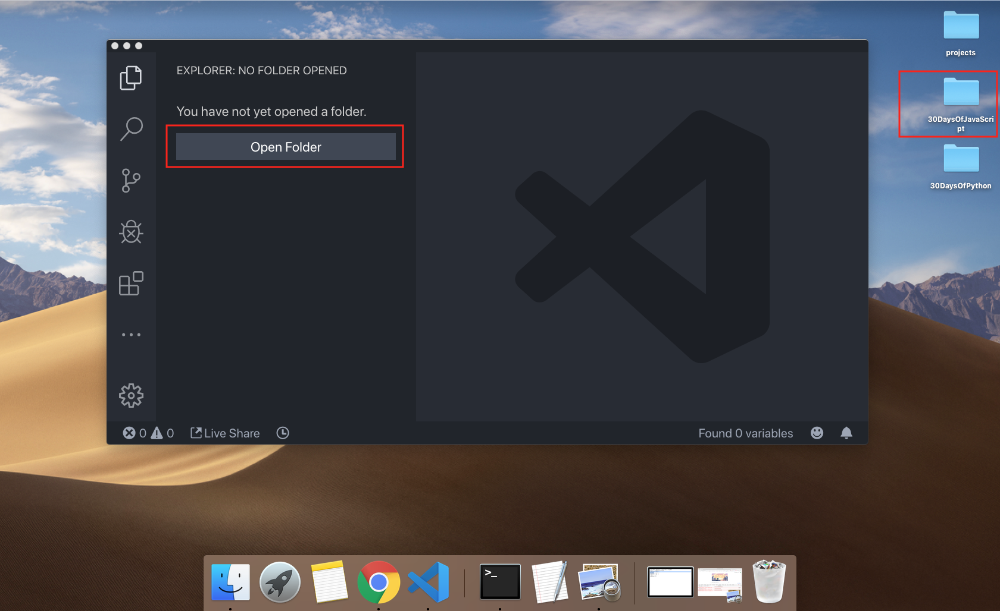

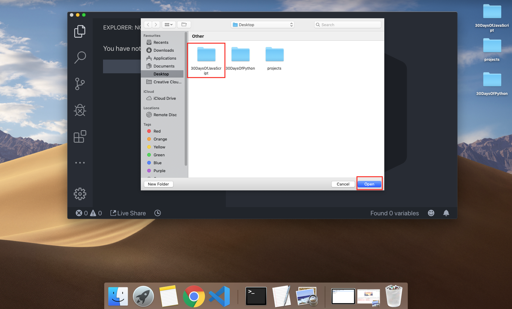

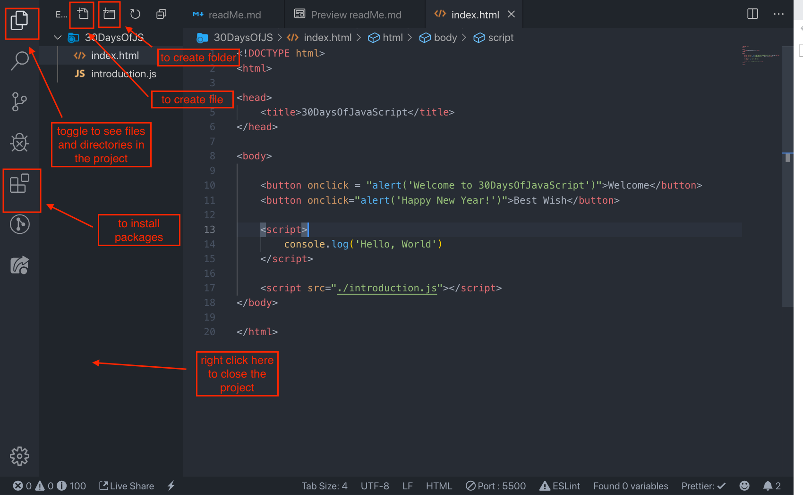

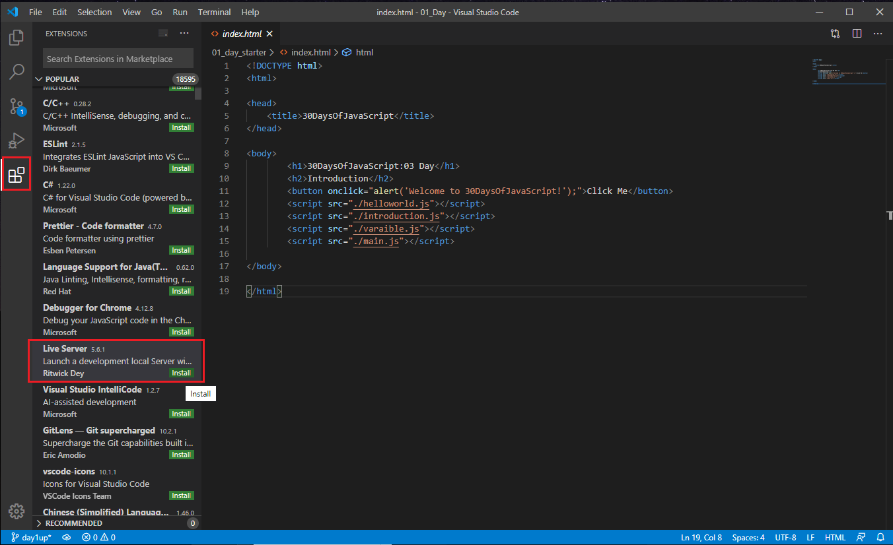

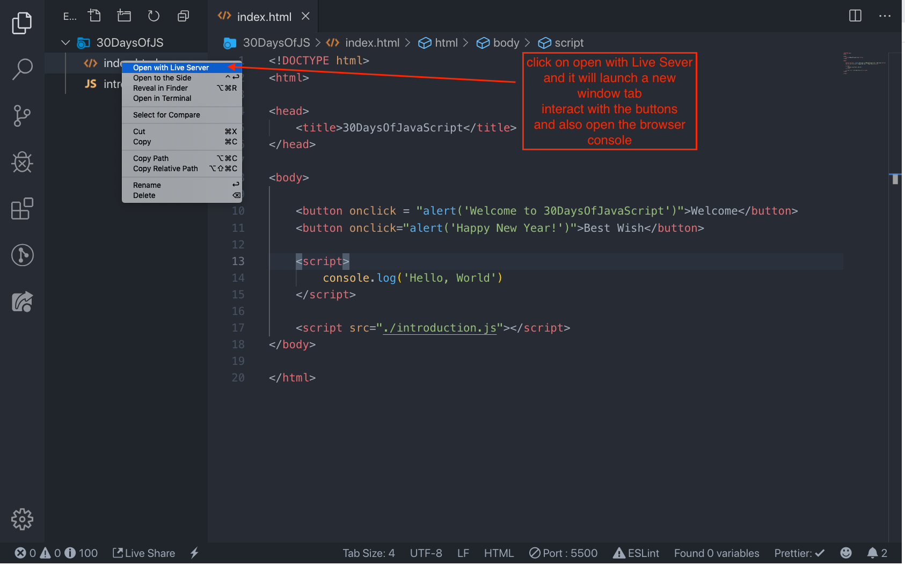

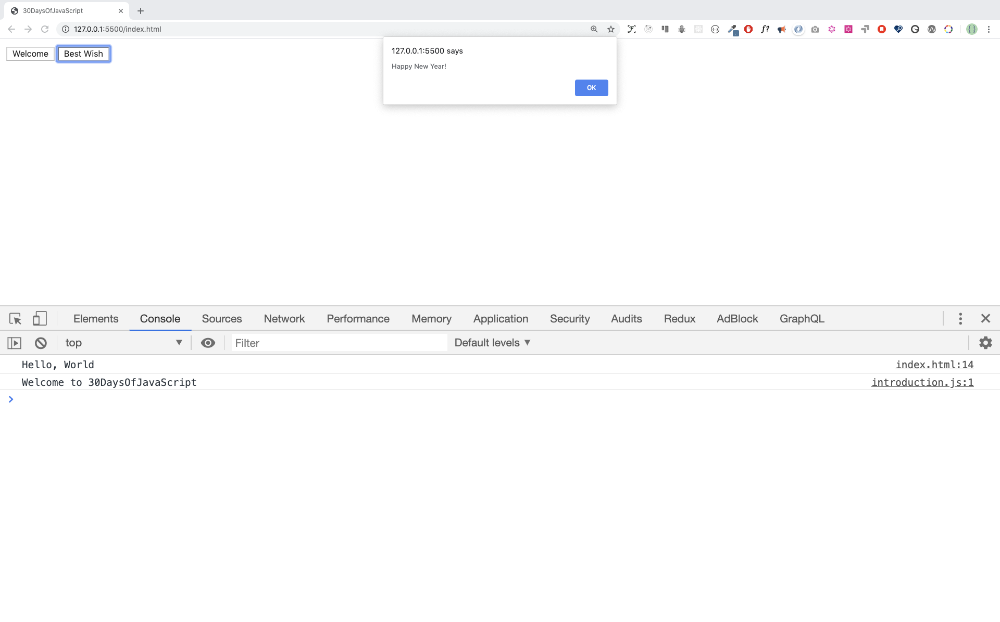

<a id="adding-javascript-to-a-web-page"></a>
## 添加 JavaScript 到网页

JavaScript 可以通过三种不同的方式添加到网页中：

- **_内联脚本_**
- **_内部脚本_**
- **_外部脚本_**
- **_多个外部脚本_**

以下部分展示了将 JavaScript 代码添加到网页的不同方法。

<a id="inline-script"></a>
### 内联脚本

在桌面或任意位置创建一个项目文件夹，将其命名为 30DaysOfJS 并在项目文件夹中创建一个 **_`index.html`_** 文件。然后粘贴以下代码并在浏览器中打开它，例如[Chrome](https://www.google.com/chrome/)。

```html
<!DOCTYPE html>
<html lang="en">
  <head>
    <title>30DaysOfScript:Inline Script</title>
  </head>
  <body>
    <button onclick="alert('欢迎来到 30DaysOfJavaScript！')">点我</button>
  </body>
</html>
```

现在，你刚刚编写了第一个内联脚本。我们可以使用 _`alert()`_ 内置函数创建弹窗消息。

<a id="internal-script"></a>
### 内部脚本

内部脚本可以写在 _`head`_ 或 _`body`_ 中，但最好将其放在 HTML 文档的正文中。
首先，让我们在页面的头部写字。

```html
<!DOCTYPE html>
<html lang="en">
  <head>
    <title>30DaysOfScript:Internal Script</title>
    <script>
      console.log('欢迎来到 30DaysOfJavaScript')
    </script>
  </head>
  <body></body>
</html>
```

这就是我们大多数时候编写内部脚本的方式。把 JavaScript 代码写在 body 部分是更好的选择。打开浏览器控制台查看 `console.log()` 的输出。

```html
<!DOCTYPE html>
<html lang="en">
  <head>
    <title>30DaysOfScript:Internal Script</title>
  </head>
  <body>
    <button onclick="alert('欢迎来到 30DaysOfJavaScript！');">点我</button>
    <script>
      console.log('欢迎来到 30DaysOfJavaScript')
    </script>
  </body>
</html>
```

打开浏览器控制台查看 `console.log()` 的输出。

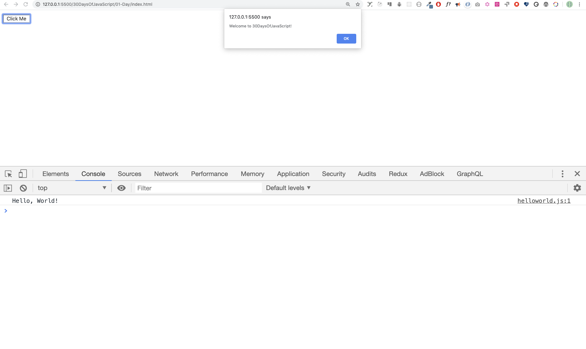

<a id="external-script"></a>
### 外部脚本

与内部脚本类似，外部脚本链接可以位于标题或正文上，但最好将其放在正文中。
首先，我们应该创建一个扩展名为 `.js` 的外部 JavaScript 文件。所有以 `.js` 扩展名结尾的文件都是 JavaScript 文件。在项目目录中创建一个名为 `introduction.js` 的文件，然后编写以下代码并在正文底部链接这个 `.js` 文件。

```js
console.log('欢迎来到 30DaysOfJavaScript')
```

_head_ 中的外部脚本：

```html
<!DOCTYPE html>
<html lang="en">
  <head>
    <title>30DaysOfJavaScript:External script</title>
    <script src="introduction.js"></script>
  </head>
  <body></body>
</html>
```

_body_ 中的外部脚本：

```html
<!DOCTYPE html>
<html lang="en">
  <head>
    <title>30DaysOfJavaScript:External script</title>
  </head>
  <body>
    <!-- JavaScript external link could be in the header or in the body --> 
    <!-- Before the closing tag of the body is the recommended place to put the external JavaScript script -->
    <script src="introduction.js"></script>
  </body>
</html>
```

打开浏览器控制台查看 `console.log()` 的输出。

<a id="multiple-external-scripts"></a>
### 多个外部脚本

我们还可以将多个外部 JavaScript 文件链接到一个网页。
在 30DaysOfJS 文件夹中创建 `helloworld.js` 文件并写入以下代码。

```js
console.log('你好，世界！')
```

```html
<!DOCTYPE html>
<html lang="en">
  <head>
    <title>Multiple External Scripts</title>
  </head>
  <body>
    <script src="./helloworld.js"></script>
    <script src="./introduction.js"></script>
  </body>
</html>
```

_你的 main.js 文件应位于所有其他脚本之后_。记住这一点非常重要。

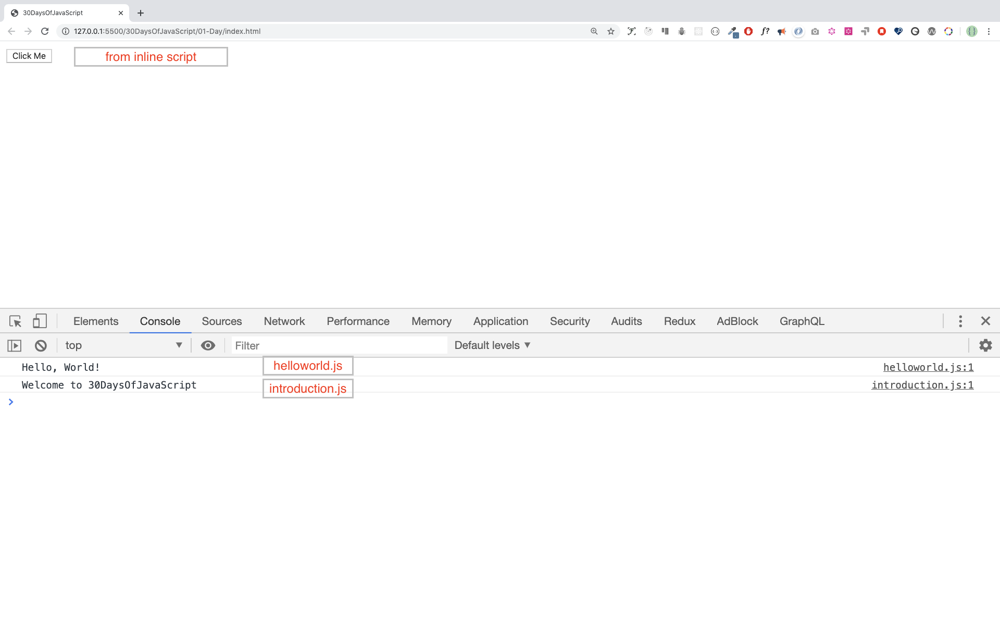

<a id="introduction-to-data-types"></a>
## 数据类型简介

在 JavaScript 和其他编程语言中，有不同类型的数据类型。以下是 JavaScript 原始数据类型：_String、Number、Boolean、undefined、Null_ 和 _Symbol_。

<a id="numbers"></a>
### 数字

- 整数：整数（负数、零和正数）
  示例：
  ... -3, -2, -1, 0, 1, 2, 3 ...
- 浮点数：十进制数
  示例
  ... -3.5、-2.25、-1.0、0.0、1.1、2.2、3.5 ...

<a id="strings"></a>
### 字符串

两个单引号、双引号或反引号之间的一个或多个字符的集合。

**例子：**

```js
'a'
'Asabeneh'
"Asabeneh"
'Finland'
'JavaScript is a beautiful programming language'
'I love teaching'
'I hope you are enjoying the first day'
`We can also create a string using a backtick`
'A string could be just as small as one character or as big as many pages'
'Any data type under a single quote, double quote or backtick is a string'
```

<a id="booleans"></a>
### 布尔值

布尔值要么是 True，要么是 False。任何比较都会返回一个布尔值，该值要么为 true，要么为 false。

布尔数据类型要么是真值，要么是假值。

**例子：**

```js
true // if the light is on, the value is true
false // if the light is off, the value is false
```

<a id="undefined"></a>
### undefined

在 JavaScript 中，如果我们不给变量赋值，则该值是 `undefined`。除此之外，如果函数没有返回任何内容，它将返回 `undefined`。

```js
let firstName
console.log(firstName) // undefined, because it is not assigned to a value yet
```

<a id="null"></a>

### null

JavaScript 中的 null 表示空值。

```js
let emptyValue = null
```

<a id="checking-data-types"></a>
## 检查数据类型

要检查某个变量的数据类型，我们使用 **typeof** 运算符。请参阅以下示例。

```js
console.log(typeof 'Asabeneh') // string
console.log(typeof 5) // number
console.log(typeof true) // boolean
console.log(typeof null) // object type
console.log(typeof undefined) // undefined
```

<a id="comments-again"></a>

## 再次介绍注释

请记住，JavaScript 中的注释与其他编程语言类似。注释对于提高代码的可读性非常重要。
注释有两种方式：

- _单行注释_
- _多行注释_

```js
// 使用单行注释注释代码本身
// let firstName = 'Asabeneh'; 单行注释
// let lastName = 'Yetayeh'; 单行注释
```

多行注释：

```js
/*
  let location = 'Helsinki';
  let age = 100;
  let isMarried = true;
  这是一条多行注释
*/
```

<a id="variables"></a>
## 变量

变量是数据的_容器_。变量用于在内存位置存储数据。声明变量时，会保留一个内存位置。当变量被分配给一个值（数据）时，内存空间将被该数据填充。要声明变量，我们使用 _var_、_let_ 或 _const_ 关键字。

对于会在不同时间发生变化的变量，我们使用 _let_。如果数据不会改变，我们使用 _const_。例如，PI、国家名称和重力不会变化，我们可以使用 _const_。本次挑战中不会使用 var，我也不建议你使用它。var 是一种更容易出错的变量声明方式，存在很多作用域泄漏问题。我们会在后续的作用域部分详细讨论 var、let 和 const。就目前而言，上述解释已经足够。

有效的 JavaScript 变量名称必须遵循以下规则：

- JavaScript 变量名称不应以数字开头。
- JavaScript 变量名称不允许使用除美元符号和下划线之外的特殊字符。
- JavaScript 变量名称遵循驼峰式命名约定。
- JavaScript 变量名单词之间不应有空格。

以下是有效 JavaScript 变量的示例。

```js
firstName
lastName
country
city
capitalCity
age
isMarried

first_name
last_name
is_married
capital_city

num1
num_1
_num_1
$num1
year2020
year_2020
```

列表中的第一个和第二个变量遵循 JavaScript 中声明的驼峰命名约定。在本材料中，我们将使用驼峰命名法变量(camelWithOneHump)。我们使用 CamelCase(CamelWithTwoHump) 来声明类，我们将在其他部分讨论类和对象。

无效变量的示例：

```js
  first-name
  1_num
  num_#_1
```

让我们声明具有不同数据类型的变量。要声明变量，我们需要在变量名前使用 _let_ 或 _const_ 关键字。在变量名后面，我们写一个等号（赋值运算符）和一个值（赋值数据）。

```js
// 语法
let nameOfVariable = value
```

nameOfVariable 是用于存储不同数据值的名称。请参阅下面的详细示例。

**声明变量的示例**

```js
// 声明不同数据类型的变量
let firstName = 'Asabeneh' // 名
let lastName = 'Yetayeh' // 姓
let country = 'Finland' // 国家
let city = 'Helsinki' // 首都
let age = 100 // 年龄
let isMarried = true

console.log(firstName, lastName, country, city, age, isMarried)
```

```sh
Asabeneh Yetayeh Finland Helsinki 100 true
```

```js
// 声明数值变量
let age = 100 // 年龄
const gravity = 9.81 // 地球重力，单位 m/s2
const boilingPoint = 100 // 水的沸点，单位 °C
const PI = 3.14 // 几何常量
console.log(gravity, boilingPoint, PI)
```

```sh
9.81 100 3.14
```

```js
// 变量也可以在一行中用逗号分隔声明，不过建议分行声明，让代码更易读
let name = 'Asabeneh', job = 'teacher', live = 'Finland'
console.log(name, job, live)
```

```sh
Asabeneh teacher Finland
```

当你运行 01-Day 文件夹中的 _index.html_ 文件时，应该得到以下输出：

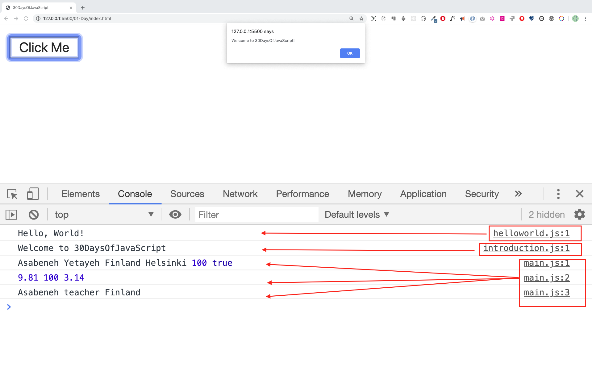

🌕 你太棒了！你刚刚完成了第一天的挑战，正在走向更优秀的自己。现在为你的大脑和肌肉做一些练习。

<a id="-day-1-exercises"></a>
# 💻 第一天：练习

1. 编写一行注释，表示_注释可以使代码可读_
2. 再写一条注释：_欢迎来到 30DaysOfJavaScript_
3. 编写多行注释，说明_注释可以使代码可读，易于重用_
   _且信息丰富_

4. 创建一个 `variable.js` 文件，声明变量并分别赋值为字符串、布尔值、`undefined` 和 `null` 数据类型
5. 创建 datatypes.js 文件并使用 JavaScript **_typeof_** 运算符检查不同的数据类型。检查每个变量的数据类型
6.声明四个变量而不赋值
7. 声明四个变量并赋值
8. 声明变量，用多行存储你的名字、姓氏、婚姻状况、国家和年龄。
9. 声明变量，用一行存储你的名字、姓氏、婚姻状况、国家和年龄。
10. 声明两个变量 _myAge_ 和 _yourAge_，为它们赋初始值，并打印到浏览器控制台。

```sh
I am 25 years old.
You are 30 years old.
```

🎉 恭喜！ 🎉

[第 2 天 >>](./02_Day_Data_types/02_day_data_types.md)
